<p align="center">
  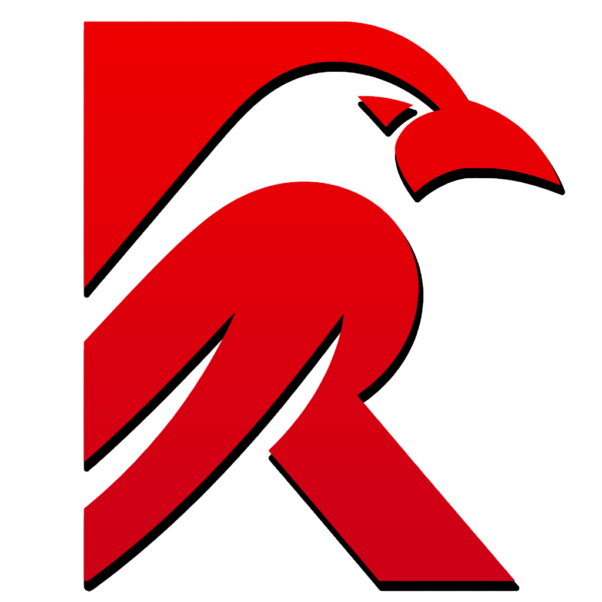
</p>

<h1 align="center">Raven</h1>

<p align="center">
  A lightweight, multithreaded GUI library in C for editors and tools.
</p>

<p align="center">
<p align="center">
  <a href="docs/">
    
  </a>
  <a href="https://github.com/oscar-soirey/Raven/issues">
    
  </a>
  <a href="https://github.com/oscar-soirey/Raven/releases">
    
  </a>
  <a href="https://github.com/oscar-soirey/Raven/issues/15">
    
  </a>
  <a href="https://oscar-soirey.github.io/Raven/">
    
  </a>
  <a href="https://www.youtube.com/@oscar-soirey">
    
  </a>
</p>
</p>

Try the [web demo gallery](https://oscar-soirey.github.io/Raven/demos/) (WebAssembly and WebGL 2), or [build and preview it locally](docs/emscripten.md).
In the browser Raven draws only when something changes, so an idle page uses no CPU, and the
on-screen keyboards of phones see the text around the caret (suggestions, autocorrection,
composition), with a password input for passwords and the keyboard of each kind of field.

## Disclaimer : This project is still in active development and public API is subject to change.

## Build from source

> **For the latest features, clone and build Raven yourself** rather than
> downloading a release: the [releases](https://github.com/oscar-soirey/Raven/releases)
> and the packages of the bindings (PyPI, NuGet, crates.io, LuaRocks, Maven
> Central) are made from time to time, while the repository moves every day,
> so what this page describes may not be in the last release yet.
>
> ```
> git clone https://github.com/oscar-soirey/Raven.git
> cd Raven
> cmake -S . -B build -DCMAKE_BUILD_TYPE=Release
> cmake --build build --config Release --parallel
> ```
>
> `git pull` and the same `cmake --build` bring it up to date later.

Raven builds with CMake and a C11 compiler, and has no dependency to install
besides the X11 development package on Linux. The Vulkan *headers* are
downloaded automatically during the configuration (git and an internet
connection are needed for that), unless the [Vulkan SDK](https://vulkan.lunarg.com)
is installed. No Vulkan library is linked.

Each build below gives the library, the designer, the examples and the
tests. Add `-DRAVEN_BUILD_SHARED=ON` to the
configure command for a shared library (`raven.dll`, `libraven.so`,
`libraven.dylib`) instead of a static one.

### Windows (Visual Studio)

1. Install [Visual Studio 2022](https://visualstudio.microsoft.com/downloads/)
   (Community is fine) with the **Desktop development with C++** workload; it
   includes CMake. Install [Git](https://git-scm.com/download/win).
2. Open the **Developer PowerShell for VS 2022** and run:

```powershell
git clone https://github.com/oscar-soirey/Raven.git
cd Raven
cmake -S . -B build
cmake --build build --config Release --parallel
ctest --test-dir build -C Release --output-on-failure   # optional: the tests
cmake --install build --config Release --prefix install
```

The programs are in `build\bin\Release` (start `raven_editor.exe` or
`raven_designer.exe`); the library, its headers and the CMake package are in
`install\`. Shortcuts: `build.bat` does the configure and the build in one
command, `generate-cmake.bat --open` opens the solution in Visual Studio (see
[Build options and scripts](#build-options-and-scripts)).

### Windows (MinGW-w64)

1. Install [MSYS2](https://www.msys2.org), then in the **MSYS2 MINGW64** shell:

```sh
pacman -S --needed git mingw-w64-x86_64-gcc mingw-w64-x86_64-cmake mingw-w64-x86_64-ninja
git clone https://github.com/oscar-soirey/Raven.git
cd Raven
cmake -S . -B build -G Ninja -DCMAKE_BUILD_TYPE=Release
cmake --build build --parallel
cmake --install build --prefix install
```

This gives `libraven.a` (or `raven.dll` and `libraven.dll.a` in a shared
build). A MinGW library is for programs built with MinGW, not with Visual C++.

### Linux

1. Install a compiler, CMake, Git and the X11 headers:

```sh
sudo apt install build-essential cmake git libx11-dev ninja-build   # Debian, Ubuntu
sudo dnf install gcc cmake git libX11-devel ninja-build             # Fedora
sudo pacman -S base-devel cmake git libx11 ninja                    # Arch
```

2. Build:

```sh
git clone https://github.com/oscar-soirey/Raven.git
cd Raven
cmake -S . -B build -G Ninja -DCMAKE_BUILD_TYPE=Release
cmake --build build --parallel
ctest --test-dir build --output-on-failure   # optional: the tests
cmake --install build --prefix install       # or: sudo cmake --install build
```

The programs are in `build/bin` (`./build/bin/raven_editor`,
`./build/bin/raven_designer`). At run time the Vulkan driver of the system
is used (`libvulkan.so.1`, from the `libvulkan1` / `vulkan-loader` package).

### macOS

1. Install the Xcode command line tools (`xcode-select --install`) and CMake
   (`brew install cmake`, or the app from [cmake.org](https://cmake.org/download/)).
2. Build:

```sh
git clone https://github.com/oscar-soirey/Raven.git
cd Raven
cmake -S . -B build -DCMAKE_BUILD_TYPE=Release
cmake --build build --parallel
ctest --test-dir build --output-on-failure   # optional: the tests
cmake --install build --prefix install
```

Add `-DCMAKE_OSX_ARCHITECTURES="arm64;x86_64"` for a universal library.
On macOS and iOS Raven draws with **Metal**, natively: nothing else needs to
be installed, and `Rinit_ex` with `backend = 0` (the default) picks it. Its
shaders are compiled at run time from their sources, so building needs only
the command line tools, not Xcode.

The Vulkan backend is still compiled next to it, for applications that ask
for `R_BACKEND_VULKAN` (a Vulkan viewport, effects of their own in SPIR-V); it
runs through [MoltenVK](https://github.com/KhronosGroup/MoltenVK)
(`brew install molten-vk`, or the Vulkan SDK for macOS), which only those
applications need. `-DRAVEN_BACKEND_VULKAN=OFF` leaves it out: no Vulkan
header, loader or MoltenVK at all.

The Metal backend runs everything Raven draws, glass and the built-in effects
(`REffect`) included. Effects an application gives as SPIR-V
(`Rshader_create`, a `.spv` file) cannot run on Metal: they are drawn as
rounded rectangles in their color, with a warning. Such an application asks
for `R_BACKEND_VULKAN`. A viewport callback receives the Metal encoder
(`RViewportDrawInfo::metal_encoder`) instead of a Vulkan command buffer.
[docs/METAL_BACKEND.md](docs/METAL_BACKEND.md) describes the backend.

### iOS and Android (experimental)

Raven also runs on iOS (UIKit, drawn with Metal; no MoltenVK) and on
Android (NativeActivity). Both platforms are experimental. CMake chooses them
when it builds for iOS or Android (`CMAKE_SYSTEM_NAME`), or with
`-DRAVEN_PLATFORM=uikit` and `-DRAVEN_PLATFORM=android`. On Android the
application gives Raven its `android_app` (`Randroid_set_app`, in
`raven/raven_android.h`) before `Rinit`; on iOS UIKit owns the main loop, and
the application calls `Rwait_frame` from a `CADisplayLink`.

[examples/mobile](examples/mobile/README.md) holds one showcase in C and the
scripts that build Raven and the app, without an Xcode project or Gradle: for
the iOS Simulator, and for an Android device or emulator (API 29 or later).
Its [Packaging](examples/mobile/README.md#packaging) section makes Raven an
Android AAR (`raven_aar`, `tools/mobile/build-android-aar.sh`) and an iOS
`Raven.xcframework` (`tools/mobile/build-xcframework.sh`).
What these platforms do not do yet is in
[Not implemented yet](#not-implemented-yet).

| iPhone (Simulator) | | | Android (Xiaomi 15T) | Android (emulator) |
|---|---|---|---|---|
| 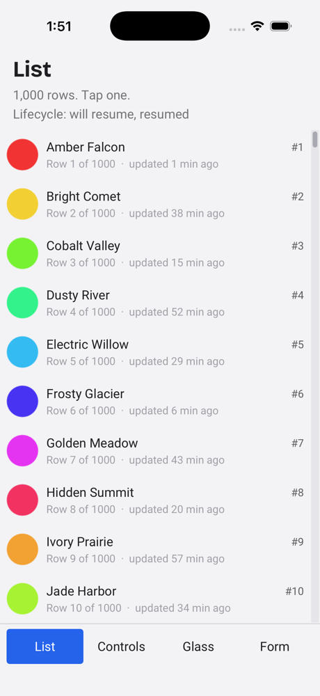 | 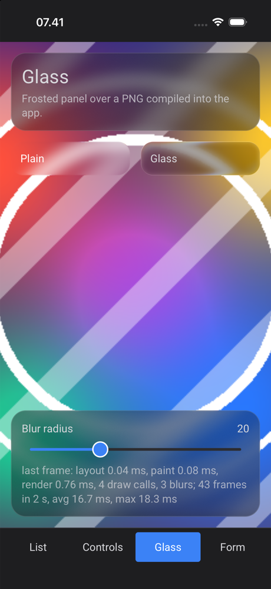 | 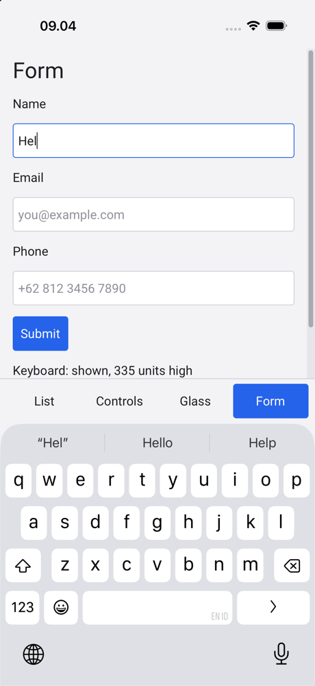 | 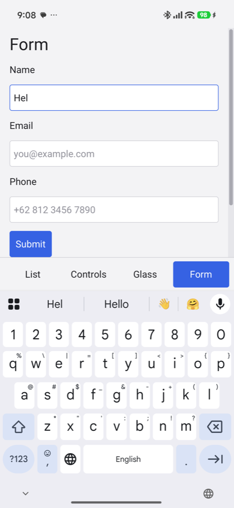 | 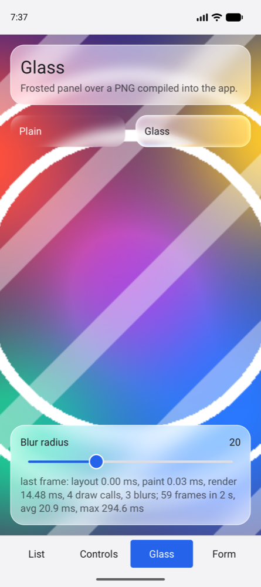 |

### Using the built library

`install/` is a CMake package. In your project:

```cmake
find_package(raven REQUIRED)          # configure with -DCMAKE_PREFIX_PATH=<path to install>
target_link_libraries(app PRIVATE raven::raven)
```

or, without installing, `add_subdirectory(Raven)` before the same
`target_link_libraries`. Prebuilt packages for every platform are attached to
the [releases](https://github.com/oscar-soirey/Raven/releases).

- **The interface in XML, the code in your language.** The window is a `.xml`
  file; C, C++, Rust, Python, Go, C#, Zig, Lua or LuaJIT load it, bind the
  actions it names and find its widgets by name, built by their usual tools.
  Save the XML while the program runs and the window follows. See
  [Any language](#any-language-the-interface-in-xml-the-code-in-yours).
- **The designer** (`raven_designer`): the interfaces of a folder made by
  looking at them, in the size of a phone or a desktop, in any look, theme or
  language, with their translations; one search for everything (Ctrl+K). It
  compiles nothing: the program is written in any language, elsewhere. See
  [The designer](#the-designer).
- **A theme editor** (`raven_theme_editor`): every color, size, glass setting,
  syntax color and style rule of a theme, edited over a live preview of real
  widgets, a palette worked out from one accent, contrast checked. See
  [The theme editor](#the-theme-editor).
- **C11, no dependency.** Raven opens its own native windows (Win32, X11 and Wayland, Cocoa on macOS), loads
  Vulkan at run time and has its own memory allocator. A stripped shared
  library is about 1.3 MB, two fonts included.
- **Slate-style layout.** Boxes, grid, overlay, border, canvas, scroll box,
  splitter, wrap box, switcher, tabs, expander. Each child carries a *slot*
  (padding, alignment, auto or fill size) read by its parent.
- **Windows written in XML**, or built with the C API, or both. A document
  can declare **its own tags** (`<Widget Name="Card">`), with parameters.
- **Everything moves.** Animations are springs, as on iOS: buttons squash and
  bounce back, popups pop out of what opened them, panels fly to their place,
  lists stretch at their ends. Widgets arrive with transitions (`Appear="Drop"`).
- **What a tool needs**: a multi-line **text editor** with languages (colors,
  proposals, brackets, indentation), a **header bar** that replaces the title
  bar of the system, **docking**, the **file dialogs** of the system and a
  file browser widget, **drag and drop** from and to other applications,
  pictures and formats of the application on the **clipboard**.
- **Materials.** Solid, or three kinds of **glass** (clear, frosted, tinted)
  that blur and bend what is behind them, for one widget or for everything;
  panels that only **blur** what is behind; windows that are **seen through**,
  with the blur of the system behind them; an **island** that unfolds at the
  top of the window.
- **Tools of the trade.** A **graph of nodes** whose wires hang and swing, a
  **timeline** (tracks, clips, keys, markers), a complete **color picker**.
- **Looks and themes you write.** The looks of Raven, or the ones of
  **Windows 11**, **macOS** (Sequoia, and macOS 26 with Liquid Glass) and **GNOME** imitated closely (their controls,
  colors, accent, font and motion). Theme files laid over them, styles for a type of widget, a class,
  a **part of a widget and its states**, a theme for a window or a part of one. **Markdown** in labels and in the
  text editor, and labels whose text the mouse **selects and copies** as on a
  web page (`Selectable="true"`). Interface and theme files are **loaded again while the
  application runs** when they are saved.
- **Web pages** shown by the web engine of the system in a view embedded in
  the window (`SystemWebView`: WKWebView on macOS and iOS), or (`raven_web.h`,
  built into the same library) by driving a browser already installed.
- **Every language.** Translations in **CSV tables**, read with `Rtr("key")`
  in C or `Text="@key"` in XML, with plurals, arguments, numbers and times
  (12 or 24 hours) in the conventions of each language, and the **time
  zones** of the tz database. **Right-to-left** layouts that mirror
  themselves, bidirectional text, Arabic shaping, **emoji** in color and
  the fonts of the system for the scripts the bundled font lacks.
- **Touch, pens and trackpads, with nothing to do.** On Windows, X11, Wayland
  and macOS: a tap clicks, a finger scrolls lists, trees, text and graphs and
  flicks them, resting is a right click, two fingers pinch to zoom; a pen is a
  mouse with a pressure and a tilt, and the palm resting on the screen is
  ignored. On a trackpad, two fingers scroll by the pixel (with inertia) and
  pan canvases, a pinch zooms and turns, three fingers swiped across go back
  and forward (Direct Manipulation on Windows, pointer gestures on Wayland,
  XInput 2.4 on X11, AppKit on macOS). Settings for the application, a window
  or a widget, from code, XML or the designer, and events of their own
  (`raven_touch.h`).
- **Accessible.** Native **screen readers** (Narrator and NVDA through UI
  Automation, VoiceOver on macOS and iOS, TalkBack on Android, Orca through
  AT-SPI), a **text scale**,
  **high-contrast** themes, **color filters** for color blindness, a focus
  ring that stays visible, less motion.
- **Viewports** for content rendered by the application: a texture (zero-copy
  Vulkan image, shared memory for OpenGL, or CPU pixels), a draw callback
  inside the render pass of Raven, or a native child window for any API.
- **Multithreaded.** A render thread owns the GPU, a job system paints large
  trees in parallel and runs your asynchronous work.
- **Your loop.** Raven draws one frame per call: `while (Rdraw_frame()) { ... }`.
- **Vulkan and Metal renderers behind an interface**: another backend is a table of functions.
- **Opaque handles** in the style of HRL: every object is a `Rid`,
  validated on every call, with errors reported through a callback.
- **One header**: `#include <Raven.h>`.

> **Raven is open source** under the [Apache License 2.0](LICENSE). Use it
> for anything, commercial included; what you make with it is yours. No
> watermark, no paid edition, no royalties.

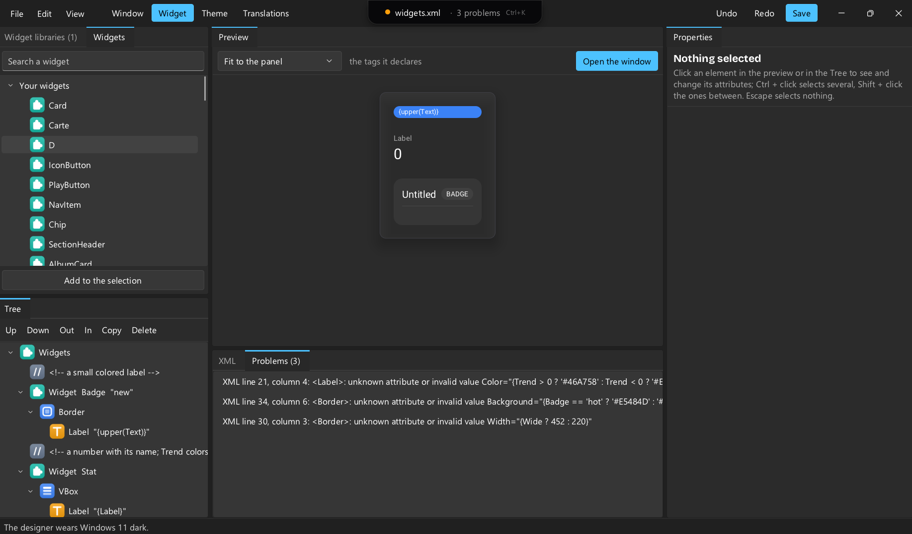

*`examples/studio`: a graph of nodes with widgets inside them, a color picker and a timeline, with the dark glass theme.*

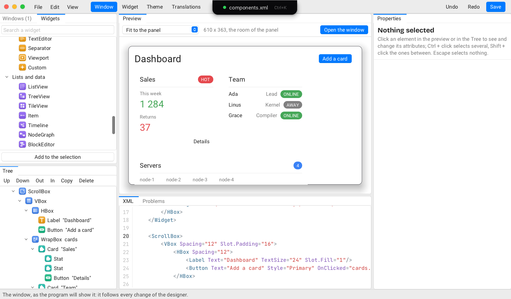

*`raven_designer`: the widgets that can be added, the tree, the interface built for real, the attributes of the selected element, and the XML.*

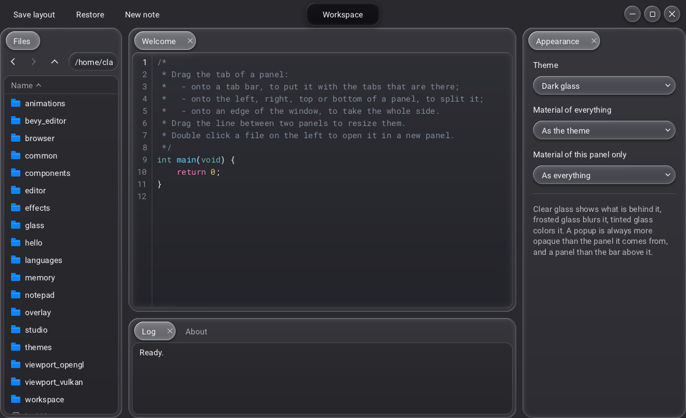

*`examples/workspace`: docked panels, a file browser and an island, with the dark glass theme and a custom header bar.*

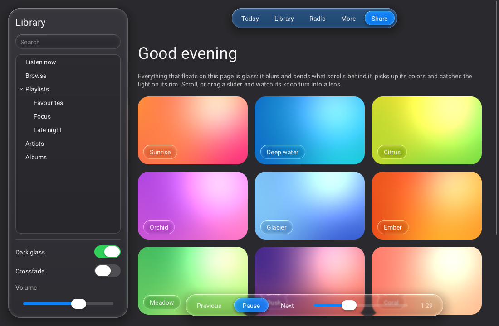

*`examples/glass`: a frosted side bar, a tinted tool bar and a clear player bar over a page that scrolls under them.*

```c
#include <Raven.h>

static void on_clicked(Rid button, void* user) { Rquit(0); }

int main(void) {
    Rinit(R_BACKEND_DEFAULT);

    Rid window = Rwindow_create("Hello", 420, 220, R_WINDOW_DEFAULT);
    Rid box = Rwidget_create(R_WIDGET_VBOX);
    Rpanel_set_spacing(box, 12);
    Rslot_set_halign(box, R_HALIGN_CENTER);
    Rslot_set_valign(box, R_VALIGN_CENTER);
    Rwindow_set_content(window, box);

    Rwidget_add_child(box, Rlabel_create("Hello from Raven"));
    Rid button = Rwidget_add_child(box, Rbutton_create("Quit"));
    Rbutton_set_clicked_callback(button, on_clicked, NULL);

    while (Rwait_frame(-1.0)) {}     /* the loop is yours: see "The loop" */
    Rshutdown();
    return 0;
}
```

The same window in XML (`Rwindow_create_from_xml_file("hello.xml")`):

```xml
<Window Title="Hello" Width="420" Height="220">
    <VBox Spacing="12" Slot.HAlign="Center" Slot.VAlign="Center">
        <Label>Hello from Raven</Label>
        <Button Text="Quit" OnClicked="app.quit"/>
    </VBox>
</Window>
```

## Any language: the interface in XML, the code in yours

The interface is a `.xml` file; the program, in any language that has a
binding, loads it, binds the actions it names and finds the widgets it needs
by name. Save the XML while the program runs and the window follows, the
code untouched (see [Files that are loaded again](#files-that-are-loaded-again)).

```xml
<!-- main.xml -->
<Window Title="Hello" Width="400" Height="200">
    <VBox Spacing="12" Slot.Padding="24">
        <Label Name="status">Not clicked yet</Label>
        <Button Text="Click me" Style="Primary" OnClicked="hello.clicked"/>
    </VBox>
</Window>
```

```rust
// src/main.rs: the same program exists in C, C++, Python, Go, C#, Zig and Lua
use raven::*;

fn main() {
    unsafe { Rinit(R_BACKEND_DEFAULT) };
    let window = unsafe { Rwindow_create_from_xml_file(cstr("main.xml").as_ptr()) };
    let mut clicks = 0;
    action_bind("hello.clicked", move |_sender, _action| {     // OnClicked="hello.clicked"
        clicks += 1;
        let text = cstr(&format!("{} clicks", clicks));
        unsafe { Rlabel_set_text(widget_find(window, "status"), text.as_ptr()) };   // Name="status"
    });
    unsafe { while Rdraw_frame() != 0 {} Rshutdown() };
}
```

| Language | Loads the XML | Binds an action | Finds a widget |
|---|---|---|---|
| C, C++ | `Rwindow_create_from_xml_file("main.xml")` | `Raction_bind("hello.clicked", f, NULL)` | `Rwidget_find(window, "status")` |
| Rust | `Rwindow_create_from_xml_file(...)`, `window_from_xml(text)` | `action_bind("hello.clicked", closure)` | `widget_find(window, "status")` |
| Python | `r.Rwindow_create_from_xml_file("main.xml")` | `r.Raction_bind("hello.clicked", f)` | `r.Rwidget_find(window, "status")` |
| Go | `raven.WindowCreateFromXmlFile("main.xml")` | `raven.ActionBind("hello.clicked", f)` | `raven.WidgetFind(window, "status")` |
| C# | `R.Rwindow_create_from_xml_file("main.xml")` | `R.Raction_bind("hello.clicked", R.Keep<RActionCallback>(F), IntPtr.Zero)` | `R.Rwidget_find(window, "status")` |
| Zig | `r.Rwindow_create_from_xml_file("main.xml")` | `r.Raction_bind("hello.clicked", f, null)` | `r.Rwidget_find(window, "status")` |
| LuaJIT | `r.Rwindow_create_from_xml_file("main.xml")` | `r.Raction_bind("hello.clicked", ffi.cast("RActionCallback", f), nil)` | `r.Rwidget_find(window, "status")` |
| Lua (5.1–5.5) | `r.Rwindow_create_from_xml_file("main.xml")` | `r.Raction_bind("hello.clicked", f)` | `r.Rwidget_find(window, "status")` |

- Each project is built by the tools of its language (CMake, Cargo, `go build`,
  `dotnet`, `zig build`) or run by its interpreter (Python, Lua, LuaJIT): nothing
  is generated, there is no extra step.
- An interface that must not depend on a file at run time can be compiled
  into the program as text (`include_str!`, a C string, an embedded resource)
  and built with `Rwindow_create_from_xml`.
- `examples/languages/` holds the same small program in the eight languages,
  each one loading the same `main.xml`, and `examples/bevy_editor/` a complete 3D
  scene editor: its interface is one `editor.xml`, driven from Rust (see
  [Examples](#examples)).

## The designer

`raven_designer [folder | interface.xml]` makes the interfaces of Raven
(`.xml`) by looking at them, in a folder. It is a tool, not an IDE: nothing
is built or compiled there; the program that loads the interfaces is written
in any language, with its own tools (see
[Any language](#any-language-the-interface-in-xml-the-code-in-yours)).

**Four tabs, kept apart.** At the top of the window, each kind of file has
its own tab, and each tab keeps its own file open and its own undo:

- **Window**: the interfaces of the folder (`.xml` with a `<Window>`, a panel
  or a form), in the visual editor.
- **Widget**: the widget libraries of the folder (`<Widgets>` with `<Widget
  Name="Card">`...). The preview shows one of each tag declared; the tags are
  then offered to the windows of the folder.
- **Theme**: the theme editor itself, built in: the themes of the folder in a
  list, every color, size and rule, the preview, the contrast; saved, the
  windows of the folder wear it.
- **Translations**: the tables (`.csv`) as a grid: one row per key, one column
  per language, an empty cell marked; what is typed shows in the preview at once.

`Ctrl+1` to `Ctrl+4` switch tabs. **Files** shows what the tab in front works
on, the sub-folders included. The folder is followed live: a file that another
program writes shows at once, the file open is read again when it has no
unsaved changes here, a theme or a table that changes changes the preview.
The combo at the top right dresses the designer itself: a look of Raven, or a
theme of the folder.

**The interface, five ways, kept in step:**

- **Widgets**: what can be added, the tags of the library and those the
  folder declares. Drag one into the preview, or double click to add it
  inside the selection.
- **Tree**: the elements. Move up, down, out, in; duplicate; delete; wrap in
  a panel or unwrap; copy and paste as XML.
- **Preview**: the interface, built for real, in the size of a device (a
  phone, a tablet, a laptop, a desktop, or the size of the XML), in any look
  of Raven or theme of the folder, in any language of the tables, right to
  left included. A click selects an element (an outline, the inside left
  clear); drag it to move it: a line shows where it goes, Escape cancels.
  With *Use it* on (F6), it reacts as the interface will.
- **Properties**: every attribute of the selected element, by kind of value.
- **XML**: the text, colored, with completion of the tags, the attributes and
  the `@keys`; a mistake is underlined and listed in **Problems** while the
  last good version stays shown.

**Preview in a window** (the button above the preview, or `F7`) opens the
interface in a window of its own, at its real size, that follows every change
live. Its bar chooses the device, the theme and the language, and goes back
to the designer.

**The island**, at the top of the window, is the command center. It unfolds
when the pointer is over it. Folded, it says which file is open, whether it
has unsaved changes, what is selected and how many problems there are.
`Ctrl+K` unfolds it on one search for everything: a widget to add (`add
slider`), an interface to open (`open settings`), a tab, a command (`wrap in a
vbox`, `preview in a window`, `undo`, `new theme`...), a language or a theme
for the preview. Below the search, the Name and the Text of the selection are
edited in place, with duplicate, wrap, delete and run.

Undo and redo follow the tab in front; a folder or an interface dropped on
the window opens. The visual editor uses the public API only. The files are in
`tools/designer/` (`designer.h` says what each one does).

## The theme editor

`raven_theme_editor [theme.xml]` makes theme files ([docs/THEMES.md](docs/THEMES.md))
by looking at them: the theme on the left, a preview on the right made of real
widgets (controls, an application, code, lists, a dialog) drawn with the theme
as it changes, and alive.

- **Theme**: the look it starts from (any of the sixteen), dark or light,
  material, motion, accent, font, wallpaper; *Generate the palette* works out
  every color from the accent (tint and depth adjustable), *Surprise me* tries
  another one.
- **Colors**, **Sizes**, **Code**: the 43 color roles, the metrics, the glass
  multipliers and the syntax colors, each showing what the look gives until it
  is set, with a button to go back to it.
- **Styles**: the `<Style>` rules as text, with ready-made ones to add.
- **Check**: the contrast of the pairs of colors people read, as WCAG 2
  measures it, with a button that fixes a pair (or all of them).
- **XML**: the file as it will be saved, editable, or copied as C code that
  loads it.

*Saved version* above the preview compares with the last saved theme.

Undo and redo, open and save, `F7` for the preview in a window of its own.
The files are in `tools/theme_editor/`.

## The inspector

```c
Rwindow_set_inspector(window, R_TRUE);   /* R_FALSE hides it */
```

A window beside the application that shows what a window is made of while it
runs: its widgets as a tree (type, name, classes), what the selected one is
(place and size in the window, desired size, constraints, slot, visibility,
state, style, action, children) and what the last frame cost (layout, paint
and render times, widgets, instances, draw calls). The selected widget is
outlined in the window with its type and size; *Pick* selects the next widget
clicked in the window, and that click goes to the inspector only. The tree
follows the window as widgets come and go. No key opens it: the application
calls the function (behind a debug menu, a command line option...), and
`Rwindow_get_inspector` gives its window, to place it.

## License

**Raven is open source**, under the [Apache License 2.0](LICENSE) (see also
[NOTICE](NOTICE)). All of its source code is in this repository.

Use it for anything: whatever you build with Raven is yours. Sell it, ship it
to clients, keep its source closed, use it at work. No watermark, no paid
edition, no license file, no royalties, no permission to ask.

Raven itself is yours to study, fork and change. When you redistribute Raven
or a modified copy of it, keep its license and copyright notices and say what
you changed. Contributions (issues, pull requests) are welcome on
[GitHub](https://github.com/oscar-soirey/Raven).

Questions: oscarsoirey.contact@gmail.com.

## Status

Version 0.2.3. Everything in this README has been tested: the headless test
programs (layout, widgets, XML, threads, memory, animations, text editor,
shell, dialogs, themes, Markdown, tools, locales and accessibility, clean
under AddressSanitizer, UBSan and ThreadSanitizer; run on every push on Linux,
macOS and Windows, with the tests of the Cocoa and Win32 platforms), the renderer and glass on
real GPUs, Windows, macOS and Linux (X11), the screen readers of each system,
`raven_web`, the designer, the build scripts, `dist.sh`/`dist.bat`, the CMake
package and every binding but Odin (C++, Python, Rust, Go, C#, Zig, LuaJIT,
Java, Bun, Node.js, D, Nim). The native Wayland platform is newer: it is tested against a
compositor written in its test (`test_wayland`: windows, scales, keyboard,
input methods, pointer, clipboard, drops, with and without libdecor), not yet on GNOME, KDE
or wlroots with a GPU. iOS and Android are experimental: they have run on
the iOS Simulator, on an Android phone and on the Android emulator
(`examples/mobile`), not yet on an iPhone.

### Linux: Wayland and X11

Raven speaks both. In a Wayland session it opens native Wayland windows;
elsewhere, or where Wayland cannot be used, it opens X11 windows (through
XWayland in a Wayland session). Nothing of Wayland is needed to build: its
libraries are opened when the program starts.

| On Wayland | |
|---|---|
| Needs | `libwayland-client` and `libxkbcommon` (installed on every Wayland desktop) |
| Title bars | drawn by the compositor (KDE, wlroots, Hyprland...), or by `libdecor` where it draws none (GNOME). Without either, Raven uses X11 |
| Scale | fractional scales (125 %, 150 %...) through `fractional-scale-v1`, sharp at any scale |
| Keyboard | the layout of the compositor, key repeat, dead keys and compose sequences; input methods through `text-input-v3` ([Input methods](#input-methods)) |
| Cursors | `cursor-shape-v1`, or the cursor theme (`XCURSOR_THEME`, `XCURSOR_SIZE`) |
| Also | clipboard, files dropped from other applications, native viewports (sub-surfaces), window icons (`xdg-toplevel-icon`), blur behind transparent windows (`ext-background-effect`) |

`RAVEN_WINDOW_SYSTEM=x11` or `=wayland` overrides the choice;
`RAVEN_APP_ID` names the application to the desktop (default: the name of
the executable; it should match the `.desktop` file). `Rwindow_get_native_handle`
tells which one a window got (`R_WINDOW_SYSTEM_WAYLAND`: `display` is the
`wl_display*`, `window` the `wl_surface*`).

## Build options and scripts

Requirements: CMake 3.16+, a C11 compiler. Linux also needs the X11
development package (`libx11-dev`); nothing of Wayland is needed to build. The Vulkan *headers* are needed to build;
they come from the Vulkan SDK when it is installed and are downloaded
otherwise. No Vulkan library is linked.

```sh
cmake -S . -B build -DCMAKE_BUILD_TYPE=Release
cmake --build build --config Release
cd build && ctest -C Release --output-on-failure
```

The programs are written to `build/bin` (`build\bin\Release` with Visual
Studio), next to `raven.dll` in a shared build.

With CMake 3.21 or newer, presets do the same: `cmake --preset linux` (or
`msvc`, `msvc-shared`, `mingw`, `mingw-shared`, `linux-shared`, `dev`), then
`cmake --build --preset linux` and `ctest --preset linux`.

On Windows, two scripts work from the folder of Raven:

```bat
generate-cmake.bat            :: creates build\raven.sln (the newest Visual Studio installed)
generate-cmake.bat --open     :: ... and opens it; F5 starts the editor example
build.bat                     :: Release build (generates the build tree if needed)
build.bat debug --test        :: Debug build, then the tests
build.bat --run glass         :: builds, then starts an example
```

`generate-cmake.bat --help` and `build.bat --help` list their options
(`--shared`, `--generator Ninja`, `--build-dir`, `--fresh`, ...). CMake
options go after `--`: `generate-cmake.bat -- -DRAVEN_WARNINGS_AS_ERRORS=ON`.

| Option | Default | |
|---|---|---|
| `RAVEN_BUILD_SHARED` | `OFF` | shared library instead of static |
| `RAVEN_BUILD_EXAMPLES` | `ON` when top level | |
| `RAVEN_BUILD_TESTS` | `ON` when top level | tests, tests of the bindings, `raven_benchmark` |
| `RAVEN_BUILD_TOOLS` | `ON` when top level | `raven_designer`, `raven_theme_editor` |
| `RAVEN_BUILD_WEB` | `ON` | web pages (`raven_web.h`, [docs/WEB.md](docs/WEB.md)), compiled into the Raven library itself; it needs nothing more to build |
| `RAVEN_BACKEND_VULKAN` | `ON` | the Vulkan backend (on macOS and iOS through MoltenVK, only when asked for); `OFF` with Metal off builds without any GPU code (custom backend or headless) |
| `RAVEN_BACKEND_METAL` | `ON` on Apple | the Metal backend (macOS, iOS), the default there; no dependency |
| `RAVEN_PLATFORM` | `auto` | `win32`, `x11`, `cocoa` (macOS), `uikit` (iOS), `android`, `emscripten` (the browser, [docs/emscripten.md](docs/emscripten.md)) or `null` |
| `RAVEN_ANDROID_JAVA` | `ON` | Android: compile Raven's Java part (target `raven_java`) and offer `raven_aar`; the SDK and the JDK are found as [examples/mobile](examples/mobile/README.md#packaging) says, or set with `RAVEN_ANDROID_SDK`, `RAVEN_ANDROID_BUILD_TOOLS`, `RAVEN_ANDROID_JAR` |
| `RAVEN_WAYLAND` | `ON` | Linux and BSD: native Wayland compiled beside X11 ([Linux: Wayland and X11](#linux-wayland-and-x11)) |
| `RAVEN_WITH_STB_IMAGE` | `ON` | PNG / JPEG / BMP / TGA decoding (and the frames of APNG files; animated GIFs play without it) |
| `RAVEN_WITH_SVG` | `ON` | SVG images (icons), drawn by nanosvg |
| `RAVEN_FETCH_VULKAN_HEADERS` | `ON` | download the Khronos headers when no SDK is found |
| `RAVEN_VULKAN_INCLUDE_DIR` | | folder containing `vulkan/vulkan.h`, to skip the search |
| `RAVEN_REBUILD_SHADERS` | `OFF` | recompile the GLSL (needs `glslangValidator` or `glslc`); the SPIR-V is committed |
| `RAVEN_MSVC_STATIC_RUNTIME` | `OFF` | Visual C++: `/MT` instead of `/MD` |
| `RAVEN_WARNINGS_AS_ERRORS` | `OFF` | |

Using it from another CMake project:

```cmake
add_subdirectory(raven)                       # or find_package(raven) after an install
target_link_libraries(app PRIVATE raven::raven)
```

### Packages to give away

`dist.bat` (Windows) builds what is given to people who use Raven without
building it, the way `build.bat` builds (`generate-cmake.bat`, then
`build.bat`, then `cmake --install`): one folder and one zip, with the
library of Visual C++ and of MinGW-w64, static and shared.

```bat
dist.bat              :: Visual C++ and MinGW-w64 (one not installed is skipped)
dist.bat msvc         :: Visual C++ only
dist.bat --test       :: also runs the tests of each build
```

```
dist\raven-0.2.3\
    msvc-static\     include\, lib\raven.lib, lib\cmake\raven, bin\raven_designer.exe, share\raven\
    msvc-shared\     bin\raven.dll, lib\raven.lib (to link with the DLL), the rest as above
    mingw-static\    lib\libraven.a, the rest as above
    mingw-shared\    bin\raven.dll, lib\libraven.dll.a (to link with the DLL), the rest as above
```

For a release on GitHub, `dist.bat` also writes one archive per library in
`dist-release\`, to attach as they are: `windows-x64-msvc-static.zip`,
`windows-x64-msvc-shared.zip`, `windows-x64-mingw-static.zip`,
`windows-x64-mingw-shared.zip` and `SHA256SUMS.txt`.

Each of the four folders is an install prefix: `find_package(raven)` finds it
through `CMAKE_PREFIX_PATH`. The libraries of one compiler are not for the
other; `raven.dll` itself can be loaded by anything. MinGW-w64 needs `gcc`,
and `ninja` or `mingw32-make`, in the PATH; its DLL is linked with
`-static-libgcc`, so that it does not need the DLLs of the compiler beside it.
The build trees are in `build\dist\`.

`./dist.sh` makes the Linux packages. `cmake --build build
--target package` makes a simpler archive (one library) with CPack.

## Examples


*`examples/bevy_editor`: the viewport of the scene editor (its interface in `editor.xml`, driven from Rust), with the move gizmo on the selected cube (here drawn by its software renderer).*

| | |
|---|---|
| `examples/hello` | a window with the C API |
| `examples/editor` | a scene editor described in `editor.xml`: menus, splitters, tree, tabs, property grid, a viewport rendered in software on the job system, a custom-drawn graph, a virtual list. Its View menu switches between the four themes |
| `examples/notepad` | a text editor: custom header bar, languages chosen from the name of the file, a language declared by the application, proposals from a callback, markers, the file dialogs of the system, files dropped on the window |
| `examples/animations` | transitions played on demand, four springs in a custom widget, cards that pop in and out, an island, speed and "reduce motion" |
| `examples/workspace` | panels that dock, a file browser that opens files in new panels, the three kinds of glass for everything or for one panel, saving and restoring the arrangement |
| `examples/components` | tags declared with `<Widget>`, `<Repeat>`, `<ForEach>`, `<Include>`, and a piece of interface built from C as a document |
| `examples/memory` | an allocator given by the application, the statistics of the library, the heap check |
| `examples/studio` | a graph of nodes (widgets inside the nodes, links the application can refuse, nodes added from code), a timeline that plays, a color picker that colors the selected nodes; its XML is loaded again when saved |
| `examples/themes` | the looks (Raven, Windows 11, macOS, GNOME), three theme files (one that follows the look, with styles of parts and states), styles and classes, a card that keeps its own theme, Markdown in a label and in an editor; every file of the example is watched |
| `examples/charts` | a dashboard of `Chart` widgets: KPI tiles with live sparklines, a pie, a donut with its total, gauges with bands, a heatmap of orders by weekday and hour; the shares glide when shuffled |
| `examples/carousel` | an onboarding of five pages in a `Carousel`: swiped, dots, arrows, loop, autoplay, vertical |
| `examples/transfer` | swatches dragged out of the window (a picture into a document, a PNG file into the Finder or the Explorer), copied and pasted as pictures, a name copied as HTML, text and a format of the application |
| `examples/icons` | every icon shipped with Raven, and some in buttons, tabs and a tree, in the color of the text; a button switches between the dark and the light theme |
| `examples/notifications` | notifications of the system with a tag, buttons and an icon, replaced and closed; what the user did with them; a toast where the system shows none |
| `examples/animated_images` | animated GIF and APNG files in `Image` widgets: a spinner with a transparent color, a ball with an alpha channel, a countdown that plays once and fires its action; play, pause, stop, a frame chosen with a slider, reduced motion |
| `examples/diff_view` | two versions of a C file compared by a `DiffView`: side by side or in one column, spaces that count or not, the context, previous / next change, a note on a line |
| `examples/pdf` | a PDF viewer: open, save, print, pages, zoom and fit around a `PdfView`, and an invoice of three pages that it writes itself with `Rpdf_document_*`. Needs PDFium (`RAVEN_PDFIUM`) to show the pages |
| `examples/map` | a `MapView` that works offline: its tiles are drawn by the example on worker threads (a coarse world, a graticule, the z/x/y of each tile), markers for sixteen cities that fly there when clicked. `RAVEN_MAP_TILE_DIR` reads real tiles from files instead |
| `examples/overlay` | a window that is seen through, the backdrops of the system, and the four ways to blur what is behind a panel |
| `examples/web_view` | a page shown by the web engine of the system (`SystemWebView`, WKWebView on macOS): an address bar, the history, a color picker of Raven that drives the CSS of the page, scripts that answer, messages from the page |
| `examples/browser` | web pages with `raven_web`: an address bar, the history, a color picker of Raven that drives the CSS of the page, messages from the page |
| `examples/glass` | the glass themes and the three glass materials. `raven_glass light` starts with the light glass |
| `examples/viewport_vulkan` | a Vulkan scene in the UI, twice: offscreen image wrapped as a texture, and drawn in the render pass of Raven. Needs the Vulkan library |
| `examples/viewport_opengl` | an OpenGL scene in a native child window (WGL / GLX) |
| `examples/bevy_editor` | **a 3D scene editor in Rust, its whole interface in one `editor.xml`**: hierarchy, inspector, gizmos to move, rotate and scale, undo, scene files. Bevy draws the scene into the viewport; without Bevy, a software renderer does. See its [README](examples/bevy_editor/README.md) |
| `examples/languages` | the same program in C, C++, Rust, Python, Go, C#, Zig, LuaJIT and Lua 5.1–5.5: one `main.xml` loaded by the program of each language, built by the tools of each language |
| `examples/ui_test` | a test of an interface: the window of `login.xml` driven by the names of its widgets, its texts checked, and a golden image compared (`RAVEN_UPDATE_GOLDENS=1` writes it) |
| `examples/headless` | scripts that drive `hello` (by what its widgets read) and `music` (by their names) from outside, without a change of their code: `RAVEN_HEADLESS=1 RAVEN_SCRIPT=... ./raven_music` (see [Driving any application headlessly](#driving-any-application-headlessly)) |
| `examples/mobile` | one showcase in C for iOS and Android (experimental): a tab bar, a list of 1,000 rows with a detail page, controls, glass, a form with keyboard types. See its [README](examples/mobile/README.md) |


*`examples/notepad`: the title bar is a widget; the lines that say TODO and FIXME are marked.*


## Other languages

`bindings/` holds bindings generated from the headers by `tools/bindgen`:
C++ (classes and lambdas), Python (`ctypes`), Rust (a crate), Go (cgo), C#
(P/Invoke), Zig, LuaJIT, Lua 5.1–5.5 (a C module, which a program that
embeds Lua can also compile in), Java (the Foreign Function & Memory API of Java 22,
on Maven Central), Odin, Bun (`bun:ffi`), Node.js (a Node-API addon, which
also runs on Bun and Deno), D (a dub package), Nim (a nimble package), C3
(a library), Swift (a Swift package) and Haskell (a cabal package). All but Odin and C3 are
tested. See
[bindings/README.md](bindings/README.md). They cover everything in `Raven.h`;
`raven_web.h` is C only.

```python
import raven as r
r.Rinit(r.R_BACKEND_DEFAULT)
window = r.Rwindow_create_from_xml('<Window Title="Hi"><Button Text="Quit" OnClicked="quit"/></Window>')
r.Raction_bind("quit", lambda sender, action, user: r.Rquit(0))
while r.Rwait_frame(-1.0):
    pass
r.Rshutdown()
```

## Concepts

### Names

`#include <Raven.h>` gives the whole API; the headers it includes
(`raven/raven_window.h`, `raven/raven_controls.h`...) can also be included
one by one.

| | | |
|---|---|---|
| functions | `R<object>_<action>` | `Rwindow_create`, `Rwindow_get_size`, `Rbutton_set_text`, `Rslot_set_padding` |
| library functions | `R<action>` | `Rinit`, `Rdraw_frame`, `Rwait_frame`, `Rquit`, `Rshutdown` |
| types | `R<Name>` | `Rid`, `REvent`, `RInitDesc`, `RPainter`; callbacks end with `Callback` |
| constants | `R_<NAME>` | `R_INVALID_ID`, `R_WIDGET_VBOX`, `R_KEY_ESCAPE`, `R_THEME_GLASS_DARK` |
| build options and macros | `RAVEN_<NAME>` | `RAVEN_BUILD_SHARED`, `RAVEN_API`, `RAVEN_VERSION_MAJOR` |

Names that do not start this way (`rvn_...`, `RVN_...`) are internal to the
library and are not exported.

### Handles and errors

Every object is a `Rid`. Handles carry a generation, so using a deleted
object is detected and reported instead of crashing. Deleting a widget
deletes its children; deleting a window deletes its content.

```c
static void on_error(RError code, RSeverity severity, const char* detail) {
    fprintf(stderr, "%s: %s\n", Rerror_to_string(code), detail);
}
Rerror_set_callback(on_error);
```

**Loss of the GPU.** When the device is lost (a driver reset or update, a
GPU removed), Raven starts the backend again at the next frame and remakes
the surfaces, the fonts, the shaders, the textures made from image files and
the small textures. Larger textures made from pixels come back transparent:
fill them again in the function given to `Rset_device_reset_callback`.
`Rvulkan_simulate_device_lost` tests this path; a custom backend reports a
loss with `Rbackend_device_lost`.

### The loop

Raven has no loop of its own. The application asks for one frame at a time:

```c
while (Rdraw_frame()) {            /* a game or an engine: never waits      */
    update_and_render_my_scene();
}

while (Rwait_frame(-1.0)) {}       /* a tool: sleeps until something happens */
```

`Rdraw_frame` processes the events, runs the timers and the posted tasks,
then lays out, paints and submits the windows that changed; a window in which
nothing changed is not drawn again. `Rwait_frame` first sleeps until there is
something to do (an event, a timer, an animation still moving). Both return
false once `Rquit` was called or the last window is closed.

### Layout

Layout is the two passes of Slate: each widget computes the size it would
like, bottom-up, then each panel gives a rectangle to its children, top-down.
How a child is placed is stored on the child, in its slot:

```c
Rid row = Rwidget_add_child(parent, Rwidget_create(R_WIDGET_HBOX));
Rid name = Rwidget_add_child(row, Rwidget_create(R_WIDGET_TEXT_INPUT));
Rslot_set_fill(name, 1.0f);                   /* takes the free width          */
Rid ok = Rwidget_add_child(row, Rbutton_create("OK"));
Rslot_set_valign(ok, R_VALIGN_CENTER);      /* its own height, centered      */
Rslot_set_padding(ok, 8, 0, 0, 0);
```

Sizes are logical units, multiplied by the scale of the monitor. Only the
part of the tree that changed is measured and arranged again.

### XML

Tags are widget types, attributes are properties, `Slot.*` attributes are
the slot. `On...` attributes name *actions*, bound from C with
`Raction_bind`. The full reference is [docs/XML.md](docs/XML.md).

A document can declare its own tags, with parameters:

```xml
<Widget Name="Field" Label="Name" Hint="" Wide="false">
    <HBox Spacing="8">
        <Label Text="{Label}:" Width="{Wide ? 140 : 90}"/>
        <TextInput Placeholder="{Hint}" Slot.Fill="1"/>
        <Children/>
    </HBox>
</Widget>

<Field Label="Email" Hint="you@example.com" Name="email"/>
<Field Label="Password" Wide="true"><Button Text="Show"/></Field>
```

The attributes of `<Widget>` other than `Name` are its parameters and their
default values; `{...}` is an expression of them (arithmetic, comparisons,
`a ? b : c`, a few functions); `<Children/>` is where the children given to
the tag go. `If="..."`, `<Repeat Count="3" Var="i">`, `<ForEach Items="a|b"
Var="x">` and `<Include Source="file.xml"/>` complete it. From C,
`Rxml_register_widgets` reads declarations ahead of the documents that use them.

For tools, `Rxml_document_parse` gives a document as a tree of nodes that can
be changed, written back and built, each widget knowing its node
(`raven_xml.h`); `Rxml_get_attribute_info` lists what can be written.

### Raven Script

The actions can also be written in the document, in Raven Script, a small
statically typed language with the syntax of TypeScript, run by an
interpreter of Raven (no other engine):

```xml
<Window Title="Counter">
    <Script>
        let counter: number = 0;
        fn app.increment() {
            counter += 1;
            ui.setText("counter", counter.toString());
        }
    </Script>
    <VBox>
        <Label Name="counter" Text="0"/>
        <Button Text="+1" OnClicked="app.increment"/>
    </VBox>
</Window>
```

Scripts are checked before anything runs (types, names, and the parameters
of each event handler against what its widget gives), and an error in a
script never stops the application. Script functions are actions, in the same
registry as those of `Raction_bind`; C functions with typed parameters are
bound with `Raction_bind_with_parameters` and called from scripts. The
command line tool `raven_script` checks and formats scripts, and the VS Code
extension (`tools/vscode-raven`) has a language server for them. See
[docs/SCRIPT.md](docs/SCRIPT.md).

### Animations

Nothing has to be done for the controls: they move by themselves, with
springs. What an application decides:

```c
Rwidget_set_transition(card, R_TRANSITION_FLY_UP, 0.1f);   /* each time it appears; Appear="FlyUp" in XML */
Rwidget_play_transition(card, R_TRANSITION_DROP, 0.0f);    /* once, now                                  */

/* in the paint callback of a custom widget: a value pulled to its target */
float s = Rdraw_spring(painter, &state->size, hovered ? 1.0f : 0.0f, R_MOTION_BOUNCY);

Rset_animation_speed(0.25f);          /* slow motion        */
Rset_animations_enabled(R_FALSE);     /* "reduce motion"    */
```

Transitions: `Fade`, `Pop`, `Zoom`, `FlyUp/Down/Left/Right`, `Drop`,
`SlideLeft/Right`. Motions: `SNAPPY`, `SMOOTH`, `BOUNCY`, `WOBBLY`. While
something moves the window keeps drawing by itself; `Rwait_frame` sleeps
again when everything is at rest.

### Text editor

`R_WIDGET_TEXT_EDITOR` (`<TextEditor>`) edits text of any number of lines:
selection, clipboard, undo, line numbers, word wrap, find and replace,
several cursors, code folding. With a language it
colors the text, proposes words while typing (those of the language and the
names already in the text; `Ctrl+Space` asks), shows which bracket closes
which, closes brackets and quotes, indents, and comments lines out (`Ctrl+/`).

```c
Rtext_editor_set_language(editor, Rlanguage_for_file(path));     /* "main.rs" -> "Rust" */
```

C, C++, C#, Java, JavaScript, TypeScript, Python, Rust, GLSL, JSON, CSS, XML
and HTML (with the JavaScript and the CSS inside it) are built in. Any of
them can be changed and others declared with `Rlanguage_register`: a language
is a description (its words, its comments, its quotes), not code.

This is what an editor knows from the text alone: it is **not a language
server**. What needs to understand a whole program comes from outside,
through two doors made for it: `Rtext_editor_set_completion_callback` (your
proposals, listed first) and `Rtext_editor_add_marker` (underline a part of
the text with a message: the errors of a compiler). An LSP client would plug
in there; Raven does not include one.

**Find and replace.** `Ctrl+F` (`Cmd+F` on macOS) opens a find bar over the
top of the text, `Ctrl+H` (`Cmd+Option+F`) the same bar with a row to
replace. The selected text becomes the search; every match of the visible
text is highlighted (theme colors `SearchMatch` and `SearchCurrent`), the bar
shows "3 of 12", and options match the case and whole words. `Enter` /
`Shift+Enter`, `F3` / `Shift+F3` and `Cmd+G` / `Cmd+Shift+G` go to the next
and the previous match, wrapping around; in the replace field `Enter`
replaces one match and `Ctrl+Enter` all of them, in a single step of undo.
`Escape` closes the bar. The search works without the bar for an
application with its own (`FindBar="false"` removes the bar and its keys):

```c
Rtext_editor_set_search(editor, "needle", R_SEARCH_MATCH_CASE | R_SEARCH_WHOLE_WORD);
Rtext_editor_find_next(editor);                      /* selects it, scrolls to it */
printf("%d of %d\n", Rtext_editor_get_match_index(editor) + 1, Rtext_editor_get_match_count(editor));
Rtext_editor_replace_all(editor, "pin");             /* one undo puts them all back */
```

Matches are counted per line and counted again only where the text changed,
so a text of hundreds of thousands of lines stays fast. Case is ignored for
ASCII, Latin-1, the Latin letters of Unicode, Greek, Cyrillic and Armenian.
There are no regular expressions.

**Several cursors.** `Alt+click` (`Option+click`) adds a cursor, `Ctrl+D`
(`Cmd+D`) selects the word at the caret and then adds the next occurrence of
the selection, `Ctrl+Shift+L` (or `Alt+Enter` in the find bar) puts a cursor
on every occurrence, `Ctrl+Alt+Up` / `Down` (`Cmd+Option+Up` / `Down`) adds
one on the row above or below, and `Alt+Shift+drag` selects a column.
Typing, erasing, `Enter`, `Tab`, the arrows (with `Shift` to select), the
clipboard and `Ctrl+/` then act at every cursor; cursors that meet become
one, and each edit is one step of undo that gives the cursors back. Copying
puts one selection per line; pasting as many lines as there are cursors puts
one at each. `Escape` goes back to one cursor. The main cursor (the last one
added) is the one the view follows and the one an input method composes at;
what it commits is typed at every cursor.

```c
Rtext_editor_add_cursor(editor, 12, 4);                  /* the main cursor stays where it is */
Rtext_editor_select_all_occurrences(editor);             /* as Ctrl+Shift+L */
for (int i = 0; i < Rtext_editor_get_cursor_count(editor); i++) {
    int line, column;
    Rtext_editor_get_cursor_at(editor, i, &line, &column, NULL, NULL);
}
```

**Code folding.** A line that opens a bracket closed on a later line, or that
the next lines are more indented than, starts a region. With line numbers, a
marker beside them folds and unfolds it (the markers show while the pointer is
over the margin; a folded one always); `Ctrl+Shift+[` and `Ctrl+Shift+]`
(`Cmd+Option+[` and `]`) fold and unfold at the caret. A folded region keeps
its first line, followed by `...` (a click unfolds it); the hidden lines are
skipped by the arrows, the pointer and the scrollbar, and the line numbers
stay those of the text. Folds follow their lines when text changes elsewhere;
editing a hidden line, or a match of the search or a cursor that goes into
one, unfolds it. `Rtext_editor_fold`, `Rtext_editor_unfold`,
`Rtext_editor_fold_all`, `Rtext_editor_unfold_all`; `Folding="false"` turns it
off. It works with word wrap.

### Header bar

```xml
<Window Title="Tool" CustomHeader="true">
    <VBox>
        <HeaderBar>
            <MenuBar>...</MenuBar>
            <Button Text="Run" Slot.HAlign="Right"/>
        </HeaderBar>
        ...
```

`CustomHeader` (`R_WINDOW_CUSTOM_HEADER`) removes the title bar of the
system; the `HeaderBar` draws the title and the window buttons and holds any
widgets. Dragging it moves the window, a double click maximizes it, the edges
of the window resize it. On Windows this is done with the hit test of the
system, so snapping to the sides of the screen keeps working. Any widget can
play the same role (`Rwidget_set_window_drag`).

### Docking

A `DockArea` arranges its children as panels with tabs. The user drags a tab
onto another tab bar, onto a side of a panel or onto an edge of the area; the
panels fly to their new place. `Slot.Dock`, `Slot.DockTo` and `Slot.DockSize`
give the starting arrangement in XML; `Rdock_area_add_panel` adds panels from
C, and `Rdock_area_save_layout` / `Rdock_area_load_layout` turn the
arrangement into a short text and back.

**Tearing.** A tab dragged out of the area takes its panel to a window of its
own; dragged back over a dock area, it docks there again. A double click on
the tab, or closing the window, puts the panel back where it was.
`Rdock_area_set_tearable` (or `Tearable="false"` in XML) keeps the panels
inside their window.

For cards inside the same window, call
`Rdock_area_set_float_mode(area, R_DOCK_FLOAT_IN_WINDOW)` or set
`FloatMode="InWindow"` in XML. Future floats use draggable cards above the
window content, clamped to its client bounds. Drop a card on a tab bar or
edge to dock it, or double click its tab to return it. Existing floats keep
their mode when the default changes. In-window `Rdock_area_float_panel`
coordinates are window-local logical pixels and its return value is the
containing window. The default native mode uses screen coordinates.

Layouts containing in-window cards use a versioned `D2(...)` description
that preserves card order and geometry. Dock-only descriptions retain the
original format. Invalid versioned layouts, duplicate panel names and
unknown names are rejected without changing the current arrangement;
legacy descriptions continue to ignore unknown names. Give panels unique
names to persist their arrangement.

### Dialogs and files

```c
RFileDialogDesc desc = { .parent = window, .title = "Open", .filters = filters, .filter_count = 2 };
const char* path = Rfile_dialog_open(&desc);          /* the dialog of the system; NULL when cancelled */

if (Rmessage_box(window, "Quit", "Discard the changes?", R_MESSAGE_OK_CANCEL) == R_MESSAGE_RESULT_OK) ...
```

File dialogs are those of the system (Windows: the common dialogs; Linux:
`zenity` or `kdialog` when installed), and otherwise a dialog of Raven built
on the `FileBrowser` widget, which can also be put in any window. Any widget
can be shown as a dialog of a window (`Rdialog_open`, `Rdialog_run`).
`Rfile_read` and `Rfile_write` take UTF-8 paths on every platform.

### Table colors and selection

```c
Rtable_set_selection_mode(table, R_TABLE_SELECTION_MULTIPLE); /* <Table SelectionMode="Multiple"> */
for (int i = 0; i < Rtable_get_selection_range_count(table); i++) {
    int first, last;
    Rtable_get_selection_range(table, i, &first, &last);  /* rows first..last are selected */
}
```

A table selects one row at a time by default. In multiple selection
(`Rtable_set_selection_mode`, or the older `Rtable_set_multi_select`) a click
selects one row, Ctrl/Cmd+click toggles a row, Shift+click and Shift with the
arrows, Page Up / Page Down, Home and End extend from the anchor (Ctrl+Shift
keeps the other rows), Ctrl+arrows move the current row without selecting,
Space toggles the current row and Ctrl/Cmd+A selects every row. A tap of a
finger toggles its row, since a finger has no Ctrl key (a long press stays
the context menu). `R_TABLE_SELECTION_NONE` makes a table the user selects
nothing in: the arrows scroll it, and its cells can still be edited or checked.

The selection is kept as sorted ranges of rows, not as a flag per row:
selecting all of a million virtual rows is one range, and asking whether a
row is selected is a binary search. `Rtable_select_range`, `Rtable_select_all`,
`Rtable_set_row_selected` and `Rtable_clear_selection` change it;
`Rtable_is_row_selected`, `Rtable_get_selection_count`, `Rtable_get_selection`
(the n-th selected row) and `Rtable_get_selection_range` read it.
`Rtable_set_selected` replaces the whole selection with one row.
`Rtable_get_selected` is the primary row (the one selected last; the selection
changed callback receives it), and `Rtable_get_current_row` the row the
keyboard is on. Sorting a stored table and removing rows keep the selection on
its rows. A virtual table keeps the selected indices when its count is
refreshed (dropping those past the end) and when it is sorted: the application
orders its data, and selects again if the selection must follow it.

`Rtable_set_cell_text_color(table, row, column, r, g, b, a)` colors a stored
cell, or the whole row with column -1. Cell overrides take precedence over row
overrides, including selected rows; alpha zero restores the inherited/theme
color. `Rtable_set_cell_color_callback` (stored and virtual tables) takes
precedence: when it returns true with a non-zero alpha its color is used,
otherwise the fixed cell/row color, then the theme color. Color callbacks run
on the UI thread for visible cells only.
Screen readers see selectable rows, including Cocoa selected rows, AT-SPI
selected states, UIA multiple-selection support and the browser grid state.

### Check boxes and progress bars in cells

```c
Rtable_set_column_kind(table, 0, R_TABLE_COLUMN_CHECK);    /* <Column Kind="Check"/> */
Rtable_set_column_kind(table, 3, R_TABLE_COLUMN_PROGRESS); /* <Column Kind="Progress"/> */
Rtable_add_row(table, "1|Release notes|Ana|0.75");
```

A column can draw its cells as a check box or a progress bar instead of a
text. The value is the text of the cell, stored or given by the virtual
callback: "1", "true" or "yes" is checked; a number 0..1 or a percentage
("45%") is a progress (an empty cell shows nothing). The table draws them
itself, for the visible rows only, so a million virtual rows stay as fast as
before. A check column is editable: a click on its cell toggles it without
changing the selection, and Space, Enter or F2 toggle the current cell. The
cell edited callback is then called with "1" or "0", and accepts or refuses
the change as for a typed text; a stored table keeps it, a virtual table
leaves it to the application. `Rtable_set_column_editable(table, column,
R_FALSE)` makes it a check box that is only shown. Screen readers hear
"checked", "not checked" (`Raven.Checked`, `Raven.NotChecked` translate them)
and percentages. Sorting such a column orders by the state and by the value.
Tables do not hold other widgets in their cells; colors are given per cell by
`Rtable_set_cell_color_callback`.

### Editing cells, frozen columns, searchable combo boxes

```c
Rtable_set_column_editable(table, 1, R_TRUE);       /* or <Column Editable="true"/> */
Rtable_set_cell_edited_callback(table, on_edited, NULL);
Rtable_set_frozen_columns(table, 1);                /* or <Table FrozenColumns="1"> */

static int on_edited(Rid table, int row, int column, const char* text, void* user) {
    return is_valid(text);            /* R_FALSE: refused, the editor stays open */
}
```

The cells of an editable column are edited in place: a double click, F2,
Enter or a typed character on the current cell opens a text field over it.
Enter keeps the text and goes down a row, Tab and Shift+Tab go to the next or
previous editable cell, Escape forgets the text, and a click elsewhere keeps
it. Left and Right move the current cell. The callback accepts or refuses
the text; a stored table then keeps it (or what the callback wrote with
`Rtable_set_cell`), a virtual table leaves it to the application.
`Rtable_edit_cell`, `Rtable_is_editing` and `Rtable_end_edit` drive the
editor from the program. Frozen columns stay at the left while the others
scroll under them, with a thin shadow at their edge. A screen reader sees the
editor as a text field named after its column.

`Rcombo_box_set_searchable` (`Searchable="true"`) turns a combo box into a
field that filters its list as the user types: the items that contain the
text without regard to case or accents ("sao" finds "São Paulo"), Up / Down
and Enter to choose, a "No matches" row when nothing does.
`Rcombo_box_set_editable` (`Editable="true"`) accepts any text, read with
`Rcombo_box_get_text` and followed with `Rcombo_box_set_text_changed_callback`.
The `workspace` example has a Tasks panel with both.

### Drag and drop

```c
static int on_drop(Rid target, const RDropEvent* event, void* user) {
    if (event->phase == R_DROP_DROPPED && event->path_count > 0) open(event->paths[0]);
    return R_TRUE;                    /* "I take it": the target is highlighted while it hovers */
}
Rwindow_set_drop_callback(window, on_drop, NULL);     /* or Rwidget_set_drop_callback for one widget */
```

Files and text dragged from other applications.

Data goes the other way too, to the other applications: dragged out of a
window (macOS and Windows) or put on the clipboard. It is one content in
several formats, each named by a MIME type (`RDataItem`); the program that
receives it takes the one it prefers, and Raven gives each format its native
name and conversion on each system (`text/plain`, `text/html`, `image/png`,
`text/uri-list` for files; any other name is a format of the application):

```c
/* from a widget's mouse move, the button held: the system takes the drag */
RDataItem items[] = {
    { "image/png",     png, png_size },                 /* a picture: documents, mail, image editors */
    { "text/uri-list", "file:///tmp/photo.png\r\n", 23 }, /* the file: the Finder, the Explorer      */
};
Rdrag_begin_external(source, items, 2, R_DRAG_OPERATION_COPY, on_finished, NULL);
Rdrag_set_image(rgba, 96, 96);                          /* what follows the pointer (optional)        */

Rclipboard_set_image(rgba, width, height, 0);           /* goes as PNG (and TIFF, or a bitmap)        */
uint8_t* pasted = Rclipboard_get_image(&width, &height); /* from PNG, TIFF, a bitmap...: Rpixels_free */
Rclipboard_set_data(items, count);                      /* Rclipboard_has_data, Rclipboard_get_data   */
```

`on_finished` is told what the target did (`R_DRAG_OPERATION_COPY`, `MOVE`,
`LINK`, or `NONE`). Called while a drag inside the application (`Rdrag_begin`)
is in progress, `Rdrag_begin_external` lets that drag leave the window: it
stays with the drop targets of the window and becomes a drag of the system
when the pointer leaves it. A `TileView` does both for its tiles with
`Rtile_view_set_drag_out_callback`. `Rimage_encode_png` writes the PNG files.
The clipboard takes these formats on macOS, Windows and in headless runs
(where it is kept in the process); X11 and Wayland keep text and HTML for now,
and dragging out is not there yet (`Rdrag_external_supported`).

During `R_DROP_ENTER` or `R_DROP_MOVE`, call
`Rdrop_set_highlight_rect(x, y, width, height)` to highlight an insertion line,
dock band or other part of the target. Coordinates are target-local logical
units and the rectangle is clipped to the target. Zero width or height hides
the highlight while a `R_TRUE` callback result still accepts the drop. Every
callback starts with the default full-target highlight again.

### Materials and glass

A material is what the surface of a widget is made of:

| | |
|---|---|
| `Solid` | filled with the colors of the theme |
| `Glass` | clear glass: what is behind shows through, bent at the rim |
| `FrostedGlass` | blurred: the colors behind, without their shapes |
| `TintedGlass` | blurred and colored by the theme: the easiest to read on |

```c
Rlook_set(R_LOOK_RAVEN_GLASS_DARK);                   /* a look comes with its material           */
Rtheme_set_material(R_MATERIAL_FROSTED_GLASS);        /* every widget that was not given its own  */
Rwidget_set_material(panel, R_MATERIAL_GLASS);        /* this widget and what it contains         */
```

In XML: `Material="TintedGlass"` on any widget. Whatever the material, a
popup is more opaque than the panel it comes from, and a panel than the bar
above it, so that what is on top stays readable.

With glass, controls are capsules that show a blurred, more vivid version of
what is behind them; their rim bends it like a lens, splits it into a thin
rainbow where its colors change (violet bent more than red, seven wavelengths)
and catches a light placed at the top left; the edge of a `BackgroundBlur`
splits what is behind it the same way, more faintly; the knob of a slider turns into a clear lens while it
is dragged. Glass needs something behind it: the glass themes put every
window on a plain dark grey (dark) or plain white (light); `Rwindow_set_background`
puts an image behind it instead, and a theme file can give colored blobs
(`Wallpaper="#101020, #3040C0, #C02080"`). A custom widget draws glass with `Rdraw_glass`.

How it is rendered: a frame that contains glass is drawn into an offscreen
image; where glass begins, what has been drawn so far is copied and blurred,
and the glass primitives sample both the sharp and the blurred copy. Glass
over glass works. A frame without glass is drawn straight to the window: the
solid themes cost nothing more. [docs/ARCHITECTURE.md](docs/ARCHITECTURE.md)
has the details.

### Blur, and windows that are seen through

`BackgroundBlur` is a panel that shows what is behind it out of focus,
without the bending and the rim of glass. Four styles:

| | |
|---|---|
| `Plain` | only blurred |
| `Frosted` | blurred, a little veiled, with a fine grain (the default) |
| `Glass` | blurred and bent at its rim, like the glass material |
| `Native` | opens the window: the *system* blurs the desktop behind it |

```xml
<Window Transparent="true" Backdrop="Blur" Borderless="true">
    <BackgroundBlur Style="Native" CornerRadius="24" Padding="22" Tint="#10141C99">
        ...
    </BackgroundBlur>
</Window>
```

A window created with `Transparent="true"` (`R_WINDOW_TRANSPARENT`) is not
filled: where no widget draws, what is behind it on the screen shows.
`Backdrop` (`Rwindow_set_backdrop`) asks the system for what it puts there:
nothing, a blur, or the acrylic and mica materials of Windows 11;
`Rwindow_set_opacity` fades the whole window. All of it depends on the
window system (Windows 10 and 11; X11 with a compositor, and KWin for the
blur; Wayland, and the blur where the compositor offers `ext-background-effect`): `Rwindow_get_backdrop` tells what was obtained, and where nothing is
available the same interface shows on a plain background.


*`examples/overlay` as the window system receives it, shown here over a
checkerboard (the machine it was captured on has no compositor): the panel is
translucent, its corners are empty, and the `Native` panel is a hole through
the stripes.*

### Color picker, timeline, node graph

`raven_tools.h`. Each holds a small model that the application fills and
reads, or writes in XML ([docs/XML.md](docs/XML.md#tools)).

```c
Rid picker = Rcolor_picker_create();                 /* square, hues, opacity, code, numbers, swatches */
Rcolor_picker_set_changed_callback(picker, on_color, NULL);
Rcolor_picker_set_popup(picker, R_TRUE);             /* a swatch that opens it */

Rid timeline = Rtimeline_create();
int track = Rtimeline_add_track(timeline, "Camera");
int clip  = Rtimeline_add_clip(timeline, track, 0.0, 3.5, "Wide shot");
Rtimeline_add_key(timeline, track, 6.0);
Rtimeline_set_time_callback(timeline, on_time, NULL);       /* scrubbed, or playing */
Rtimeline_set_changed_callback(timeline, on_item, NULL);    /* moved, stretched     */

Rid graph = Rnode_graph_create();
int noise = Rnode_graph_add_node(graph, "Noise", 40, 60);
int out   = Rnode_graph_add_output(graph, noise, "Value", "number");
int blend = Rnode_graph_add_node(graph, "Blend", 320, 90);
int in    = Rnode_graph_add_input(graph, blend, "A", "number");
Rnode_graph_connect(graph, out, in);
Rnode_graph_set_node_content(graph, noise, Rwidget_create(R_WIDGET_SLIDER));   /* any widget inside a node */
Rnode_graph_set_connect_callback(graph, may_link, NULL);                       /* refuse loops, apply rules */
```

The **timeline** snaps to frames, to the playhead and to the other items,
moves several items at once, stretches clips by their ends, selects with a
rectangle, zooms with Ctrl + wheel and plays. The **graph** pans (middle
button, or Alt + drag) and zooms around the pointer; pins have types, a
color per type, and only link to pins they fit; a wire is pulled from a pin,
is attracted by the pins it can go to, and can be dropped on a node; taken
by its end, a link is plugged elsewhere or let go. Wires hang like cables and
swing when their nodes move, nodes lift while they are carried, and pulses
run along the links while the pointer is over the graph
(`Rnode_graph_set_flow_visible`). Widgets inside nodes are ordinary widgets
and work at any zoom.

**Looks.** The graph and the timeline start from a look: `Auto` (the
default) follows the theme of the window, its platform (Raven, Windows,
macOS, GNOME) and whether it is dark; `Modern`, `Blueprint`, `Blender` and
`Neon` are looks of their own. Any part can then be changed, the most
specific last: by the styles of the theme for every graph, by the widget,
by one of its items.

```xml
<NodeGraph Preset="Blueprint" Link.Shape="Step" Pin.Size="6" Grid.Shape="Lines" Node.CornerRadius="4">
    <Type Name="exec" Color="#FFFFFF" Shape="Arrow" LinkWidth="3"/>
    <Node Title="Noise" Color="#FF9F0A" HeaderStyle="Gradient" Icon="noise.svg" Glow="0.6"> ... </Node>
</NodeGraph>
<Timeline Preset="Neon" KeyShape="Circle" PlayheadColor="#FF375F">
    <Track Name="Audio" ClipStyle="Gradient"> <Clip Start="0" Length="4" Style="Outline"/> </Track>
</Timeline>
<!-- in a theme -->
<Style Widget="NodeGraph" Part="Link" State="Selected" Glow="1" Size="4"/>
```

The parts are the grid, the nodes, their headers, the pins, the links and
the badges of a graph; the ruler, the headers of the tracks, the tracks,
the lines of time, the clips, the keys, the markers and the playhead of a
timeline. Besides the properties of every style they take `Shape` (pins and
keys: `Circle`, `Ring`, `Square`, `Diamond`, `Triangle`, `Arrow`; links:
`Bezier`, `Straight`, `Step`, `Angled`; grids: `Dots`, `Lines`, `Cross`,
`None`; headers and clips: `Solid`, `Gradient`, `Stripe`, `Tint`, `Outline`,
`None`), `Glow` and `Gradient`. In C: `Rnode_graph_set_preset`,
`Rnode_graph_set_node_style`, `Rnode_graph_set_type_style`,
`Rtimeline_set_track_style`... `examples/studio` switches between the looks.

### Markdown

```xml
<Label Markdown="true" Wrap="true">
    ## Notes
    Some **strong** and *emphasized* text, `code`, a [link](https://example.org),
    - a list
    - [x] with a box
</Label>
<TextEditor Markdown="true"/>
```

On a label the text is rendered (headings, lists, quotes, code blocks, tables,
links that open or fire actions); on the text editor it stays as typed and is
styled where it stands.

### PDF documents

```xml
<PdfView Name="invoice" Source="invoice.pdf" Fit="Width" Slot.Fill="1"/>
```

```c
Rid pdf = Rwidget_find(root, "invoice");
if (!Rpdf_view_load_file(pdf, "report.pdf", NULL) && Rpdf_view_get_status(pdf) == R_PDF_NEEDS_PASSWORD)
    Rpdf_view_load_file(pdf, "report.pdf", password);
Rpdf_view_set_page(pdf, 2);                   /* pages counted from 0 */
const char* text = Rpdf_view_get_page_text(pdf, 0);
```

A `PdfView` shows the pages one under the other. The wheel, the keys and a
drag of the mouse scroll; Ctrl + wheel, Ctrl + `=` / `-` and a pinch zoom
(Ctrl + `0` fits the width again). It fits the width (default), the whole
page, or keeps a zoom of its own (`Rpdf_view_set_zoom`, 1 = the printed size).
Only the pages that are seen are drawn, with the pixels of the screen.
`Rpdf_view_set_page_changed_callback` (or `OnChanged`) follows the current
page, for a page number or a `Pagination` next to it.

The pages are drawn by [PDFium](https://pdfium.googlesource.com/pdfium/),
the PDF library of Chromium (BSD-3 / Apache-2.0). It is not part of Raven and
is not needed to build it: it is opened when the first document is loaded,
from `RAVEN_PDFIUM` (a path), else next to the executable, else where the
system finds libraries (`pdfium.dll`, `libpdfium.dylib`, `libpdfium.so`).
[pdfium-binaries](https://github.com/bblanchon/pdfium-binaries) has builds
for every system; ship the one of your platform next to your program. Without
it the view says that it cannot show the pages
(`Rpdf_view_get_status` → `R_PDF_UNAVAILABLE`, `Rpdf_is_available`).

Raven also writes PDF documents itself, with nothing outside it: pages of
text, shapes and pictures, in points from the top left corner of the page.

```c
Rid doc = Rpdf_document_create();
Rpdf_document_set_title(doc, "Invoice 2026-0117");
Rpdf_document_add_page(doc, 595.28f, 841.89f);              /* A4 */
Rpdf_document_set_font(doc, R_PDF_FONT_SANS, 24, R_PDF_TEXT_BOLD);
Rpdf_document_draw_text(doc, 56, 56, "Invoice");
Rpdf_document_set_font(doc, R_PDF_FONT_SANS, 11, 0);
Rpdf_document_draw_paragraph(doc, 56, 100, 480, terms, R_HALIGN_LEFT);
Rpdf_document_set_fill_color(doc, 0.17f, 0.36f, 0.85f, 1.0f);
Rpdf_document_draw_rect(doc, 56, 140, 200, 30, 6, R_PDF_FILL);
Rpdf_document_draw_window(doc, chart_window, 56, 200, 480, 0); /* what a window shows */
Rpdf_document_save(doc, "invoice.pdf");    /* or Rpdf_document_save_memory */
Rpdf_document_delete(doc);
```

The text is set in Roboto and Roboto Mono, embedded in the file (or in a
TrueType font of your own, `Rpdf_document_add_font`), and stays searchable.
Lines, rounded rectangles, ellipses, colors with transparency and RGBA
pictures complete it; `Rpdf_document_measure_text` and
`Rpdf_document_draw_paragraph` (wrapped, aligned) lay out tables and columns.

`Rpdf_print` prints a document with the print system: the print panel on
macOS, the print dialog on Windows (pages drawn by PDFium), CUPS (`lp`) after
a dialog of Raven on Linux. `Rpdf_view_print` prints the document a
`PdfView` shows, `Rpdf_document_print` one Raven wrote, `Rpdf_print_file` a
file. `RPdfPrintDesc` names a printer, the copies, or skips the dialog
(`R_PDF_PRINT_NO_DIALOG`).

### Maps

```xml
<MapView Name="map" Latitude="48.85" Longitude="2.35" Zoom="5" MaxZoom="18"
         Attribution="© OpenStreetMap contributors" OnChanged="map.moved" Slot.Fill="1">
    <Marker Latitude="48.8566" Longitude="2.3522" Label="Paris" Color="#E74C3C"/>
</MapView>
```

A `MapView` shows the square tiles of the Web Mercator projection that
OpenStreetMap and most tile servers use (zoom z: 2^z × 2^z tiles of 256
units). It is dragged (and glides on when flung), zoomed around the pointer
with the wheel, a pinch or a double click, and with `+` / `-` and the arrows
when it has the focus; between two whole zooms the tiles are scaled. Markers
are pins with a label; `Rmap_view_set_marker_clicked_callback` tells which one
was clicked, `Rmap_view_set_view_changed_callback` (or `OnChanged`) where the
map went. `Rmap_view_screen_to_latlon` and `Rmap_view_latlon_to_screen`
convert between points of the widget and places.

Raven has no HTTP client: the application gives the tiles. The tile callback
asks for each tile once, only for those seen and a ring around them; the
answer comes then or later, from any thread, as pixels
(`Rmap_view_set_tile`), as the bytes of a PNG or JPEG file
(`Rmap_view_set_tile_data`), or as none (`Rmap_view_set_tile_failed`). A tile
that is no longer wanted before its answer comes is dropped (the cancel
callback says so, to stop its download), and the late answer is ignored.
With curl, for example (on a worker thread, or with curl's multi interface):

```c
static void on_tile(Rid map, int z, int x, int y, void* user) {
    char url[256];
    snprintf(url, sizeof url, "https://tiles.example.com/%d/%d/%d.png", z, x, y);
    start_download(url, map, z, x, y);         /* your loader: curl, a disk cache... */
}
/* when a download ends, on any thread: */
Rmap_view_set_tile_data(map, z, x, y, body, body_size);   /* or Rmap_view_set_tile_failed */

Rmap_view_set_tile_callback(map, on_tile, NULL);
Rmap_view_set_attribution(map, "© OpenStreetMap contributors");
```

Tile servers have rules: the tiles of openstreetmap.org are for light use
only, with a User-Agent that names the application, a cache kept by it, no
bulk downloading, and the credit shown
([tile usage policy](https://operations.osmfoundation.org/policies/tiles/));
heavier use needs a provider of its own or tiles served by yourself.
Offline, `Rmap_view_set_tile_path(map, "tiles/{z}/{x}/{y}.png")` (or the
`TilePath` attribute) reads the tiles from files on a worker thread: a tile
cache, an extracted MBTiles (`{-y}` for its rows counted from the south). The
decoded tiles are kept in a cache of 64 MiB by default
(`Rmap_view_set_cache_size`), the least recently seen dropped first; while a
tile is missing, a coarser one that is there is shown stretched in its place.

### Carousel

```xml
<Carousel Name="intro" Loop="true" Autoplay="5" OnChanged="intro.page" Slot.Fill="1">
    <Border Background="#5B5BD6"><Label Text="Welcome" TextSize="32"/></Border>
    <Border Background="#12A594"><Label Text="Swipe the pages" TextSize="32"/></Border>
    <Border Background="#F76B15"><Label Text="Ready" TextSize="32"/></Border>
</Carousel>
```

```c
Rid carousel = Rcarousel_create();
Rwidget_add_child(carousel, page_one);         /* every child is a page */
Rwidget_add_child(carousel, page_two);
Rcarousel_set_page_changed_callback(carousel, on_page, NULL);
Rcarousel_set_page(carousel, 1, R_TRUE);       /* pages counted from 0; glides to it */
Rcarousel_next(carousel);
```

A `Carousel` shows its children one at a time, side by side (or one above
the other, `Orientation="Vertical"`). The pages follow a drag of the mouse, a
finger or two fingers on a trackpad as if they were held, stretch before the
first page and after the last, and settle on the nearest page when let go, or
on the next one when flicked. The arrow keys, Home and End, the dots along the
bottom edge, the round arrows shown under the pointer and the mouse wheel turn
the pages too. `Loop` makes the last page lead to the first; `Autoplay` turns
them every so many seconds, and waits while the pointer is on the carousel.
Only the page shown, and the one coming in while the pages move, is drawn and
reached by the mouse and the keyboard. Screen readers see a list of tabs, one
per page (its `Slot.Title`, else "Page 2 of 5").


### Diff view

```xml
<DiffView Name="diff" Mode="Split" Context="3" IgnoreWhitespace="Trailing"
          LeftSource="v1.0/server.c" RightSource="v1.1/server.c" Slot.Fill="1"/>
```

```c
Rid diff = Rdiff_view_create();
Rdiff_view_set_texts(diff, old_text, new_text);     /* or Rdiff_view_load_files, Rdiff_view_set_patch */
Rdiff_view_set_names(diff, "config.ini (saved)", "config.ini (now)");
Rdiff_view_set_mode(diff, R_DIFF_VIEW_SPLIT);
Rdiff_view_add_annotation(diff, R_DIFF_RIGHT, 42, "Why this timeout?");
Rdiff_view_next_change(diff);                       /* scrolls to it; F7 / Shift+F7 do the same */

char* patch = Rdiff_unified(old_text, new_text, "a/config.ini", "b/config.ini", 3, 0, NULL);
/* ... the patch of `diff -u`, without a widget, from any thread ... */
Rmemory_free(patch);
```

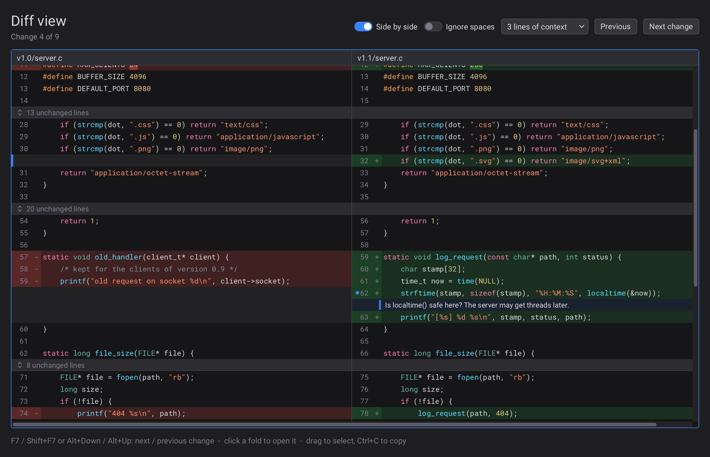

A `DiffView` shows what changed between two texts (two versions of a file,
of a setting, of a document), or a patch as `git diff` writes it, files and
hunks included. The removed and added lines are in one column (`Unified`) or
side by side (`Split`, where the lines of a change face each other and both
sides scroll together), with the numbers of the lines of both sides and the
words that changed inside a changed line marked. Unchanged lines are folded
away except `Context` lines around each change; a click on "20 unchanged
lines" shows them. With the extension of the names or `Language`, the code
is colored as in the text editor. Only the rows on screen are drawn: a
hundred thousand lines scroll as ten do. The text is selected and copied as
in an editor; F7 / Shift+F7 (or Alt+Down / Alt+Up) go from change to change,
`Rdiff_view_get_change` tells where each one is, and a click on a line or on
its number calls `Rdiff_view_set_line_clicked_callback`. Notes
(`Rdiff_view_add_annotation`) show under their line, which is never folded.

The comparison is Myers' algorithm in linear memory, after the lines found
on one side only are set apart (two texts with nothing in common cost no
more than reading them); a limit on the work keeps the worst cases (the
same few lines shuffled) bounded, with a result a little longer than the
shortest one. Two files of 50 000 lines with 1% of them changed are compared
in a few milliseconds. `R_DIFF_IGNORE_TRAILING_SPACE`, `R_DIFF_IGNORE_SPACE`
and `R_DIFF_IGNORE_CASE` decide which lines are the same. The colors are the
theme roles `R_COLOR_DIFF_ADDED`, `R_COLOR_DIFF_REMOVED` and their `_WORD`
shades. Screen readers read each row ("added line 12: return 0;").

### Tables, dates and the small controls

```xml
<Table Name="people" Striped="true" Slot.Fill="1">
    <Column Header="Name" Width="160"/>
    <Column Header="Age" Width="60" Align="Right"/>
    <Column Header="City" Fill="1"/>
    <Row>Ada|36|London</Row>
</Table>
<HBox Spacing="8">
    <DatePicker Date="Today" FirstDayOfWeek="Monday"/>
    <TimePicker Time="15:30" MinuteStep="15" TimeZone="America/New_York" ShowTimeZone="true"/>
    <Rating Value="4" AllowHalf="true"/>
</HBox>
<Breadcrumb Items="Home|Documents|Report"/>
<Pagination PageCount="20" Page="0"/>
```

A table virtualizes its rows as a list does (`Rtable_set_virtual_rows`); its
columns are resized by their edges and sorted by their headers. A
`TimePicker` shows the clock of the locale: 1 to 12 with AM and PM where it
is the usage (en-US, en-CA, en-AU, en-IN, hi, ar, ko, zh-TW...), 0 to 23
elsewhere, or what `Clock="12"` / `Clock="24"` says; A and P, or the arrows
on the AM/PM part, switch it, and its values stay on 24 hours. With a
`TimeZone`, it is a time of a day in that zone: `Rtime_picker_get_instant`
gives the instant, and `ShowTimeZone` writes the zone after it ("EST",
"CET"). A `DatePicker` gives the first instant of its day in its zone
(`Rdate_picker_get_instant`). A `Toast`, put
in an `Overlay`, shows a short message for a few seconds (`Rtoast_show`), with
an optional button ("Undo"). Messages that come while one is shown replace it,
wait their turn (`Queue="Sequence"`) or stack up, the newest at the bottom
(`Queue="Stack" MaxVisible="3"`), each with its own kind, button and time.
`Rnotification_show` asks the system for a
notification (Windows, macOS, `org.freedesktop.Notifications` on Linux) and,
where there is none, calls the fallback the application gave
(`Rnotification_set_fallback`), to show it in a toast for instance.

`Rnotification_show_desc` adds a tag (a notification shown again with the same
tag replaces the first one; `Rnotification_close` takes it away), up to three
buttons and an icon. What the user does with it comes back to
`Rnotification_set_callback`: a click on the notification
(`R_NOTIFICATION_ACTIVATED`, which also brings its window back: shown again,
out of the Dock or the taskbar, in front; `Rnotification_set_bring_to_front`
turns that off), a click on a button (`R_NOTIFICATION_ACTION_INVOKED` with its
id) or its dismissal. Where the system shows no notifications, a `Toast` given
to `Rnotification_set_fallback_toast` shows them with their title, icon and
buttons, and reports to the same callback: the application behaves the same
everywhere.

```c
static const RNotificationAction actions[] = { { "reply", "Reply" }, { "later", "Remind me" } };
RNotificationDesc desc = { sizeof(RNotificationDesc) };
desc.tag = "chat-ada";
desc.title = "Ada Lovelace";
desc.body = "Are we still on for tonight?";
desc.icon = "chat.svg";
desc.actions = actions;
desc.action_count = 2;
Rnotification_show_desc(&desc);
```

| | buttons | replace / close | icon | click | dismissal |
|---|---|---|---|---|---|
| macOS (in a bundle) | yes | yes | yes | yes | yes |
| Linux, BSD | where the server has them (GNOME, KDE, dunst, mako...) | yes | yes | where the server has buttons | yes |
| Windows (a balloon shown as a toast) | no | yes (one at a time) | no | yes | no |
| fallback toast | yes | yes | yes | yes | yes |

`Rnotification_supports(R_NOTIFICATION_FEATURE_ACTIONS)` and the other
features tell an application what the system does here.

SVG files are read wherever an image is (`Image Source="icon.svg"`,
`Rtexture_create_from_file`) and shown at the size the SVG gives. They are
drawn with as many pixels as they are shown with: once painted, an SVG is
drawn again on a worker thread for the density of the screen, an `Image` that
stretches it or a zoom, and again when the window moves to another monitor.
`Rtexture_create_from_svg` with a scale draws one at that scale only.

### Icons

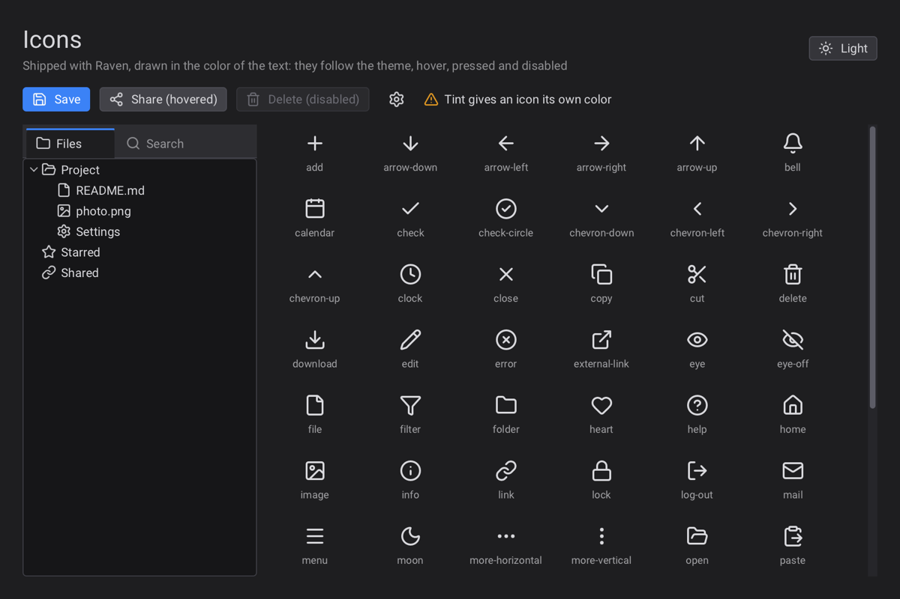

*`examples/icons`: every icon shipped with Raven, and some in buttons (one
hovered, one disabled), tabs and a tree; the button at the top right switches
to the light theme.*

```xml
<Button>
    <HBox Spacing="8">
        <Image Source="raven:save" Width="16" Height="16"/>
        <Label Text="Save"/>
    </HBox>
</Button>
<TreeView>
    <Item Text="Project" Icon="raven:folder"/>
</TreeView>
<MenuItem Text="Open" Icon="raven:open"/>
```

```c
Rid search = Ricon_get("search");               /* a texture owned by Raven, shared */
Rimage_set_texture(image, search);
Rmenu_item_set_icon(item, Ricon_get("save"), 0, 0, 1, 1, R_FALSE);
for (int i = 0; i < Ricon_get_count(); i++)     /* "add", "arrow-down"... in order */
    printf("%s\n", Ricon_get_name(i));
```

Raven ships a set of 63 icons for the usual actions: add, remove, close,
check, chevrons and arrows, menu, search, settings, edit, delete, copy, cut,
paste, undo, redo, save, open, folder, file, home, user, info, warning, error,
help, refresh, download, upload, share, link, lock, eye, star, heart,
calendar, clock, bell, mail, play, pause, stop, filter, sort, more,
external-link, zoom, print, sun, moon... They are the icons of
[Lucide](https://lucide.dev) (ISC License), drawn with lines on a grid of
24 x 24, and take 7 KB in the library. `Ricon_get` gives one by its name, and
XML names one with `raven:` wherever an image goes: `Image Source`,
`MenuItem Icon`, the `Icon` of a `TreeView` item, `Slot.Icon` (the tab of a
`TabView` with `Documents="true"`, a docked panel), a `Node Icon`, a Markdown
image. They are SVGs, drawn at the density they are shown with.

An icon takes the color of the text around it, and so does any SVG painted
only in `currentColor` (`fill="currentColor"`, `stroke="currentColor"`): it
is drawn once, in white, and the widget that shows it tints it with the color
of its text when it paints. It follows the theme, dark or light, hover,
pressed and disabled, and a `Color` given to a panel, without being drawn
again. A `Tint` on the `Image` gives it a color of its own;
`Rdraw_image` draws it in the color it is given; `Rtexture_uses_current_color`
tells such a texture. In an SVG that also uses other colors, `currentColor`
is black, as in an SVG shown on its own.

Animated GIF and APNG files play in an `Image`, wherever the image comes from
(`Image Source="loading.gif"`, `Rtexture_create_from_file`, a texture made
from memory or on a worker thread). The frames follow the clock of the
animations: `Rset_animation_speed` slows them, `Rtest_set_deterministic`
makes them advance by a fixed step for tests, and with reduced motion
(`Rset_animations_enabled(R_FALSE)`) the image stays on its frame. An image
only asks for frames while it is painted: hidden, scrolled away or in a
window that is not shown, it costs nothing and goes on from where it was;
between two frames of the GIF the window sleeps instead of drawing at the
rate of the screen. Each `Image` has its own playback:

```c
Rid image = Rwidget_create(R_WIDGET_IMAGE);
Rimage_set_texture(image, Rtexture_create_from_file("spinner.gif"));
Rimage_set_loop_count(image, 3);           /* -1: as the file says, 0: forever */
Rimage_set_finished_callback(image, on_done, NULL);
Rimage_pause(image);                       /* Rimage_play, Rimage_stop */
Rimage_set_frame(image, 0);                /* Rimage_get_frame_count, _get_duration */
```

```xml
<Image Source="intro.gif" Loop="1" Action="intro_done"/>
<Image Source="badge.png" Animate="false"/>
```

The disposal and blend operations, transparency, local palettes, interlaced
GIFs and the loop count (NETSCAPE2.0, `acTL`) are followed; frames of 10 ms
or less last 100 ms, as in browsers. Nothing is decoded ahead: a playing
image composes the frame it shows into one canvas of the size of the
picture, so its memory does not grow with the number of frames (going back
to an earlier frame composes again from the first). `Rimage_decode_info` and
`Rimage_decode_frame` read the frames of a file without a widget. Other
widgets that draw an animated texture (a `Button` icon...) show its first
frame.

### Charts

`Chart` draws the charts of dashboards, where `Plot` draws curves over axes:
a pie or a donut of slices, a gauge with colored bands, a heatmap, and a
sparkline to put in a tile or in a cell of a table.

```xml
<Chart Kind="Donut" Title="Sessions by browser" CenterCaption="sessions">
    <Slice Label="Chrome" Value="6420"/>
    <Slice Label="Safari" Value="2310"/>
    <Slice Label="Other" Value="1070"/>
</Chart>
<Chart Kind="Gauge" Title="CPU" Min="0" Max="100" Value="64" Format="%.0f%%">
    <Band From="0" To="60"/> <Band From="60" To="85"/> <Band From="85" To="100"/>
</Chart>
<Chart Kind="Heatmap" RowLabels="Mon|Tue|Wed" ColumnLabels="9h|12h|15h|18h">
    <Row Values="3 8 5 2"/> <Row Values="4 9 6 3"/> <Row Values="2 7 7 5"/>
</Chart>
<Chart Kind="Sparkline" Height="40" Values="31 33 32 35 38 37 41 40 44 48"/>
```

```c
Rid pie = Rchart_create(R_CHART_PIE);
Rchart_set_title(pie, "Visits by source");
Rchart_add_slice(pie, "Organic", 18420);
Rchart_add_slice(pie, "Direct", 10530);
Rchart_set_slice_clicked_callback(pie, on_slice, NULL);

Rid load = Rchart_create(R_CHART_GAUGE);
Rchart_set_format(load, "%.0f%%");
Rchart_add_band(load, 0, 60, 0, 0, 0, 0);     /* alpha 0: success, warning, danger of the theme */
Rchart_add_band(load, 60, 85, 0, 0, 0, 0);
Rchart_add_band(load, 85, 100, 0, 0, 0, 0);
Rchart_set_value(load, 72);

Rchart_push_value(spark, latency_ms, 60);      /* live data: the last 60 values */
```

The colors come from the theme (the accent, then a palette made for dark and
light themes; bands take the success, warning and danger colors in turn), and
the values glide to their new place when they change. The pointer over a slice
lifts it and tells its value and share (in the middle of a donut); over a cell
or a point of a sparkline, its value. A click selects a slice or reports a
cell (`Rchart_set_cell_clicked_callback`). Screen readers hear a pie as its
slices and their shares, and a gauge as a meter. `examples/charts` is a small
dashboard made of them.

### Files that are loaded again

An interface created from a file is watched while the application runs:
save `editor.xml` and the window follows, keeping the widgets the file did
not change (their handles, their callbacks, what was typed or scrolled).
Theme files and the files of declared tags are watched too.
`Rxml_set_reload_callback` tells when it happened;
`Rxml_set_live_reload(R_FALSE)` or `RAVEN_LIVE_RELOAD=0` turns it off.

### Translations

```csv
key,en,fr,ar
menu.file,File,Fichier,ملف
greeting,"Hello, {0}!","Bonjour, {0} !",مرحبا {0}
files.one,{n} file,{n} fichier,ملف واحد
files.other,{n} files,{n} fichiers,{n} ملفات
```

```c
Rlocale_load_csv("strings.csv");
Rlocale_set_language(Rlocale_get_system_language());
Rlabel_set_text(label, Rtr("menu.file"));
const char* args[] = { "Ada" };
Rlabel_set_text(hello, Rtr_format("greeting", args, 1));
Rlabel_set_text(count, Rtr_plural("files", 3));          /* "3 fichiers" */
Rlabel_set_text(size, Rlocale_format_number(1234.5, 1)); /* "1 234,5" */
Rlabel_set_text(time, Rlocale_format_time(15, 5, 0, R_FALSE)); /* "3:05 PM" in en-US, "15:05" in fr */
```

```xml
<Strings Source="strings.csv"/>
<Button Text="@menu.file" Tooltip="@menu.file.tip"/>
```

A text that starts with `@` is a key: the widget follows the language when it
changes. One column per language, any number of tables, plurals with the
CLDR rules, and the tables are read again when they are saved (live reload).
Times are written on 12 hours with AM and PM where the language does so (the
time data of CLDR), or as the user set the system when the application chose
no language; `Rlocale_set_clock` forces one, and the keys `Raven.AM` and
`Raven.PM` translate AM and PM. `raven_locale.h` has the rest.

**Time zones** come from the tz database of the system, read directly: the
files of `/usr/share/zoneinfo` (Linux, macOS, iOS, BSD, with the rule of
their footer for the years after their last change), the `tzdata` file of
Android, the ICU of Windows 10 (version 1903 and later), `Intl` in a browser.
No library is added.

```c
double now = (double)time(NULL);
int y, mo, d, h, mi, s;
Rtimezone_to_local("Europe/Paris", now, &y, &mo, &d, &h, &mi, &s);
double t = Rtimezone_from_local("America/New_York", 2026, 3, 8, 2, 30, 0); /* skipped: 03:30 EDT */
Rlabel_set_text(zone, Rtimezone_get_label("Europe/Paris", now));        /* "CET, UTC+1" */
```

A local time the clocks skip (spring forward) is moved forward by the length
of the gap; one they repeat (fall back) is taken the first time, still on
summer time; `Rtimezone_count_local` says which (0, 1 or 2 instants).
`Rtimezone_get_system` names the zone of the system, and
`Rtimezone_set_directory` reads a database shipped with the application
instead.

### Right to left, scripts and emoji

A language written from right to left (Arabic, Hebrew, Persian, Urdu...)
mirrors the layouts: boxes, grids, menus, scroll bars and alignments start on
the right. `Rset_layout_direction(R_DIRECTION_RTL)` forces it for every
window, `Rwidget_set_direction` or `Direction="RightToLeft"` for one part.
Text with both directions is ordered with the Unicode bidirectional
algorithm and Arabic letters take their joined forms. A character the
bundled font does not have is drawn with a font of the system (Segoe UI,
Noto, the CJK fonts...), and color emoji are drawn in color.

### Input methods

Chinese, Japanese and Korean input methods, dead keys and the character
palette type into a `TextInput`, a `SpinBox` and a `TextEditor`. The text
being composed is drawn in the field at the caret, underlined (the clause
being converted thicker), and is not part of the text until it is committed:
no changed callback runs for it. The candidate window of the system opens
under the caret.

| Platform | |
|---|---|
| macOS | `NSTextInputClient` (any input source of the system) |
| Windows | IMM32; the input method is off while the focus is not in a text field |
| Wayland | `text-input-v3` where the compositor offers it (GNOME, KDE, wlroots...): IBus, Fcitx and the others run by the compositor; enabled only while the focus is in a text field |
| X11 | XIM; the composition drawn in the field (on the spot) when the input method can (IBus, Fcitx), in the input method's own window otherwise |
| iOS, Android | the text services of the on-screen keyboard |
| Host platform | `Rhost_inject_composition` from the application's own input method |

`Rwindow_inject_composition` and `Rwindow_get_text_composition` drive and read
the composition (tests, a host that has its own input method).

### Spell checking

```xml
<TextInput SpellCheck="true" Placeholder="Subject"/>
<TextEditor SpellCheck="true" SpellLanguage="fr" Wrap="true"/>
```

A `TextInput` or a `TextEditor` with `SpellCheck="true"`
(`Rtext_input_set_spell_check`, `Rtext_editor_set_spell_check`) underlines
the misspelled words with a wavy line of the theme's `Spelling` color, but not
the word being typed at the caret. A right click on one opens a menu with up
to five corrections, *Ignore Spelling* (for the session) and *Add to
Dictionary*; the keys `Raven.SpellIgnore`, `Raven.SpellLearn` and
`Raven.SpellNoGuesses` translate it. A `TextEditor` checks only the lines it
shows, and a line again only when it changes, a few milliseconds of them per
frame: typing in a text of 50,000 lines checks one line.

Spell checking is off by default: existing forms and code editors look as
before, and a field that holds names, codes or passwords is not covered in
red. Turn it on where people write prose.

| Platform | Checker |
|---|---|
| macOS | `NSSpellChecker` (the languages and the dictionary of the user in the settings of the system) |
| Windows 8 and later | the spell checker of Windows (`ISpellCheckerFactory`) |
| Linux, BSD | Enchant 2 (`libenchant-2.so.2`), else Hunspell (`libhunspell`) with the dictionaries in `/usr/share/hunspell`, `/usr/share/myspell` or `$DICPATH`; both loaded at run time |
| iOS, Android, web | none: `Rspell_is_supported` is `R_FALSE` and nothing is underlined |

The language is the widget's (`SpellLanguage`), else `Rspell_set_language`,
else the language of the locale (`Rlocale_get_language`), else the system's;
`"fr"` finds `fr_FR`. `Rspell_check`, `Rspell_suggest`, `Rspell_learn`,
`Rspell_ignore` and `Rspell_get_language_count` / `_at` use the same checker
from code.

### Accessibility

```c
Raccessibility_follow_system();                  /* text size, contrast, motion of the OS */
Raccessibility_set_text_scale(1.5f);             /* every text and control 50 % larger */
Raccessibility_set_high_contrast(R_TRUE);        /* High Contrast Dark / Light themes */
Raccessibility_set_color_filter(R_COLOR_FILTER_DEUTERANOPIA);
Rwidget_set_accessible_name(close_button, "Close");
Raccessibility_announce("File saved", R_FALSE);
```

Custom controls can expose a screen-reader press action without changing their
pointer or keyboard handlers. Set their role and name, then call
`Rwidget_set_accessible_action(widget, press, user_data)`. The callback runs on
the UI thread and may destroy the widget; disabled controls cannot be pressed.
Pass `NULL` to restore the widget's default action. For a toggle, use
`Rwidget_set_accessible_checked(widget, 0)` or `1`; the application updates that
state from its callback. `-1` restores the class-derived checked state (a custom
widget is not checkable by default). Both are exposed through native screen
readers and the browser accessibility tree.

```xml
<Button Icon="close.png" AccessibleName="Close" AccessibleDescription="Closes the document"/>
```

Every widget is seen by the screen reader of the system with its role,
name, value and state, and can be used from it (press, toggle, set a value,
edit text, move the focus): UI Automation on Windows (Narrator, NVDA, JAWS),
NSAccessibility on macOS (VoiceOver), AT-SPI on Linux (Orca),
UIAccessibility on iOS (VoiceOver) and an `AccessibilityNodeProvider` on
Android (TalkBack, Switch Access). Nothing has to be added: names come from
the texts and from the label in front of a field. On a touch screen a double
tap presses, toggles, selects or focuses, and a swipe up or down moves a
slider or a spin box by its step; the widgets out of view are left out.
The color filters correct (or, for designers, simulate) protanopia,
deuteranopia, tritanopia and achromatopsia.

### Testing your interface

`raven_testing.h` drives an interface the way a user does and checks what it
shows: widgets are found by their `Name`, clicked, typed into, dragged,
scrolled and tapped through the same input path as the window system (no
event is sent to the OS), frames are produced until nothing moves, and the
window, or one widget, is compared with a golden PNG file.

```c
Rid window = Rwindow_create_from_xml_file("login.xml");
Rtest_set_deterministic(R_TRUE);                /* fixed clock, carets that do not blink */

Rtest_type_text(Rtest_find(window, "user"), "ada");
Rtest_click(Rtest_find(window, "form/submit")); /* a name, or a path of names */
Rtest_settle(2.0);                              /* frames until animations and layout are done */

if (strcmp(Rtest_get_text(Rtest_find(window, "status")), "Welcome, ada") != 0) return 1;

RGoldenOptions options = { .channel_tolerance = 8, .per_platform = R_TRUE };
RGoldenResult result;
if (!Rtest_expect_golden(window, "goldens/login.png", &options, &result)) {
    printf("%s\n", result.message);             /* what differs, and where the pictures are */
    return 1;
}
```

There is also `Rtest_double_click`, `Rtest_right_click`, `Rtest_click_at`
(a position, a button, modifiers), `Rtest_hover`, `Rtest_drag`,
`Rtest_drag_to`, `Rtest_scroll`, `Rtest_key`, `Rtest_tap`, `Rtest_swipe`,
`Rtest_pump` (a number of frames), `Rtest_is_idle`, `Rtest_is_shown` and
`Rtest_is_checked`. A test is an ordinary program run by `ctest` or any
runner: `examples/ui_test` is one.

When a golden does not match, `NAME.actual.png` (what was drawn) and
`NAME.diff.png` (the golden faded, the different pixels in red) are written
beside it, or in `options.output_directory`. Run the tests with
`RAVEN_UPDATE_GOLDENS=1` to write the goldens again. Headless tests use
the null backend, which draws nothing; goldens need the GPU backend (Metal
renders offscreen on macOS; Vulkan renders without a window system where
the driver has `VK_EXT_headless_surface`, as `test_render` does). What a GPU draws differs slightly
between backends, so keep one golden per OS and backend
(`per_platform` names them `login.macos-metal.png`, `login.linux-vulkan.png`...)
and allow a small tolerance for the rounding of different GPUs. Text is
rasterized by Raven with its bundled fonts, so the goldens do not change with
the fonts of the system. `Rimage_save_png` and `Rimage_encode_png` write any
capture as a PNG file.

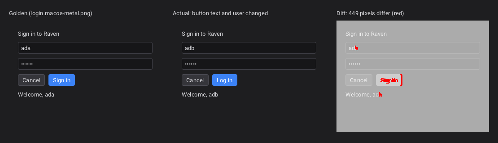

### Driving any application headlessly

Any Raven application can be run without a window on the screen, driven by a
script, photographed and read as JSON, without a change of its code: Raven
reads a few environment variables in `Rinit`. This is for automated tests of
a finished program, screenshots for documentation, bug reports that replay
themselves, and agents that use the interface the way a user does. It works
the same for programs written in C and in every binding.

```sh
# the tree of the widgets as JSON, and a picture of each window
RAVEN_HEADLESS=1 RAVEN_TREE=tree.json RAVEN_SNAP=window.png ./raven_hello

# a script of steps; the exit code says whether it passed
RAVEN_HEADLESS=1 RAVEN_SCRIPT=examples/headless/music.script ./raven_music
```

| Variable | |
|---|---|
| `RAVEN_HEADLESS=1` | no window system: the windows are rendered offscreen. With the other variables alone, the run is driven in real windows |
| `RAVEN_SCRIPT=file` | the steps to run (below) |
| `RAVEN_SNAP=out.png` | at the end, a PNG of each window (`out.png`, then `out.2.png`...) |
| `RAVEN_TREE=tree.json` | at the end, the tree of every window as JSON (`-`: the standard output) |
| `RAVEN_FILM=dir/` | a PNG per frame of the run (`dir/00000.png`...) with a ring where the pointer clicks, and `dir/marks.txt` |
| `RAVEN_FRAMES=N` | wait N frames for the application to start, instead of waiting until nothing moves (at most 5 s) |
| `RAVEN_SIZE=800x600` | the size of the first window, in logical units |
| `RAVEN_SCALE=2` | pixels per logical unit of the pictures (`Rset_ui_scale`) |
| `RAVEN_THEME=Light` | a theme or a look (`Rtheme_use`) |
| `RAVEN_BACKEND=metal`, `vulkan`, `null` | the renderer. Without it, a headless run whose GPU backend cannot start goes on with the null backend: the tree and the checks work, there are no pictures |
| `RAVEN_TIMEOUT=2` | seconds a step waits for its widget, or a check to become true |
| `RAVEN_STEP_FRAMES=12` | frames left after each input (12 by default with a film, else 0) |
| `RAVEN_DETERMINISTIC=0` | the real clock instead of 1/60 s per frame (`Rtest_set_deterministic`) |

The run waits for the first window and for it to settle, runs the script one
frame at a time inside the loop of the application (`Rwait_frame` does not
sleep meanwhile), writes the pictures and the tree, and ends the application
with `Rquit`. The exit code is 0 when everything passed, 1 when a step or a
check failed, 2 when the script cannot be read; a failed run ends the
process with that code in `Rshutdown`, whatever `main` returns. What failed is
written on the standard error with the line of the script:

```
raven: FAILED login.script:7: expect: "status" reads "Type a user name", expected "Welcome, ada"
```

A script has one step per line; `#` starts a comment and `"..."` keeps
spaces (`\"`, `\\`, `\n`, `\t`). A widget is named by its `Name` or a path of
names (`form/submit`, as `Rtest_find`), by what it reads (`text:Sign in`: the
first one shown), or a point of the window by `@x,y` (logical units). Steps
wait for their widget to be shown, and checks for their state to become true,
up to the timeout. Steps that use the keyboard act on what has the focus, or
on a widget named first.

| Step | |
|---|---|
| `click W [Ctrl+Shift]`, `double W`, `right W`, `hover W` | the mouse, on the middle of a widget or at a point |
| `type [W] "text"` | types text (`\n` is Enter) |
| `key [W] Ctrl+A` | a key with modifiers: `Enter`, `Tab`, `Escape`, `F5`, `Shift+Tab`, `Cmd+S`... |
| `drag W DX DY`, `drag W W2` | drags by an offset, or onto another widget |
| `scroll W DY [DX]` | notches of the wheel (positive: toward the top) |
| `tap W`, `swipe W DX DY [SECONDS]` | a finger |
| `wait N`, `wait 0.5s` | frames, or seconds of the clock of the run |
| `settle [SECONDS]` | frames until nothing moves (5 s at most) |
| `snap NAME [W]` | `NAME.png` of the window, or of one widget |
| `tree NAME [W]` | `NAME.json`: the tree of every window, or of one widget |
| `expect W text "..."`, `contains "..."` | what the widget reads (`Rtest_get_text`) |
| `expect W shown`, `hidden`, `checked`, `unchecked`, `enabled`, `disabled`, `focused`, `exists`, `missing` | its state |
| `mark NAME` | a named point of the run, printed, and in `marks.txt` of a film |
| `action NAME`, `theme NAME`, `size W H`, `window TITLE`, `timeout SECONDS`, `echo TEXT` | fires an action; changes the theme, the size of the window, the window the steps act on, the timeout; prints |

```
# examples/headless/music.script: examples/music, which knows nothing of it
click "text:Focus flow"
expect collection.title text "Focus flow"
click search.query
type "Static"
key Enter
settle 1
expect "text:Cathedral in Berlin" shown
snap music-search
```

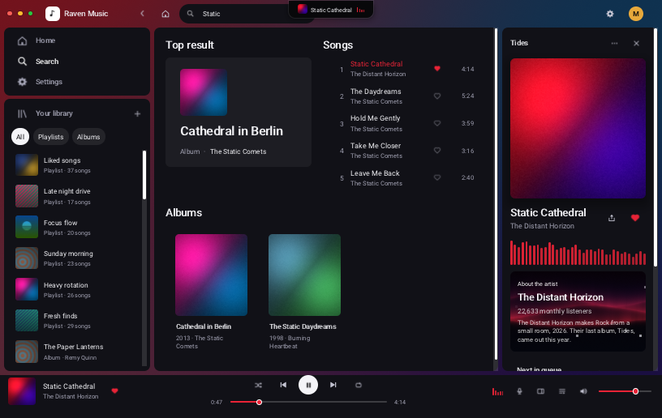

The tree gives, for every widget, what a test or an agent needs to find it
and act on it: its type, its name and path, its accessibility role, what it
reads, its bounds in logical units of its window, and its state; lists give
their rows (`items`). The open popups and the island of a window are in it
too.

```json
{ "type": "TextInput", "name": "user", "path": "form/user", "role": "text field",
  "text": "ada", "label": "Sign in to Raven", "bounds": [20, 48, 300, 26],
  "shown": true, "enabled": true, "editable": true }
```

Pictures need a GPU backend: Metal renders offscreen on macOS, Vulkan where
the driver can render without a window system. The null backend draws
nothing, so with it `snap` writes nothing (and says so) while the tree and
the checks still work. Raven does not encode video: make one from a film
with a tool of your choice, for example
`ffmpeg -framerate 60 -i dir/%05d.png -pix_fmt yuv420p run.mp4`.

From a program, the same is `Rtest_dump_tree` and `Rtest_save_tree` (the
JSON), `Rtest_save_png` (a window or a widget) and `Rtest_run_script` (a
script, in a test; `Rtest_get_script_error` says why it failed).

### Web pages

The web engine of the system, in a view embedded in the window and kept over
a widget: WKWebView on macOS (and iOS). WebKit is opened when the first view
is made; a program that shows no page does not load it.

```c
Rid view = Rsystem_web_view_create();                       /* <SystemWebView Url="https://..."/> */
Rsystem_web_view_load_url(view, "https://example.org");     /* or _load_file, _load_html(html, base_url) */
Rsystem_web_view_set_message_callback(view, on_message, NULL);  /* window.raven.postMessage(value) in the page */
Rsystem_web_view_run_javascript(view, "document.title", on_result, NULL);  /* the result as JSON, later */
```

The page follows the widget (its place, its size, its visibility, the part a
`ScrollBox` lets be seen) and takes the mouse and the keyboard as a browser
does. As with a native child window, Raven cannot draw over it: a popup or a
menu that crosses it goes under it. `Rsystem_web_view_is_supported()` tells
whether pages are shown: on Windows, Linux, Android and in the browser it is
false for now, and the widget shows a message in place of the page, so the
same program and the same XML run everywhere.

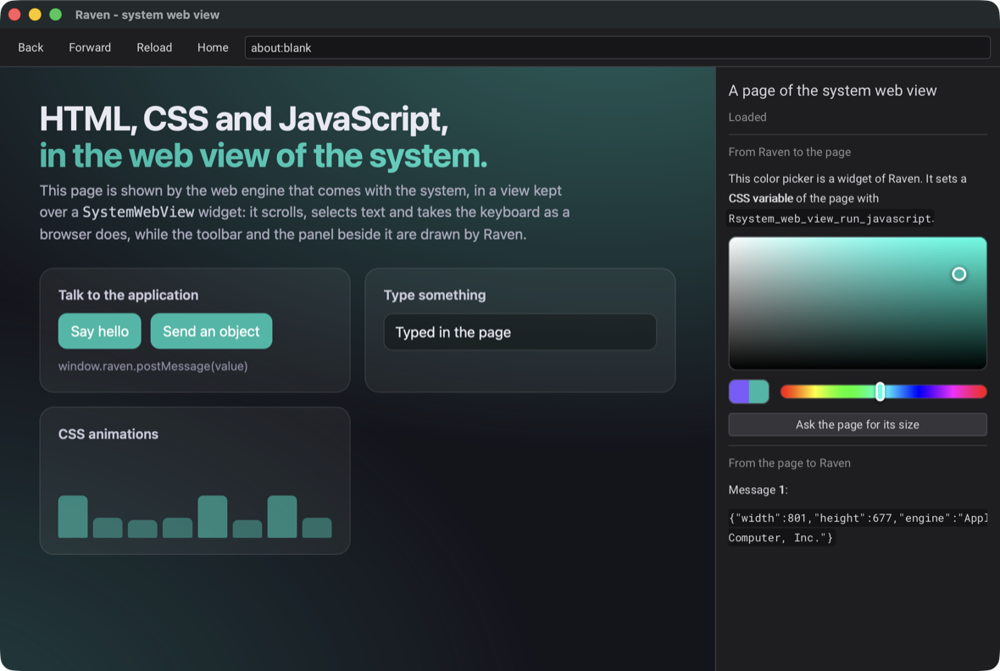

On any system, `raven_web` shows pages through a browser that is installed:

```c
#include <raven_web.h>                      /* part of the Raven library (raven::web is kept as an alias) */
Rweb_register_xml();                        /* <WebView Url="https://..."/> */
Rid view = Rweb_view_create();
Rweb_view_load_url(view, "https://example.org");
Rweb_view_run_javascript(view, "document.title", on_result, NULL);
```

`raven_web` shows real web pages by driving a browser of the Chromium family
that is already installed (Edge on Windows): the page arrives as pictures in
a texture, the input goes back. It contains no browser and nothing is
needed to build it; without a browser, a web view only shows that it has none. What it can and cannot do is in [docs/WEB.md](docs/WEB.md).


### Island

```xml
<Window ...>
    <Island>
        <Label Text="3 messages"/>                      <!-- folded   -->
        <VBox> ... anything ... </VBox>                 <!-- unfolded -->
    </Island>
    <VBox> ... the content of the window ... </VBox>
</Window>
```

A pill at the top of the window that unfolds under the pointer, on a click,
or from C (`Risland_set_expanded`, `Risland_expand_for(island, 2.0)` to say
something and fold back). Its two contents cross-fade while it changes size,
a click pins it open and a click elsewhere closes it. It is dark whatever
the theme, as the notch of a phone is (`Theme="Default"` gives it the theme
of the window). It is optional, and an `Island` can also be used as an
ordinary widget anywhere.

### Picture in picture

```c
Rwindow_set_picture_in_picture(player, R_TRUE);   /* and R_FALSE to come back */
```

The window becomes a small floating window above all the others, on every
desktop (every space of macOS, over full-screen applications too), in a
corner of the work area. It loses its title bar: its empty parts move it, its
edges resize it, its proportions are kept. Leaving gives back its size, place,
frame and state. `Rwindow_set_picture_in_picture_layout` chooses its size and
corner; a button with `OnClicked="window.picture_in_picture"` goes in and out.
Wayland does not let an application keep a window above the others: the call
returns `R_FALSE` there.

### Splash screen

```xml
<Window Title="Loading" Width="480" Height="280" IsSplashScreen="true">
    <Image Source="splash.png"/>
</Window>
```

`IsSplashScreen="true"` (or `R_WINDOW_SPLASH_SCREEN` given to
`Rwindow_create`) makes a splash screen: no frame and a fixed size, centered
on the screen before it is first shown and again when its size changes, above
the other windows, out of the taskbar and of Alt+Tab on Windows, out of the
Window menu on macOS, typed as a splash for the window manager on X11. On
Wayland it is a window without frame. Create the main window, then destroy
the splash: the application keeps running between the two.

### The menu bar of macOS

On macOS, the first `MenuBar` of a window goes to the menu bar at the top of
the screen while the window is the active one, after the menu of the
application (About, Hide, Hide Others, Show All, Quit). It then takes no room
in the window; its entries, check marks and shortcuts are those of the system
(`R_MOD_SUPER` is Command, `R_MOD_CTRL` Control). Quit, and Cmd+Q, fire the
action `app.quit`, which an application may bind to ask first. Elsewhere the
bar is drawn in the window; `Rmenu_bar_set_native(bar, R_FALSE)` or
`<MenuBar Native="false">` keeps it there on macOS too.

`Rmenu_item_set_shortcut_text(item, "G G")` (XML: `ShortcutText`) sets a copied,
display-only hint, including chords or mouse gestures. It overrides the formatted
shortcut label without adding or changing a binding. `NULL` restores the bound
shortcut label; an empty string hides it. In native macOS menus, hints use a
right-aligned text column; any independently configured binding is dispatched
by Raven.

In-window bars support `Rmenu_bar_add_divider(bar)` between menu titles and
`Rmenu_set_title_color(menu, r, g, b, a)` for a title tint (alpha zero restores
the theme). Native macOS bars omit these decorations. `Rmenu_add_header(menu,
"Devices · pdk1")` adds a secondary-text caption that cannot be activated and
is skipped by keyboard navigation. Screen readers see it as a heading; native
macOS menus use section headers on macOS 14+ and a disabled caption on older
systems.

### Taskbar and Dock

```c
Rwindow_set_taskbar_progress(window, R_TASKBAR_PROGRESS_NORMAL, 0.4f);
Rtaskbar_set_badge("3");                      /* NULL removes it */
Rwindow_request_attention(window, R_FALSE);   /* R_TRUE: until the user comes */
Rtaskbar_set_menu(menu);                      /* the menu of the icon in the Dock */
```

A progress bar and a badge on the icon of the application: on the taskbar
button of the window (Windows; the badge is a small round icon drawn from its
text), on the Dock icon (macOS), on the launchers of Linux desktops that
listen to `com.canonical.Unity.LauncherEntry` (KDE, Ubuntu Dock, Dash to
Dock, Plank; the badge is a number there). A request for attention flashes
the taskbar button, bounces the Dock icon or marks the window urgent. On
macOS a `Menu` becomes the menu of the Dock icon, whose entries fire as when
clicked; Quit from the Dock goes through `app.quit`. On Windows,
`Rtaskbar_set_jump_list` fills the tasks of the jump list: each starts the
application again with its arguments. Each call returns `R_FALSE` where the
system has nothing to show it with.

### Tray icon

```c
Rid tray = Rtray_create();                    /* R_INVALID_ID where there is no tray */
Rtray_set_icon(tray, rgba, 32, 32);           /* RGBA pixels, copied */
Rtray_set_tooltip(tray, "Sync: up to date");
Rtray_set_menu(tray, menu);                   /* a Menu: shown on a click */
Rtray_set_clicked_callback(tray, on_tray, NULL);
```

An icon beside the clock: in the notification area of Windows, as a status
item in the menu bar of macOS, as a `StatusNotifierItem` on Linux (KDE,
GNOME with the AppIndicator extension, XFCE, waybar...), its menu served over
`com.canonical.dbusmenu`. The menu is a `Menu` like the others: its entries
fire their callbacks and actions, and changes to it reach the system on the
next frame. The callback receives the button: the left one for a click (also
on Linux when the panel calls `Activate`), the right one when the icon has no
menu. On macOS, an icon with a menu opens it and does not call the callback.
While an icon exists, the application keeps running after its last window
is closed: `app.quit` (or a Quit entry in the menu) ends it.
`Rtray_is_supported` says whether the desktop shows such icons now.

### Memory

Raven does not call `malloc`. It takes memory from the system by regions of
4 MB and hands it out with its own heap (TLSF: constant time, neighbours
merged when freed); the bundled font and image decoders use it too.

```c
RAllocator mine = { my_alloc, my_realloc, my_free, my_data };
Rset_allocator(&mine);                 /* before Rinit: every block goes through your functions */

RMemoryStats stats;
Rmemory_get_stats(&stats);             /* blocks, bytes in use, peak, taken from the system     */
```

`Rset_allocator(Rallocator_get_system())`, or the environment variable
`RAVEN_ALLOCATOR=system`, selects `malloc` (what Valgrind and heap profilers
follow; it is the default in a build with AddressSanitizer). `Rmemory_check`
verifies the heap, and the tests fail on a block left allocated after
`Rshutdown`.

### Threads

- The thread that calls `Rinit` is the **UI thread**. Every function is
  called from it, except the few documented as thread-safe (`Rtask_post`,
  `Rtask_run_async`, `Rwake_up`, `Rquit`, `Rwindow_request_redraw`,
  `Rget_time`, `Rmemory_alloc` / `Rmemory_realloc` / `Rmemory_free`).
- From another thread, change the UI by posting a task:
  `Rtask_post(function, data)` runs `function` on the UI thread.
- `Rtask_run_async` and `Rparallel_for` run your work on the worker threads.
- `Rtexture_create_from_file_async` decodes in the background; the widgets
  that use the texture update when it is ready.
- Viewport draw callbacks run on the **render thread**.

### Viewports

```c
/* 1. texture: any image, shown like a widget (clipped, UI on top) */
Rviewport_set_texture(viewport, texture);
/*    Vulkan, zero copy:   Rvulkan_texture_create_from_image_view(view, 0, w, h)
      OpenGL, zero copy:   Rvulkan_texture_create_shared + GL_EXT_memory_object
      anything, one copy:  Rtexture_update(texture, rgba, w, h)             */

/* 2. draw callback: your Vulkan draw calls in the render pass of the window */
Rviewport_set_draw_callback(viewport, on_draw, user);

/* 3. native child window: a HWND / X11 Window / Wayland wl_surface for OpenGL, Direct3D, anything */
Rviewport_set_native(viewport, R_TRUE);
Rviewport_get_native_handle(viewport, &native);
```

To render the UI with the device of an engine instead of a device created
by Raven, call `Rvulkan_set_external_device` (and
`Rvulkan_set_queue_lock_callbacks`) before `Rinit`: see `raven_vulkan.h`.

### Themes

`Rlook_set` chooses the look: the ones of Raven (`R_LOOK_RAVEN_DARK`,
`R_LOOK_RAVEN_LIGHT`, the glass and high contrast ones), the one of Windows 11
(`R_LOOK_WINDOWS_DARK`, `R_LOOK_WINDOWS_LIGHT`), of macOS
(`R_LOOK_MACOS_...` for Sequoia, `R_LOOK_MACOS_GLASS_...` for macOS 26 and
its Liquid Glass) and of GNOME (`R_LOOK_GNOME_...`) — their controls,
their colors, the accent and the font of the system — or the one of the
platform the program runs on (`R_LOOK_NATIVE_DARK`, `R_LOOK_NATIVE_LIGHT`). A theme is
laid over it:

```c
Rlook_set(R_LOOK_NATIVE_LIGHT);                                         /* the look of the platform              */
Rtheme_set_accent(0.13f, 0.83f, 0.93f);                                 /* one color, and the shades that follow */
Rtheme_set_color(R_COLOR_PANEL, 0.07f, 0.10f, 0.17f, 1.0f);             /* any color or metric of the theme      */
Rtheme_set_style_metric("Button", NULL, R_METRIC_CORNER_RADIUS, 16);    /* a style for a type of widget          */
Rtheme_set_style_color(NULL, "danger", R_COLOR_ACCENT, 1, 0.3f, 0.4f, 1); /* ... or for a class: Class="danger" */
Rtheme_load("themes/ocean.xml");  Rtheme_use("Ocean");                  /* a theme file                          */
```

```xml
<Theme Name="Ocean" Accent="#22D3EE" CornerRadius="10">
    <Colors Panel="#111A2C" Text="#DCE7F5"/>
    <Style Widget="Button" CornerRadius="16"/>
    <Style Class="danger" Accent="#FB7185"/>
    <Style Widget="Slider" Part="Thumb" State="Hovered" Background="#FFB340"/>
</Theme>
```

A theme file that names no look (`Look="WindowsDark"`) follows the look in
use. Styles reach the parts of widgets (`Part="Thumb"`) in their states
(`State="Hovered Pressed"`).

`Theme="Ocean"` (or `Theme="themes/ocean.xml"`) on a widget gives a theme to
that part of the interface only; on a `<Window>` (or `Rwindow_set_theme`), to
that window only, its menus, dialogs and background included, while the other
windows keep the theme of the application (`Rtheme_use`). Colors and metrics can
still be set on one widget (`Rwidget_set_color`, `Color.Accent="..."`).
[docs/THEMES.md](docs/THEMES.md) is the guide.

Fonts are TrueType files (`Rfont_create_from_file`, `Rtheme_set_font`,
`Rfont_set_fallback`, `Rfont_set_variant` for real bold and italic faces);
subsets of Roboto and of Roboto Mono covering Latin-1 and Latin Extended-A
are embedded.

### Custom widgets and custom backends

A `R_WIDGET_CUSTOM` widget is measured and painted by two callbacks using
the `Rdraw_...` functions (`raven_draw.h`), and receives its events through
`Rwidget_set_event_callback`. `Rxml_register_tag` gives it a tag of its own
in XML, with its attributes, and `Rwidget_set_destroy_callback` tells when
it is gone. A rendering backend is a `RBackendVTable`
(`raven_backend.h`) given to `Rbackend_register`;
`src/render/null/null_backend.c` is a template.

`Rdraw_shadow` draws a soft shadow or colored glow in a custom paint callback.
Its bounds, corner radius and blur are in logical units. Offset the rectangle
for a drop shadow, or paint it beneath a shape for a glow. It uses the same
batched shadow primitive as Border, with the current clip and opacity.

## Performance

`raven_benchmark` (built with the tests) measures a large tree without a GPU.
On the 2-core virtual machine used for development, release build:

| 12 000 widgets, 27 800 primitives | |
|---|---|
| first layout | 2 to 3 ms |
| full repaint | 1.3 to 2.3 ms, one draw call |
| layout after changing one label | 0.03 to 0.05 ms |

Parallel painting made little difference on that machine (two cores shared
with the render thread); measure on yours with `raven_benchmark 160 0` against
`raven_benchmark 160 -1`. Nothing is recomputed or drawn while nothing changes.

The glass materials were only run on a software Vulkan driver (SwiftShader,
two cores), where a frame of the `glass` example takes about 250 ms at
1100 x 720. That measures the CPU rasterizer, not the design: on a GPU the
cost is the blur passes, but it has not been measured. Read
`RFrameStats::render_ms` and `backdrop_count` on your machine.

## Layout of the repository

```
include/Raven.h      the whole public API in one include
include/raven/       ... one header per area
src/core/            allocator, handles, threads, job system, files, main loop
src/platform/        window systems behind one interface: win32/, x11/, wayland/, cocoa/, uikit/, android/, emscripten/, null/
src/render/          draw lists, fonts and glyph atlas, textures, render thread
src/render/vulkan/   the Vulkan backend and its shaders (vk_glass.c: backdrop blur)
src/render/metal/    the Metal backend (macOS, iOS) and its shaders in MSL, compiled at run time
src/widget/          widget base: tree, layout, events, painting, animation, windows, style, themes
src/widgets/         one file per widget type (text_editor.c, markdown.c, node_graph.c, timeline.c, dialogs.c...)
src/xml/             parser, loader, declared widgets, documents, watched files, the list of tags and attributes
web/                 web pages (raven_web.h), compiled into the Raven library
examples/            sixteen programs (bevy_editor: a scene editor in Rust; languages: one program in eight languages)
tools/designer/      raven_designer (main.c: the visual editor; files, island, strings, welcome, os)
tools/theme_editor/  raven_theme_editor
tools/bindgen/       writes bindings/ from the headers
bindings/            C++, Python, Rust, Go, C#, Zig, LuaJIT, Lua, Java, Odin, Bun, Node.js, D, Nim, C3, Swift, Haskell
tests/  docs/  cmake/  third_party/
build.bat  generate-cmake.bat  dist.bat  dist.sh  CMakePresets.json
```

[docs/ARCHITECTURE.md](docs/ARCHITECTURE.md) explains how the pieces work
and how to add a widget, a window system or a backend.

## Not implemented yet

The plan for what comes next is in [ROADMAP.md](ROADMAP.md).

What Raven does not do yet, by area. Contributions are welcome.

**Platforms**
- Notifications on Windows are balloons of the notification area: no buttons
  and no image of their own (the toasts of WinRT, with their actions, would
  need an application id and a COM activator). A click on a notification
  brings the window back everywhere but on Wayland, where Raven does not use
  xdg-activation yet (the token the notification server gives is not used).
- Wayland: placing windows (`Rwindow_set_position`, `Rwindow_center`), keeping
  one above the others (so picture in picture and splash screens too) and fading a whole window:
  the protocol does not let an application do it.
- Embedding the system web view on Windows (WebView2), Linux (WebKitGTK) and
  Android: `SystemWebView` shows pages on macOS and iOS only; elsewhere
  `raven_web` drives an installed Chromium-based browser instead.
- iOS and Android are experimental ([examples/mobile](examples/mobile/README.md)).
  On both, a window fills the screen: its size, position and title are left
  to the system. There are no native child windows, no tray icon, menu bar
  or badge of the system;
  notifications go to the fallback of the application
  (`Rnotification_set_fallback`, `Rnotification_set_fallback_toast`), and file dialogs are Raven's own. The text
  services of the system (suggestions, autocorrection, composition) work in a
  `TextInput`; a `TextEditor` or a `SpinBox` gets plain keys and text. The
  places known to be simplified are marked `SHORTCUT` in the sources.
- iOS: only the Simulator has been tried, not a device. Raven pauses the
  application's `CADisplayLink` while it has nothing to draw, but the function
  that hands it over (`rvn_uikit_set_display_link`) is not public API yet.
- Android: one window, the surface of the activity. The clipboard stays inside
  the application. The Back key reaches Raven as Escape, and the application
  decides what it means. The on-screen keyboard needs Raven's Java class
  (`src/platform/android/java`) in the APK; without it, key events only (no
  suggestions, ASCII only). The swapchain is not pre-rotated: the compositor
  rotates it.

**Text**
- Full OpenType shaping of complex scripts (Indic scripts, kerning); Arabic
  joining is done.
- Spell checking on iOS, Android and the web, and misspelled words reported
  to screen readers.
- In the text editor: a language server client; regular expressions in the
  search; folding by the tags of markup (XML and HTML fold by indentation).

**Windows and docking**
- Dragging from a Raven window to another application on X11 and Wayland
  (macOS and Windows have it); pictures and formats of the application on
  their clipboards (text and HTML only for now). Files made on demand when
  dropped (file promises).
- Glass over a native child window.

**Rendering**
- A GPU memory sub-allocator.
- Presenting several windows in one call.

**Widgets**
- Node graph: knots on links, groups and comments, a minimap, undo (for now the
  application holds the model and its history).
- Timeline: nested tracks, curves between keys.
- Markdown: images from the network, HTML, footnotes.

## Third-party code

`stb_truetype` and `stb_image` (public domain / MIT, Sean Barrett), `nanosvg`
(zlib, Mikko Mononen), a subset
of the Roboto font (Apache 2.0, Google), a subset of Roboto Mono (SIL Open
Font License 1.1) and 63 icons of Lucide (ISC, some MIT from Feather) are
included under `third_party/`; see
[THIRD_PARTY.md](THIRD_PARTY.md). The Vulkan headers (Apache 2.0 / MIT,
Khronos) are needed to build but are not part of this repository.
