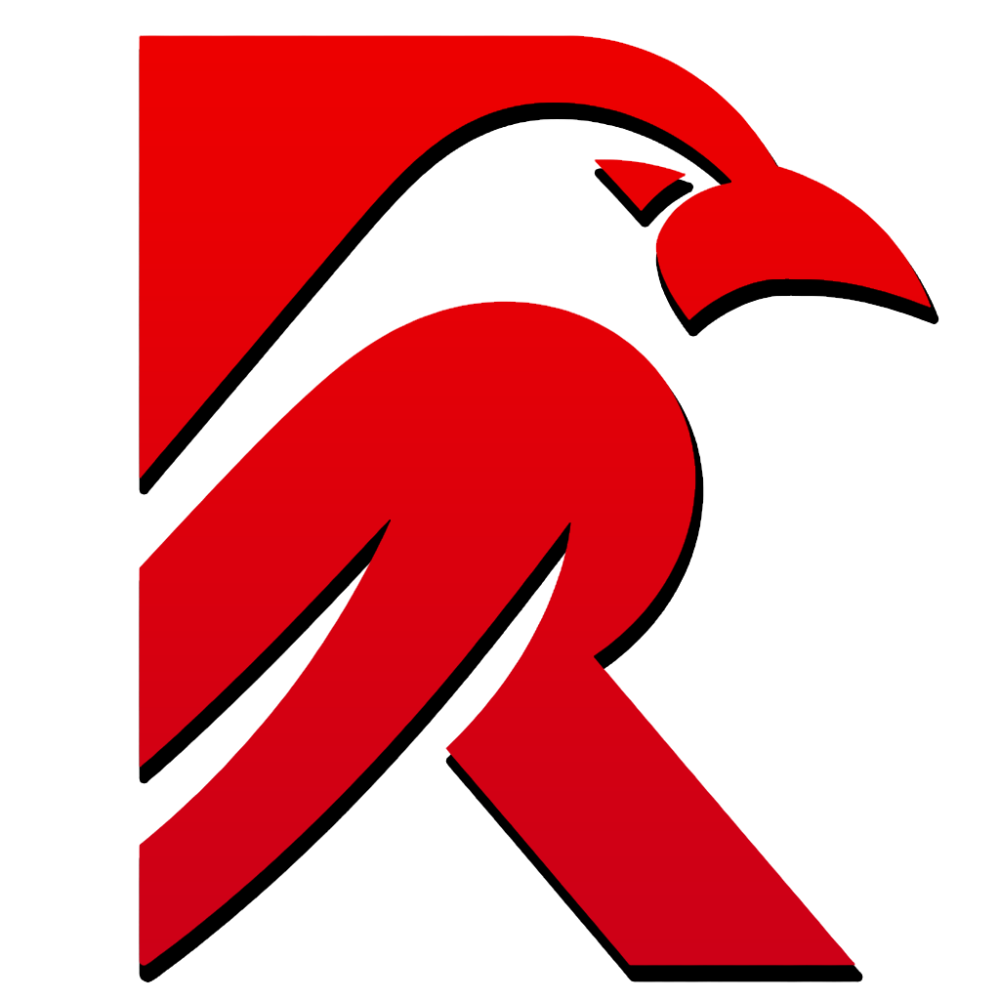
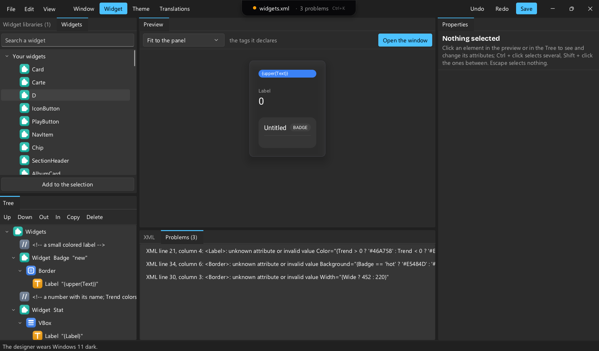
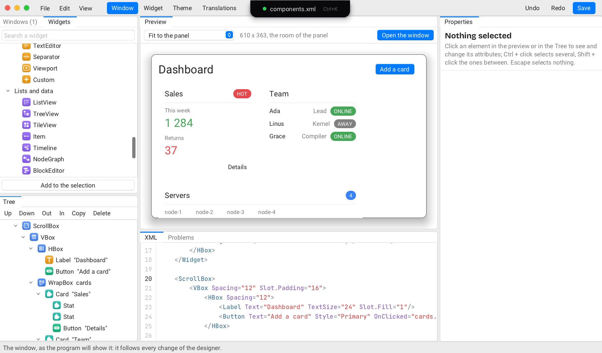
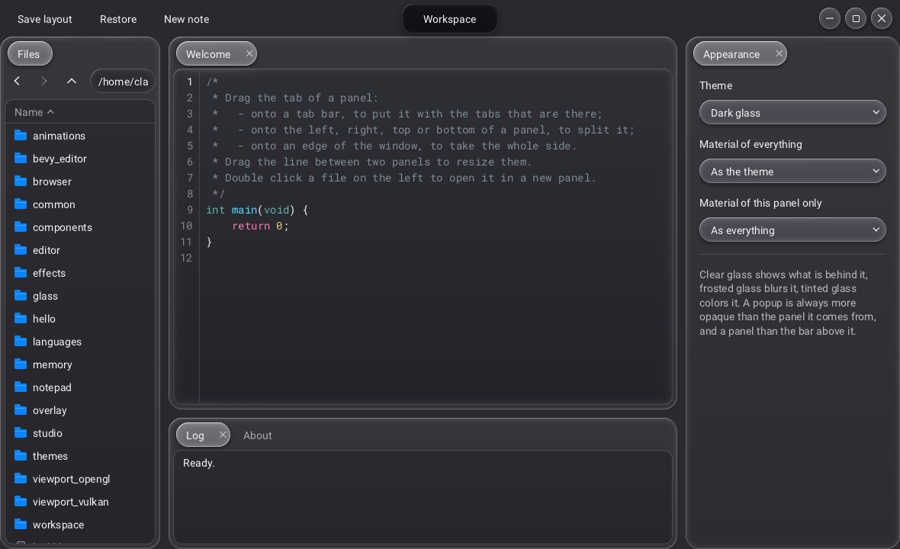
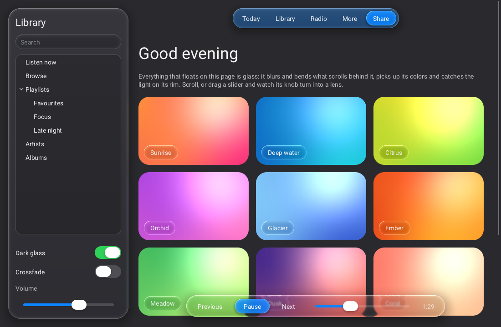

<p align="center">
  
</p>

<h1 align="center">Raven</h1>

<p align="center">
  A lightweight, multithreaded GUI library in C for editors and tools.
</p>

<p align="center">
<p align="center">
  <a href="docs/">
    
  </a>
  <a href="https://github.com/oscar-soirey/Raven/issues">
    
  </a>
  <a href="https://github.com/oscar-soirey/Raven/releases">
    
  </a>
  <a href="https://github.com/oscar-soirey/Raven/issues/15">
    
  </a>
  <a href="https://oscar-soirey.github.io/Raven/">
    
  </a>
  <a href="https://www.youtube.com/@oscar-soirey">
    
  </a>
</p>
</p>

Try the [web demo gallery](https://oscar-soirey.github.io/Raven/demos/) (WebAssembly and WebGL 2), or [build and preview it locally](docs/emscripten.md).

## Disclaimer : This project is still in active development and public API is subject to change.

## Build from source

> **For the latest features, clone and build Raven yourself** rather than
> downloading a release: the [releases](https://github.com/oscar-soirey/Raven/releases)
> and the packages of the bindings (PyPI, NuGet, crates.io, LuaRocks, Maven
> Central) are made from time to time, while the repository moves every day,
> so what this page describes may not be in the last release yet.
>
> ```
> git clone https://github.com/oscar-soirey/Raven.git
> cd Raven
> cmake -S . -B build -DCMAKE_BUILD_TYPE=Release
> cmake --build build --config Release --parallel
> ```
>
> `git pull` and the same `cmake --build` bring it up to date later.

Raven builds with CMake and a C11 compiler, and has no dependency to install
besides the X11 development package on Linux. The Vulkan *headers* are
downloaded automatically during the configuration (git and an internet
connection are needed for that), unless the [Vulkan SDK](https://vulkan.lunarg.com)
is installed. No Vulkan library is linked.

Each build below gives the library, the designer, the examples and the
tests. Add `-DRAVEN_BUILD_SHARED=ON` to the
configure command for a shared library (`raven.dll`, `libraven.so`,
`libraven.dylib`) instead of a static one.

### Windows (Visual Studio)

1. Install [Visual Studio 2022](https://visualstudio.microsoft.com/downloads/)
   (Community is fine) with the **Desktop development with C++** workload; it
   includes CMake. Install [Git](https://git-scm.com/download/win).
2. Open the **Developer PowerShell for VS 2022** and run:

```powershell
git clone https://github.com/oscar-soirey/Raven.git
cd Raven
cmake -S . -B build
cmake --build build --config Release --parallel
ctest --test-dir build -C Release --output-on-failure   # optional: the tests
cmake --install build --config Release --prefix install
```

The programs are in `build\bin\Release` (start `raven_editor.exe` or
`raven_designer.exe`); the library, its headers and the CMake package are in
`install\`. Shortcuts: `build.bat` does the configure and the build in one
command, `generate-cmake.bat --open` opens the solution in Visual Studio (see
[Build options and scripts](#build-options-and-scripts)).

### Windows (MinGW-w64)

1. Install [MSYS2](https://www.msys2.org), then in the **MSYS2 MINGW64** shell:

```sh
pacman -S --needed git mingw-w64-x86_64-gcc mingw-w64-x86_64-cmake mingw-w64-x86_64-ninja
git clone https://github.com/oscar-soirey/Raven.git
cd Raven
cmake -S . -B build -G Ninja -DCMAKE_BUILD_TYPE=Release
cmake --build build --parallel
cmake --install build --prefix install
```

This gives `libraven.a` (or `raven.dll` and `libraven.dll.a` in a shared
build). A MinGW library is for programs built with MinGW, not with Visual C++.

### Linux

1. Install a compiler, CMake, Git and the X11 headers:

```sh
sudo apt install build-essential cmake git libx11-dev ninja-build   # Debian, Ubuntu
sudo dnf install gcc cmake git libX11-devel ninja-build             # Fedora
sudo pacman -S base-devel cmake git libx11 ninja                    # Arch
```

2. Build:

```sh
git clone https://github.com/oscar-soirey/Raven.git
cd Raven
cmake -S . -B build -G Ninja -DCMAKE_BUILD_TYPE=Release
cmake --build build --parallel
ctest --test-dir build --output-on-failure   # optional: the tests
cmake --install build --prefix install       # or: sudo cmake --install build
```

The programs are in `build/bin` (`./build/bin/raven_editor`,
`./build/bin/raven_designer`). At run time the Vulkan driver of the system
is used (`libvulkan.so.1`, from the `libvulkan1` / `vulkan-loader` package).

### macOS

1. Install the Xcode command line tools (`xcode-select --install`) and CMake
   (`brew install cmake`, or the app from [cmake.org](https://cmake.org/download/)).
2. Build:

```sh
git clone https://github.com/oscar-soirey/Raven.git
cd Raven
cmake -S . -B build -DCMAKE_BUILD_TYPE=Release
cmake --build build --parallel
ctest --test-dir build --output-on-failure   # optional: the tests
cmake --install build --prefix install
```

Add `-DCMAKE_OSX_ARCHITECTURES="arm64;x86_64"` for a universal library.
Raven draws with Vulkan, which runs on macOS through
[MoltenVK](https://github.com/KhronosGroup/MoltenVK) (`brew install molten-vk`,
or the Vulkan SDK for macOS).

### Using the built library

`install/` is a CMake package. In your project:

```cmake
find_package(raven REQUIRED)          # configure with -DCMAKE_PREFIX_PATH=<path to install>
target_link_libraries(app PRIVATE raven::raven)
```

or, without installing, `add_subdirectory(Raven)` before the same
`target_link_libraries`. Prebuilt packages for every platform are attached to
the [releases](https://github.com/oscar-soirey/Raven/releases).

- **The interface in XML, the code in your language.** The window is a `.xml`
  file; C, C++, Rust, Python, Go, C#, Zig or LuaJIT load it, bind the
  actions it names and find its widgets by name, built by their usual tools.
  Save the XML while the program runs and the window follows. See
  [Any language](#any-language-the-interface-in-xml-the-code-in-yours).
- **The designer** (`raven_designer`): the interfaces of a folder made by
  looking at them, in the size of a phone or a desktop, in any look, theme or
  language, with their translations; one search for everything (Ctrl+K). It
  compiles nothing: the program is written in any language, elsewhere. See
  [The designer](#the-designer).
- **A theme editor** (`raven_theme_editor`): every color, size, glass setting,
  syntax color and style rule of a theme, edited over a live preview of real
  widgets, a palette worked out from one accent, contrast checked. See
  [The theme editor](#the-theme-editor).
- **C11, no dependency.** Raven opens its own native windows (Win32, X11 and Wayland, Cocoa on macOS), loads
  Vulkan at run time and has its own memory allocator. A stripped shared
  library is about 1.3 MB, two fonts included.
- **Slate-style layout.** Boxes, grid, overlay, border, canvas, scroll box,
  splitter, wrap box, switcher, tabs, expander. Each child carries a *slot*
  (padding, alignment, auto or fill size) read by its parent.
- **Windows written in XML**, or built with the C API, or both. A document
  can declare **its own tags** (`<Widget Name="Card">`), with parameters.
- **Everything moves.** Animations are springs, as on iOS: buttons squash and
  bounce back, popups pop out of what opened them, panels fly to their place,
  lists stretch at their ends. Widgets arrive with transitions (`Appear="Drop"`).
- **What a tool needs**: a multi-line **text editor** with languages (colors,
  proposals, brackets, indentation), a **header bar** that replaces the title
  bar of the system, **docking**, the **file dialogs** of the system and a
  file browser widget, **drag and drop** from other applications.
- **Materials.** Solid, or three kinds of **glass** (clear, frosted, tinted)
  that blur and bend what is behind them, for one widget or for everything;
  panels that only **blur** what is behind; windows that are **seen through**,
  with the blur of the system behind them; an **island** that unfolds at the
  top of the window.
- **Tools of the trade.** A **graph of nodes** whose wires hang and swing, a
  **timeline** (tracks, clips, keys, markers), a complete **color picker**.
- **Looks and themes you write.** The looks of Raven, or the ones of
  **Windows 11**, **macOS** (Sequoia, and macOS 26 with Liquid Glass) and **GNOME** imitated closely (their controls,
  colors, accent, font and motion). Theme files laid over them, styles for a type of widget, a class,
  a **part of a widget and its states**, a theme for a window or a part of one. **Markdown** in labels and in the
  text editor, and labels whose text the mouse **selects and copies** as on a
  web page (`Selectable="true"`). Interface and theme files are **loaded again while the
  application runs** when they are saved.
- **Web pages** (`raven_web.h`, built into the same library) shown by driving
  a browser already installed.
- **Every language.** Translations in **CSV tables**, read with `Rtr("key")`
  in C or `Text="@key"` in XML, with plurals, arguments and numbers in the
  conventions of each language. **Right-to-left** layouts that mirror
  themselves, bidirectional text, Arabic shaping, **emoji** in color and
  the fonts of the system for the scripts the bundled font lacks.
- **Touch, pens and trackpads, with nothing to do.** On Windows, X11, Wayland
  and macOS: a tap clicks, a finger scrolls lists, trees, text and graphs and
  flicks them, resting is a right click, two fingers pinch to zoom; a pen is a
  mouse with a pressure and a tilt, and the palm resting on the screen is
  ignored. On a trackpad, two fingers scroll by the pixel (with inertia) and
  pan canvases, a pinch zooms and turns, three fingers swiped across go back
  and forward (Direct Manipulation on Windows, pointer gestures on Wayland,
  XInput 2.4 on X11, AppKit on macOS). Settings for the application, a window
  or a widget, from code, XML or the designer, and events of their own
  (`raven_touch.h`).
- **Accessible.** Native **screen readers** (Narrator and NVDA through UI
  Automation, VoiceOver, Orca through AT-SPI), a **text scale**,
  **high-contrast** themes, **color filters** for color blindness, a focus
  ring that stays visible, less motion.
- **Viewports** for content rendered by the application: a texture (zero-copy
  Vulkan image, shared memory for OpenGL, or CPU pixels), a draw callback
  inside the render pass of Raven, or a native child window for any API.
- **Multithreaded.** A render thread owns the GPU, a job system paints large
  trees in parallel and runs your asynchronous work.
- **Your loop.** Raven draws one frame per call: `while (Rdraw_frame()) { ... }`.
- **Vulkan renderer behind an interface**: another backend is a table of functions.
- **Opaque handles** in the style of HRL: every object is a `Rid`,
  validated on every call, with errors reported through a callback.
- **One header**: `#include <Raven.h>`.

> **Raven is open source** under the [Apache License 2.0](LICENSE). Use it
> for anything, commercial included; what you make with it is yours. No
> watermark, no paid edition, no royalties.



*`examples/studio`: a graph of nodes with widgets inside them, a color picker and a timeline, with the dark glass theme.*



*`raven_designer`: the widgets that can be added, the tree, the interface built for real, the attributes of the selected element, and the XML.*



*`examples/workspace`: docked panels, a file browser and an island, with the dark glass theme and a custom header bar.*



*`examples/glass`: a frosted side bar, a tinted tool bar and a clear player bar over a page that scrolls under them.*

```c
#include <Raven.h>

static void on_clicked(Rid button, void* user) { Rquit(0); }

int main(void) {
    Rinit(R_BACKEND_VULKAN);

    Rid window = Rwindow_create("Hello", 420, 220, R_WINDOW_DEFAULT);
    Rid box = Rwidget_create(R_WIDGET_VBOX);
    Rpanel_set_spacing(box, 12);
    Rslot_set_halign(box, R_HALIGN_CENTER);
    Rslot_set_valign(box, R_VALIGN_CENTER);
    Rwindow_set_content(window, box);

    Rwidget_add_child(box, Rlabel_create("Hello from Raven"));
    Rid button = Rwidget_add_child(box, Rbutton_create("Quit"));
    Rbutton_set_clicked_callback(button, on_clicked, NULL);

    while (Rwait_frame(-1.0)) {}     /* the loop is yours: see "The loop" */
    Rshutdown();
    return 0;
}
```

The same window in XML (`Rwindow_create_from_xml_file("hello.xml")`):

```xml
<Window Title="Hello" Width="420" Height="220">
    <VBox Spacing="12" Slot.HAlign="Center" Slot.VAlign="Center">
        <Label>Hello from Raven</Label>
        <Button Text="Quit" OnClicked="app.quit"/>
    </VBox>
</Window>
```

## Any language: the interface in XML, the code in yours

The interface is a `.xml` file; the program, in any language that has a
binding, loads it, binds the actions it names and finds the widgets it needs
by name. Save the XML while the program runs and the window follows, the
code untouched (see [Files that are loaded again](#files-that-are-loaded-again)).

```xml
<!-- main.xml -->
<Window Title="Hello" Width="400" Height="200">
    <VBox Spacing="12" Slot.Padding="24">
        <Label Name="status">Not clicked yet</Label>
        <Button Text="Click me" Style="Primary" OnClicked="hello.clicked"/>
    </VBox>
</Window>
```

```rust
// src/main.rs: the same program exists in C, C++, Python, Go, C#, Zig and Lua
use raven::*;

fn main() {
    unsafe { Rinit(R_BACKEND_VULKAN) };
    let window = unsafe { Rwindow_create_from_xml_file(cstr("main.xml").as_ptr()) };
    let mut clicks = 0;
    action_bind("hello.clicked", move |_sender, _action| {     // OnClicked="hello.clicked"
        clicks += 1;
        let text = cstr(&format!("{} clicks", clicks));
        unsafe { Rlabel_set_text(widget_find(window, "status"), text.as_ptr()) };   // Name="status"
    });
    unsafe { while Rdraw_frame() != 0 {} Rshutdown() };
}
```

| Language | Loads the XML | Binds an action | Finds a widget |
|---|---|---|---|
| C, C++ | `Rwindow_create_from_xml_file("main.xml")` | `Raction_bind("hello.clicked", f, NULL)` | `Rwidget_find(window, "status")` |
| Rust | `Rwindow_create_from_xml_file(...)`, `window_from_xml(text)` | `action_bind("hello.clicked", closure)` | `widget_find(window, "status")` |
| Python | `r.Rwindow_create_from_xml_file("main.xml")` | `r.Raction_bind("hello.clicked", f)` | `r.Rwidget_find(window, "status")` |
| Go | `raven.WindowCreateFromXmlFile("main.xml")` | `raven.ActionBind("hello.clicked", f)` | `raven.WidgetFind(window, "status")` |
| C# | `R.Rwindow_create_from_xml_file("main.xml")` | `R.Raction_bind("hello.clicked", R.Keep<RActionCallback>(F), IntPtr.Zero)` | `R.Rwidget_find(window, "status")` |
| Zig | `r.Rwindow_create_from_xml_file("main.xml")` | `r.Raction_bind("hello.clicked", f, null)` | `r.Rwidget_find(window, "status")` |
| LuaJIT | `r.Rwindow_create_from_xml_file("main.xml")` | `r.Raction_bind("hello.clicked", ffi.cast("RActionCallback", f), nil)` | `r.Rwidget_find(window, "status")` |

- Each project is built by the tools of its language (CMake, Cargo, `go build`,
  `dotnet`, `zig build`) or run by its interpreter (Python, LuaJIT): nothing
  is generated, there is no extra step.
- An interface that must not depend on a file at run time can be compiled
  into the program as text (`include_str!`, a C string, an embedded resource)
  and built with `Rwindow_create_from_xml`.
- `examples/languages/` holds the same small program in the eight languages,
  each one loading the same `main.xml`, and `examples/bevy_editor/` a complete 3D
  scene editor: its interface is one `editor.xml`, driven from Rust (see
  [Examples](#examples)).

## The designer

`raven_designer [folder | interface.xml]` makes the interfaces of Raven
(`.xml`) by looking at them, in a folder. It is a tool, not an IDE: nothing
is built or compiled there; the program that loads the interfaces is written
in any language, with its own tools (see
[Any language](#any-language-the-interface-in-xml-the-code-in-yours)).

**Four tabs, kept apart.** At the top of the window, each kind of file has
its own tab, and each tab keeps its own file open and its own undo:

- **Window**: the interfaces of the folder (`.xml` with a `<Window>`, a panel
  or a form), in the visual editor.
- **Widget**: the widget libraries of the folder (`<Widgets>` with `<Widget
  Name="Card">`...). The preview shows one of each tag declared; the tags are
  then offered to the windows of the folder.
- **Theme**: the theme editor itself, built in: the themes of the folder in a
  list, every color, size and rule, the preview, the contrast; saved, the
  windows of the folder wear it.
- **Translations**: the tables (`.csv`) as a grid: one row per key, one column
  per language, an empty cell marked; what is typed shows in the preview at once.

`Ctrl+1` to `Ctrl+4` switch tabs. **Files** shows what the tab in front works
on, the sub-folders included. The folder is followed live: a file that another
program writes shows at once, the file open is read again when it has no
unsaved changes here, a theme or a table that changes changes the preview.
The combo at the top right dresses the designer itself: a look of Raven, or a
theme of the folder.

**The interface, five ways, kept in step:**

- **Widgets**: what can be added, the tags of the library and those the
  folder declares. Drag one into the preview, or double click to add it
  inside the selection.
- **Tree**: the elements. Move up, down, out, in; duplicate; delete; wrap in
  a panel or unwrap; copy and paste as XML.
- **Preview**: the interface, built for real, in the size of a device (a
  phone, a tablet, a laptop, a desktop, or the size of the XML), in any look
  of Raven or theme of the folder, in any language of the tables, right to
  left included. A click selects an element (an outline, the inside left
  clear); drag it to move it: a line shows where it goes, Escape cancels.
  With *Use it* on (F6), it reacts as the interface will.
- **Properties**: every attribute of the selected element, by kind of value.
- **XML**: the text, colored, with completion of the tags, the attributes and
  the `@keys`; a mistake is underlined and listed in **Problems** while the
  last good version stays shown.

**Preview in a window** (the button above the preview, or `F7`) opens the
interface in a window of its own, at its real size, that follows every change
live. Its bar chooses the device, the theme and the language, and goes back
to the designer.

**The island**, at the top of the window, is the command center. It unfolds
when the pointer is over it. Folded, it says which file is open, whether it
has unsaved changes, what is selected and how many problems there are.
`Ctrl+K` unfolds it on one search for everything: a widget to add (`add
slider`), an interface to open (`open settings`), a tab, a command (`wrap in a
vbox`, `preview in a window`, `undo`, `new theme`...), a language or a theme
for the preview. Below the search, the Name and the Text of the selection are
edited in place, with duplicate, wrap, delete and run.

Undo and redo follow the tab in front; a folder or an interface dropped on
the window opens. The visual editor uses the public API only. The files are in
`tools/designer/` (`designer.h` says what each one does).

## The theme editor

`raven_theme_editor [theme.xml]` makes theme files ([docs/THEMES.md](docs/THEMES.md))
by looking at them: the theme on the left, a preview on the right made of real
widgets (controls, an application, code, lists, a dialog) drawn with the theme
as it changes, and alive.

- **Theme**: the look it starts from (any of the sixteen), dark or light,
  material, motion, accent, font, wallpaper; *Generate the palette* works out
  every color from the accent (tint and depth adjustable), *Surprise me* tries
  another one.
- **Colors**, **Sizes**, **Code**: the 36 color roles, the metrics, the glass
  multipliers and the syntax colors, each showing what the look gives until it
  is set, with a button to go back to it.
- **Styles**: the `<Style>` rules as text, with ready-made ones to add.
- **Check**: the contrast of the pairs of colors people read, as WCAG 2
  measures it, with a button that fixes a pair (or all of them).
- **XML**: the file as it will be saved, editable, or copied as C code that
  loads it.

*Saved version* above the preview compares with the last saved theme.

Undo and redo, open and save, `F7` for the preview in a window of its own.
The files are in `tools/theme_editor/`.

## The inspector

```c
Rwindow_set_inspector(window, R_TRUE);   /* R_FALSE hides it */
```

A window beside the application that shows what a window is made of while it
runs: its widgets as a tree (type, name, classes), what the selected one is
(place and size in the window, desired size, constraints, slot, visibility,
state, style, action, children) and what the last frame cost (layout, paint
and render times, widgets, instances, draw calls). The selected widget is
outlined in the window with its type and size; *Pick* selects the next widget
clicked in the window, and that click goes to the inspector only. The tree
follows the window as widgets come and go. No key opens it: the application
calls the function (behind a debug menu, a command line option...), and
`Rwindow_get_inspector` gives its window, to place it.

## License

**Raven is open source**, under the [Apache License 2.0](LICENSE) (see also
[NOTICE](NOTICE)). All of its source code is in this repository.

Use it for anything: whatever you build with Raven is yours. Sell it, ship it
to clients, keep its source closed, use it at work. No watermark, no paid
edition, no license file, no royalties, no permission to ask.

Raven itself is yours to study, fork and change. When you redistribute Raven
or a modified copy of it, keep its license and copyright notices and say what
you changed. Contributions (issues, pull requests) are welcome on
[GitHub](https://github.com/oscar-soirey/Raven).

Questions: oscarsoirey.contact@gmail.com.

## Status

Version 0.2.3. Everything in this README has been tested: the headless test
programs (layout, widgets, XML, threads, memory, animations, text editor,
shell, dialogs, themes, Markdown, tools, locales and accessibility, clean
under AddressSanitizer, UBSan and ThreadSanitizer), the renderer and glass on
real GPUs, Windows, macOS and Linux (X11), the screen readers of each system,
`raven_web`, the designer, the build scripts, `dist.sh`/`dist.bat`, the CMake
package and every binding but Odin (C++, Python, Rust, Go, C#, Zig, LuaJIT,
Java). The native Wayland platform is newer: it is tested against a
compositor written in its test (`test_wayland`: windows, scales, keyboard,
pointer, clipboard, drops, with and without libdecor), not yet on GNOME, KDE
or wlroots with a GPU.

### Linux: Wayland and X11

Raven speaks both. In a Wayland session it opens native Wayland windows;
elsewhere, or where Wayland cannot be used, it opens X11 windows (through
XWayland in a Wayland session). Nothing of Wayland is needed to build: its
libraries are opened when the program starts.

| On Wayland | |
|---|---|
| Needs | `libwayland-client` and `libxkbcommon` (installed on every Wayland desktop) |
| Title bars | drawn by the compositor (KDE, wlroots, Hyprland...), or by `libdecor` where it draws none (GNOME). Without either, Raven uses X11 |
| Scale | fractional scales (125 %, 150 %...) through `fractional-scale-v1`, sharp at any scale |
| Keyboard | the layout of the compositor, key repeat, dead keys and compose sequences |
| Cursors | `cursor-shape-v1`, or the cursor theme (`XCURSOR_THEME`, `XCURSOR_SIZE`) |
| Also | clipboard, files dropped from other applications, native viewports (sub-surfaces), window icons (`xdg-toplevel-icon`), blur behind transparent windows (`ext-background-effect`) |

`RAVEN_WINDOW_SYSTEM=x11` or `=wayland` overrides the choice;
`RAVEN_APP_ID` names the application to the desktop (default: the name of
the executable; it should match the `.desktop` file). `Rwindow_get_native_handle`
tells which one a window got (`R_WINDOW_SYSTEM_WAYLAND`: `display` is the
`wl_display*`, `window` the `wl_surface*`).

## Build options and scripts

Requirements: CMake 3.16+, a C11 compiler. Linux also needs the X11
development package (`libx11-dev`); nothing of Wayland is needed to build. The Vulkan *headers* are needed to build;
they come from the Vulkan SDK when it is installed and are downloaded
otherwise. No Vulkan library is linked.

```sh
cmake -S . -B build -DCMAKE_BUILD_TYPE=Release
cmake --build build --config Release
cd build && ctest -C Release --output-on-failure
```

The programs are written to `build/bin` (`build\bin\Release` with Visual
Studio), next to `raven.dll` in a shared build.

With CMake 3.21 or newer, presets do the same: `cmake --preset linux` (or
`msvc`, `msvc-shared`, `mingw`, `mingw-shared`, `linux-shared`, `dev`), then
`cmake --build --preset linux` and `ctest --preset linux`.

On Windows, two scripts work from the folder of Raven:

```bat
generate-cmake.bat            :: creates build\raven.sln (the newest Visual Studio installed)
generate-cmake.bat --open     :: ... and opens it; F5 starts the editor example
build.bat                     :: Release build (generates the build tree if needed)
build.bat debug --test        :: Debug build, then the tests
build.bat --run glass         :: builds, then starts an example
```

`generate-cmake.bat --help` and `build.bat --help` list their options
(`--shared`, `--generator Ninja`, `--build-dir`, `--fresh`, ...). CMake
options go after `--`: `generate-cmake.bat -- -DRAVEN_WARNINGS_AS_ERRORS=ON`.

| Option | Default | |
|---|---|---|
| `RAVEN_BUILD_SHARED` | `OFF` | shared library instead of static |
| `RAVEN_BUILD_EXAMPLES` | `ON` when top level | |
| `RAVEN_BUILD_TESTS` | `ON` when top level | tests, tests of the bindings, `raven_benchmark` |
| `RAVEN_BUILD_TOOLS` | `ON` when top level | `raven_designer`, `raven_theme_editor` |
| `RAVEN_BUILD_WEB` | `ON` | web pages (`raven_web.h`, [docs/WEB.md](docs/WEB.md)), compiled into the Raven library itself; it needs nothing more to build |
| `RAVEN_BACKEND_VULKAN` | `ON` | `OFF` builds without any GPU code (custom backend or headless) |
| `RAVEN_PLATFORM` | `auto` | `win32`, `x11`, `cocoa` (macOS) or `null` |
| `RAVEN_WAYLAND` | `ON` | Linux and BSD: native Wayland compiled beside X11 ([Linux: Wayland and X11](#linux-wayland-and-x11)) |
| `RAVEN_WITH_STB_IMAGE` | `ON` | PNG / JPEG / BMP / TGA decoding |
| `RAVEN_WITH_SVG` | `ON` | SVG images (icons), drawn by nanosvg |
| `RAVEN_FETCH_VULKAN_HEADERS` | `ON` | download the Khronos headers when no SDK is found |
| `RAVEN_VULKAN_INCLUDE_DIR` | | folder containing `vulkan/vulkan.h`, to skip the search |
| `RAVEN_REBUILD_SHADERS` | `OFF` | recompile the GLSL (needs `glslangValidator` or `glslc`); the SPIR-V is committed |
| `RAVEN_MSVC_STATIC_RUNTIME` | `OFF` | Visual C++: `/MT` instead of `/MD` |
| `RAVEN_WARNINGS_AS_ERRORS` | `OFF` | |

Using it from another CMake project:

```cmake
add_subdirectory(raven)                       # or find_package(raven) after an install
target_link_libraries(app PRIVATE raven::raven)
```

### Packages to give away

`dist.bat` (Windows) builds what is given to people who use Raven without
building it, the way `build.bat` builds (`generate-cmake.bat`, then
`build.bat`, then `cmake --install`): one folder and one zip, with the
library of Visual C++ and of MinGW-w64, static and shared.

```bat
dist.bat              :: Visual C++ and MinGW-w64 (one not installed is skipped)
dist.bat msvc         :: Visual C++ only
dist.bat --test       :: also runs the tests of each build
```

```
dist\raven-0.2.3\
    msvc-static\     include\, lib\raven.lib, lib\cmake\raven, bin\raven_designer.exe, share\raven\
    msvc-shared\     bin\raven.dll, lib\raven.lib (to link with the DLL), the rest as above
    mingw-static\    lib\libraven.a, the rest as above
    mingw-shared\    bin\raven.dll, lib\libraven.dll.a (to link with the DLL), the rest as above
```

For a release on GitHub, `dist.bat` also writes one archive per library in
`dist-release\`, to attach as they are: `windows-x64-msvc-static.zip`,
`windows-x64-msvc-shared.zip`, `windows-x64-mingw-static.zip`,
`windows-x64-mingw-shared.zip` and `SHA256SUMS.txt`.

Each of the four folders is an install prefix: `find_package(raven)` finds it
through `CMAKE_PREFIX_PATH`. The libraries of one compiler are not for the
other; `raven.dll` itself can be loaded by anything. MinGW-w64 needs `gcc`,
and `ninja` or `mingw32-make`, in the PATH; its DLL is linked with
`-static-libgcc`, so that it does not need the DLLs of the compiler beside it.
The build trees are in `build\dist\`.

`./dist.sh` makes the Linux packages. `cmake --build build
--target package` makes a simpler archive (one library) with CPack.

## Examples


*`examples/bevy_editor`: the viewport of the scene editor (its interface in `editor.xml`, driven from Rust), with the move gizmo on the selected cube (here drawn by its software renderer).*

| | |
|---|---|
| `examples/hello` | a window with the C API |
| `examples/editor` | a scene editor described in `editor.xml`: menus, splitters, tree, tabs, property grid, a viewport rendered in software on the job system, a custom-drawn graph, a virtual list. Its View menu switches between the four themes |
| `examples/notepad` | a text editor: custom header bar, languages chosen from the name of the file, a language declared by the application, proposals from a callback, markers, the file dialogs of the system, files dropped on the window |
| `examples/animations` | transitions played on demand, four springs in a custom widget, cards that pop in and out, an island, speed and "reduce motion" |
| `examples/workspace` | panels that dock, a file browser that opens files in new panels, the three kinds of glass for everything or for one panel, saving and restoring the arrangement |
| `examples/components` | tags declared with `<Widget>`, `<Repeat>`, `<ForEach>`, `<Include>`, and a piece of interface built from C as a document |
| `examples/memory` | an allocator given by the application, the statistics of the library, the heap check |
| `examples/studio` | a graph of nodes (widgets inside the nodes, links the application can refuse, nodes added from code), a timeline that plays, a color picker that colors the selected nodes; its XML is loaded again when saved |
| `examples/themes` | the looks (Raven, Windows 11, macOS, GNOME), three theme files (one that follows the look, with styles of parts and states), styles and classes, a card that keeps its own theme, Markdown in a label and in an editor; every file of the example is watched |
| `examples/pdf` | a PDF viewer: open, save, print, pages, zoom and fit around a `PdfView`, and an invoice of three pages that it writes itself with `Rpdf_document_*`. Needs PDFium (`RAVEN_PDFIUM`) to show the pages |
| `examples/overlay` | a window that is seen through, the backdrops of the system, and the four ways to blur what is behind a panel |
| `examples/browser` | web pages with `raven_web`: an address bar, the history, a color picker of Raven that drives the CSS of the page, messages from the page |
| `examples/glass` | the glass themes and the three glass materials. `raven_glass light` starts with the light glass |
| `examples/viewport_vulkan` | a Vulkan scene in the UI, twice: offscreen image wrapped as a texture, and drawn in the render pass of Raven. Needs the Vulkan library |
| `examples/viewport_opengl` | an OpenGL scene in a native child window (WGL / GLX) |
| `examples/bevy_editor` | **a 3D scene editor in Rust, its whole interface in one `editor.xml`**: hierarchy, inspector, gizmos to move, rotate and scale, undo, scene files. Bevy draws the scene into the viewport; without Bevy, a software renderer does. See its [README](examples/bevy_editor/README.md) |
| `examples/languages` | the same program in C, C++, Rust, Python, Go, C#, Zig and Lua: one `main.xml` loaded by the program of each language, built by the tools of each language |


*`examples/notepad`: the title bar is a widget; the lines that say TODO and FIXME are marked.*


## Other languages

`bindings/` holds bindings generated from the headers by `tools/bindgen`:
C++ (classes and lambdas), Python (`ctypes`), Rust (a crate), Go (cgo), C#
(P/Invoke), Zig, LuaJIT, Java (the Foreign Function & Memory API of Java 22,
on Maven Central), Odin, Bun (`bun:ffi`), D (a dub package) and Nim (a nimble package). All but Odin are tested. See
[bindings/README.md](bindings/README.md). They cover everything in
`Raven.h`; `raven_web.h` is C only.

```python
import raven as r
r.Rinit(r.R_BACKEND_VULKAN)
window = r.Rwindow_create_from_xml('<Window Title="Hi"><Button Text="Quit" OnClicked="quit"/></Window>')
r.Raction_bind("quit", lambda sender, action, user: r.Rquit(0))
while r.Rwait_frame(-1.0):
    pass
r.Rshutdown()
```

## Concepts

### Names

`#include <Raven.h>` gives the whole API; the headers it includes
(`raven/raven_window.h`, `raven/raven_controls.h`...) can also be included
one by one.

| | | |
|---|---|---|
| functions | `R<object>_<action>` | `Rwindow_create`, `Rwindow_get_size`, `Rbutton_set_text`, `Rslot_set_padding` |
| library functions | `R<action>` | `Rinit`, `Rdraw_frame`, `Rwait_frame`, `Rquit`, `Rshutdown` |
| types | `R<Name>` | `Rid`, `REvent`, `RInitDesc`, `RPainter`; callbacks end with `Callback` |
| constants | `R_<NAME>` | `R_INVALID_ID`, `R_WIDGET_VBOX`, `R_KEY_ESCAPE`, `R_THEME_GLASS_DARK` |
| build options and macros | `RAVEN_<NAME>` | `RAVEN_BUILD_SHARED`, `RAVEN_API`, `RAVEN_VERSION_MAJOR` |

Names that do not start this way (`rvn_...`, `RVN_...`) are internal to the
library and are not exported.

### Handles and errors

Every object is a `Rid`. Handles carry a generation, so using a deleted
object is detected and reported instead of crashing. Deleting a widget
deletes its children; deleting a window deletes its content.

```c
static void on_error(RError code, RSeverity severity, const char* detail) {
    fprintf(stderr, "%s: %s\n", Rerror_to_string(code), detail);
}
Rerror_set_callback(on_error);
```

**Loss of the GPU.** When the device is lost (a driver reset or update, a
GPU removed), Raven starts the backend again at the next frame and remakes
the surfaces, the fonts, the shaders, the textures made from image files and
the small textures. Larger textures made from pixels come back transparent:
fill them again in the function given to `Rset_device_reset_callback`.
`Rvulkan_simulate_device_lost` tests this path; a custom backend reports a
loss with `Rbackend_device_lost`.

### The loop

Raven has no loop of its own. The application asks for one frame at a time:

```c
while (Rdraw_frame()) {            /* a game or an engine: never waits      */
    update_and_render_my_scene();
}

while (Rwait_frame(-1.0)) {}       /* a tool: sleeps until something happens */
```

`Rdraw_frame` processes the events, runs the timers and the posted tasks,
then lays out, paints and submits the windows that changed; a window in which
nothing changed is not drawn again. `Rwait_frame` first sleeps until there is
something to do (an event, a timer, an animation still moving). Both return
false once `Rquit` was called or the last window is closed.

### Layout

Layout is the two passes of Slate: each widget computes the size it would
like, bottom-up, then each panel gives a rectangle to its children, top-down.
How a child is placed is stored on the child, in its slot:

```c
Rid row = Rwidget_add_child(parent, Rwidget_create(R_WIDGET_HBOX));
Rid name = Rwidget_add_child(row, Rwidget_create(R_WIDGET_TEXT_INPUT));
Rslot_set_fill(name, 1.0f);                   /* takes the free width          */
Rid ok = Rwidget_add_child(row, Rbutton_create("OK"));
Rslot_set_valign(ok, R_VALIGN_CENTER);      /* its own height, centered      */
Rslot_set_padding(ok, 8, 0, 0, 0);
```

Sizes are logical units, multiplied by the scale of the monitor. Only the
part of the tree that changed is measured and arranged again.

### XML

Tags are widget types, attributes are properties, `Slot.*` attributes are
the slot. `On...` attributes name *actions*, bound from C with
`Raction_bind`. The full reference is [docs/XML.md](docs/XML.md).

A document can declare its own tags, with parameters:

```xml
<Widget Name="Field" Label="Name" Hint="" Wide="false">
    <HBox Spacing="8">
        <Label Text="{Label}:" Width="{Wide ? 140 : 90}"/>
        <TextInput Placeholder="{Hint}" Slot.Fill="1"/>
        <Children/>
    </HBox>
</Widget>

<Field Label="Email" Hint="you@example.com" Name="email"/>
<Field Label="Password" Wide="true"><Button Text="Show"/></Field>
```

The attributes of `<Widget>` other than `Name` are its parameters and their
default values; `{...}` is an expression of them (arithmetic, comparisons,
`a ? b : c`, a few functions); `<Children/>` is where the children given to
the tag go. `If="..."`, `<Repeat Count="3" Var="i">`, `<ForEach Items="a|b"
Var="x">` and `<Include Source="file.xml"/>` complete it. From C,
`Rxml_register_widgets` reads declarations ahead of the documents that use them.

For tools, `Rxml_document_parse` gives a document as a tree of nodes that can
be changed, written back and built, each widget knowing its node
(`raven_xml.h`); `Rxml_get_attribute_info` lists what can be written.

### Animations

Nothing has to be done for the controls: they move by themselves, with
springs. What an application decides:

```c
Rwidget_set_transition(card, R_TRANSITION_FLY_UP, 0.1f);   /* each time it appears; Appear="FlyUp" in XML */
Rwidget_play_transition(card, R_TRANSITION_DROP, 0.0f);    /* once, now                                  */

/* in the paint callback of a custom widget: a value pulled to its target */
float s = Rdraw_spring(painter, &state->size, hovered ? 1.0f : 0.0f, R_MOTION_BOUNCY);

Rset_animation_speed(0.25f);          /* slow motion        */
Rset_animations_enabled(R_FALSE);     /* "reduce motion"    */
```

Transitions: `Fade`, `Pop`, `Zoom`, `FlyUp/Down/Left/Right`, `Drop`,
`SlideLeft/Right`. Motions: `SNAPPY`, `SMOOTH`, `BOUNCY`, `WOBBLY`. While
something moves the window keeps drawing by itself; `Rwait_frame` sleeps
again when everything is at rest.

### Text editor

`R_WIDGET_TEXT_EDITOR` (`<TextEditor>`) edits text of any number of lines:
selection, clipboard, undo, line numbers, word wrap. With a language it
colors the text, proposes words while typing (those of the language and the
names already in the text; `Ctrl+Space` asks), shows which bracket closes
which, closes brackets and quotes, indents, and comments lines out (`Ctrl+/`).

```c
Rtext_editor_set_language(editor, Rlanguage_for_file(path));     /* "main.rs" -> "Rust" */
```

C, C++, C#, Java, JavaScript, TypeScript, Python, Rust, GLSL, JSON, CSS, XML
and HTML (with the JavaScript and the CSS inside it) are built in. Any of
them can be changed and others declared with `Rlanguage_register`: a language
is a description (its words, its comments, its quotes), not code.

This is what an editor knows from the text alone: it is **not a language
server**. What needs to understand a whole program comes from outside,
through two doors made for it: `Rtext_editor_set_completion_callback` (your
proposals, listed first) and `Rtext_editor_add_marker` (underline a part of
the text with a message: the errors of a compiler). An LSP client would plug
in there; Raven does not include one.

### Header bar

```xml
<Window Title="Tool" CustomHeader="true">
    <VBox>
        <HeaderBar>
            <MenuBar>...</MenuBar>
            <Button Text="Run" Slot.HAlign="Right"/>
        </HeaderBar>
        ...
```

`CustomHeader` (`R_WINDOW_CUSTOM_HEADER`) removes the title bar of the
system; the `HeaderBar` draws the title and the window buttons and holds any
widgets. Dragging it moves the window, a double click maximizes it, the edges
of the window resize it. On Windows this is done with the hit test of the
system, so snapping to the sides of the screen keeps working. Any widget can
play the same role (`Rwidget_set_window_drag`).

### Docking

A `DockArea` arranges its children as panels with tabs. The user drags a tab
onto another tab bar, onto a side of a panel or onto an edge of the area; the
panels fly to their new place. `Slot.Dock`, `Slot.DockTo` and `Slot.DockSize`
give the starting arrangement in XML; `Rdock_area_add_panel` adds panels from
C, and `Rdock_area_save_layout` / `Rdock_area_load_layout` turn the
arrangement into a short text and back.

**Tearing.** A tab dragged out of the area takes its panel to a window of its
own; dragged back over a dock area, it docks there again. A double click on
the tab, or closing the window, puts the panel back where it was.
`Rdock_area_set_tearable` (or `Tearable="false"` in XML) keeps the panels
inside their window.

### Dialogs and files

```c
RFileDialogDesc desc = { .parent = window, .title = "Open", .filters = filters, .filter_count = 2 };
const char* path = Rfile_dialog_open(&desc);          /* the dialog of the system; NULL when cancelled */

if (Rmessage_box(window, "Quit", "Discard the changes?", R_MESSAGE_OK_CANCEL) == R_MESSAGE_RESULT_OK) ...
```

File dialogs are those of the system (Windows: the common dialogs; Linux:
`zenity` or `kdialog` when installed), and otherwise a dialog of Raven built
on the `FileBrowser` widget, which can also be put in any window. Any widget
can be shown as a dialog of a window (`Rdialog_open`, `Rdialog_run`).
`Rfile_read` and `Rfile_write` take UTF-8 paths on every platform.

### Drag and drop

```c
static int on_drop(Rid target, const RDropEvent* event, void* user) {
    if (event->phase == R_DROP_DROPPED && event->path_count > 0) open(event->paths[0]);
    return R_TRUE;                    /* "I take it": the target is highlighted while it hovers */
}
Rwindow_set_drop_callback(window, on_drop, NULL);     /* or Rwidget_set_drop_callback for one widget */
```

Files and text dragged from other applications. Dragging *out* of a Raven
window to another application is not implemented.

During `R_DROP_ENTER` or `R_DROP_MOVE`, call
`Rdrop_set_highlight_rect(x, y, width, height)` to highlight an insertion line,
dock band or other part of the target. Coordinates are target-local logical
units and the rectangle is clipped to the target. Zero width or height hides
the highlight while a `R_TRUE` callback result still accepts the drop. Every
callback starts with the default full-target highlight again.

### Materials and glass

A material is what the surface of a widget is made of:

| | |
|---|---|
| `Solid` | filled with the colors of the theme |
| `Glass` | clear glass: what is behind shows through, bent at the rim |
| `FrostedGlass` | blurred: the colors behind, without their shapes |
| `TintedGlass` | blurred and colored by the theme: the easiest to read on |

```c
Rlook_set(R_LOOK_RAVEN_GLASS_DARK);                   /* a look comes with its material           */
Rtheme_set_material(R_MATERIAL_FROSTED_GLASS);        /* every widget that was not given its own  */
Rwidget_set_material(panel, R_MATERIAL_GLASS);        /* this widget and what it contains         */
```

In XML: `Material="TintedGlass"` on any widget. Whatever the material, a
popup is more opaque than the panel it comes from, and a panel than the bar
above it, so that what is on top stays readable.

With glass, controls are capsules that show a blurred, more vivid version of
what is behind them; their rim bends it like a lens, splits it into a thin
rainbow where its colors change (violet bent more than red, seven wavelengths)
and catches a light placed at the top left; the edge of a `BackgroundBlur`
splits what is behind it the same way, more faintly; the knob of a slider turns into a clear lens while it
is dragged. Glass needs something behind it: the glass themes put every
window on a plain dark grey (dark) or plain white (light); `Rwindow_set_background`
puts an image behind it instead, and a theme file can give colored blobs
(`Wallpaper="#101020, #3040C0, #C02080"`). A custom widget draws glass with `Rdraw_glass`.

How it is rendered: a frame that contains glass is drawn into an offscreen
image; where glass begins, what has been drawn so far is copied and blurred,
and the glass primitives sample both the sharp and the blurred copy. Glass
over glass works. A frame without glass is drawn straight to the window: the
solid themes cost nothing more. [docs/ARCHITECTURE.md](docs/ARCHITECTURE.md)
has the details.

### Blur, and windows that are seen through

`BackgroundBlur` is a panel that shows what is behind it out of focus,
without the bending and the rim of glass. Four styles:

| | |
|---|---|
| `Plain` | only blurred |
| `Frosted` | blurred, a little veiled, with a fine grain (the default) |
| `Glass` | blurred and bent at its rim, like the glass material |
| `Native` | opens the window: the *system* blurs the desktop behind it |

```xml
<Window Transparent="true" Backdrop="Blur" Borderless="true">
    <BackgroundBlur Style="Native" CornerRadius="24" Padding="22" Tint="#10141C99">
        ...
    </BackgroundBlur>
</Window>
```

A window created with `Transparent="true"` (`R_WINDOW_TRANSPARENT`) is not
filled: where no widget draws, what is behind it on the screen shows.
`Backdrop` (`Rwindow_set_backdrop`) asks the system for what it puts there:
nothing, a blur, or the acrylic and mica materials of Windows 11;
`Rwindow_set_opacity` fades the whole window. All of it depends on the
window system (Windows 10 and 11; X11 with a compositor, and KWin for the
blur; Wayland, and the blur where the compositor offers `ext-background-effect`): `Rwindow_get_backdrop` tells what was obtained, and where nothing is
available the same interface shows on a plain background.


*`examples/overlay` as the window system receives it, shown here over a
checkerboard (the machine it was captured on has no compositor): the panel is
translucent, its corners are empty, and the `Native` panel is a hole through
the stripes.*

### Color picker, timeline, node graph

`raven_tools.h`. Each holds a small model that the application fills and
reads, or writes in XML ([docs/XML.md](docs/XML.md#tools)).

```c
Rid picker = Rcolor_picker_create();                 /* square, hues, opacity, code, numbers, swatches */
Rcolor_picker_set_changed_callback(picker, on_color, NULL);
Rcolor_picker_set_popup(picker, R_TRUE);             /* a swatch that opens it */

Rid timeline = Rtimeline_create();
int track = Rtimeline_add_track(timeline, "Camera");
int clip  = Rtimeline_add_clip(timeline, track, 0.0, 3.5, "Wide shot");
Rtimeline_add_key(timeline, track, 6.0);
Rtimeline_set_time_callback(timeline, on_time, NULL);       /* scrubbed, or playing */
Rtimeline_set_changed_callback(timeline, on_item, NULL);    /* moved, stretched     */

Rid graph = Rnode_graph_create();
int noise = Rnode_graph_add_node(graph, "Noise", 40, 60);
int out   = Rnode_graph_add_output(graph, noise, "Value", "number");
int blend = Rnode_graph_add_node(graph, "Blend", 320, 90);
int in    = Rnode_graph_add_input(graph, blend, "A", "number");
Rnode_graph_connect(graph, out, in);
Rnode_graph_set_node_content(graph, noise, Rwidget_create(R_WIDGET_SLIDER));   /* any widget inside a node */
Rnode_graph_set_connect_callback(graph, may_link, NULL);                       /* refuse loops, apply rules */
```

The **timeline** snaps to frames, to the playhead and to the other items,
moves several items at once, stretches clips by their ends, selects with a
rectangle, zooms with Ctrl + wheel and plays. The **graph** pans (middle
button, or Alt + drag) and zooms around the pointer; pins have types, a
color per type, and only link to pins they fit; a wire is pulled from a pin,
is attracted by the pins it can go to, and can be dropped on a node; taken
by its end, a link is plugged elsewhere or let go. Wires hang like cables and
swing when their nodes move, nodes lift while they are carried, and pulses
run along the links while the pointer is over the graph
(`Rnode_graph_set_flow_visible`). Widgets inside nodes are ordinary widgets
and work at any zoom.

**Looks.** The graph and the timeline start from a look: `Auto` (the
default) follows the theme of the window, its platform (Raven, Windows,
macOS, GNOME) and whether it is dark; `Modern`, `Blueprint`, `Blender` and
`Neon` are looks of their own. Any part can then be changed, the most
specific last: by the styles of the theme for every graph, by the widget,
by one of its items.

```xml
<NodeGraph Preset="Blueprint" Link.Shape="Step" Pin.Size="6" Grid.Shape="Lines" Node.CornerRadius="4">
    <Type Name="exec" Color="#FFFFFF" Shape="Arrow" LinkWidth="3"/>
    <Node Title="Noise" Color="#FF9F0A" HeaderStyle="Gradient" Icon="noise.svg" Glow="0.6"> ... </Node>
</NodeGraph>
<Timeline Preset="Neon" KeyShape="Circle" PlayheadColor="#FF375F">
    <Track Name="Audio" ClipStyle="Gradient"> <Clip Start="0" Length="4" Style="Outline"/> </Track>
</Timeline>
<!-- in a theme -->
<Style Widget="NodeGraph" Part="Link" State="Selected" Glow="1" Size="4"/>
```

The parts are the grid, the nodes, their headers, the pins, the links and
the badges of a graph; the ruler, the headers of the tracks, the tracks,
the lines of time, the clips, the keys, the markers and the playhead of a
timeline. Besides the properties of every style they take `Shape` (pins and
keys: `Circle`, `Ring`, `Square`, `Diamond`, `Triangle`, `Arrow`; links:
`Bezier`, `Straight`, `Step`, `Angled`; grids: `Dots`, `Lines`, `Cross`,
`None`; headers and clips: `Solid`, `Gradient`, `Stripe`, `Tint`, `Outline`,
`None`), `Glow` and `Gradient`. In C: `Rnode_graph_set_preset`,
`Rnode_graph_set_node_style`, `Rnode_graph_set_type_style`,
`Rtimeline_set_track_style`... `examples/studio` switches between the looks.

### Markdown

```xml
<Label Markdown="true" Wrap="true">
    ## Notes
    Some **strong** and *emphasized* text, `code`, a [link](https://example.org),
    - a list
    - [x] with a box
</Label>
<TextEditor Markdown="true"/>
```

On a label the text is rendered (headings, lists, quotes, code blocks, tables,
links that open or fire actions); on the text editor it stays as typed and is
styled where it stands.

### PDF documents

```xml
<PdfView Name="invoice" Source="invoice.pdf" Fit="Width" Slot.Fill="1"/>
```

```c
Rid pdf = Rwidget_find(root, "invoice");
if (!Rpdf_view_load_file(pdf, "report.pdf", NULL) && Rpdf_view_get_status(pdf) == R_PDF_NEEDS_PASSWORD)
    Rpdf_view_load_file(pdf, "report.pdf", password);
Rpdf_view_set_page(pdf, 2);                   /* pages counted from 0 */
const char* text = Rpdf_view_get_page_text(pdf, 0);
```

A `PdfView` shows the pages one under the other. The wheel, the keys and a
drag of the mouse scroll; Ctrl + wheel, Ctrl + `=` / `-` and a pinch zoom
(Ctrl + `0` fits the width again). It fits the width (default), the whole
page, or keeps a zoom of its own (`Rpdf_view_set_zoom`, 1 = the printed size).
Only the pages that are seen are drawn, with the pixels of the screen.
`Rpdf_view_set_page_changed_callback` (or `OnChanged`) follows the current
page, for a page number or a `Pagination` next to it.

The pages are drawn by [PDFium](https://pdfium.googlesource.com/pdfium/),
the PDF library of Chromium (BSD-3 / Apache-2.0). It is not part of Raven and
is not needed to build it: it is opened when the first document is loaded,
from `RAVEN_PDFIUM` (a path), else next to the executable, else where the
system finds libraries (`pdfium.dll`, `libpdfium.dylib`, `libpdfium.so`).
[pdfium-binaries](https://github.com/bblanchon/pdfium-binaries) has builds
for every system; ship the one of your platform next to your program. Without
it the view says that it cannot show the pages
(`Rpdf_view_get_status` → `R_PDF_UNAVAILABLE`, `Rpdf_is_available`).

Raven also writes PDF documents itself, with nothing outside it: pages of
text, shapes and pictures, in points from the top left corner of the page.

```c
Rid doc = Rpdf_document_create();
Rpdf_document_set_title(doc, "Invoice 2026-0117");
Rpdf_document_add_page(doc, 595.28f, 841.89f);              /* A4 */
Rpdf_document_set_font(doc, R_PDF_FONT_SANS, 24, R_PDF_TEXT_BOLD);
Rpdf_document_draw_text(doc, 56, 56, "Invoice");
Rpdf_document_set_font(doc, R_PDF_FONT_SANS, 11, 0);
Rpdf_document_draw_paragraph(doc, 56, 100, 480, terms, R_HALIGN_LEFT);
Rpdf_document_set_fill_color(doc, 0.17f, 0.36f, 0.85f, 1.0f);
Rpdf_document_draw_rect(doc, 56, 140, 200, 30, 6, R_PDF_FILL);
Rpdf_document_draw_window(doc, chart_window, 56, 200, 480, 0); /* what a window shows */
Rpdf_document_save(doc, "invoice.pdf");    /* or Rpdf_document_save_memory */
Rpdf_document_delete(doc);
```

The text is set in Roboto and Roboto Mono, embedded in the file (or in a
TrueType font of your own, `Rpdf_document_add_font`), and stays searchable.
Lines, rounded rectangles, ellipses, colors with transparency and RGBA
pictures complete it; `Rpdf_document_measure_text` and
`Rpdf_document_draw_paragraph` (wrapped, aligned) lay out tables and columns.

`Rpdf_print` prints a document with the print system: the print panel on
macOS, the print dialog on Windows (pages drawn by PDFium), CUPS (`lp`) after
a dialog of Raven on Linux. `Rpdf_view_print` prints the document a
`PdfView` shows, `Rpdf_document_print` one Raven wrote, `Rpdf_print_file` a
file. `RPdfPrintDesc` names a printer, the copies, or skips the dialog
(`R_PDF_PRINT_NO_DIALOG`).

### Tables, dates and the small controls

```xml
<Table Name="people" Striped="true" Slot.Fill="1">
    <Column Header="Name" Width="160"/>
    <Column Header="Age" Width="60" Align="Right"/>
    <Column Header="City" Fill="1"/>
    <Row>Ada|36|London</Row>
</Table>
<HBox Spacing="8">
    <DatePicker Date="Today" FirstDayOfWeek="Monday"/>
    <TimePicker Time="09:30" MinuteStep="15"/>
    <Rating Value="4" AllowHalf="true"/>
</HBox>
<Breadcrumb Items="Home|Documents|Report"/>
<Pagination PageCount="20" Page="0"/>
```

A table virtualizes its rows as a list does (`Rtable_set_virtual_rows`); its
columns are resized by their edges and sorted by their headers. A `Toast`, put
in an `Overlay`, shows a short message for a few seconds (`Rtoast_show`), with
an optional button ("Undo"). Messages that come while one is shown replace it,
wait their turn (`Queue="Sequence"`) or stack up, the newest at the bottom
(`Queue="Stack" MaxVisible="3"`), each with its own kind, button and time.
`Rnotification_show` asks the system for a
notification (Windows, macOS, `org.freedesktop.Notifications` on Linux) and,
where there is none, calls the fallback the application gave
(`Rnotification_set_fallback`), to show it in a toast for instance. A click on
a notification calls `Rnotification_set_clicked_callback` (Windows for now).

SVG files are read wherever an image is (`Image Source="icon.svg"`,
`Rtexture_create_from_file`) and shown at the size the SVG gives. They are
drawn with as many pixels as they are shown with: once painted, an SVG is
drawn again on a worker thread for the density of the screen, an `Image` that
stretches it or a zoom, and again when the window moves to another monitor.
`Rtexture_create_from_svg` with a scale draws one at that scale only.

### Files that are loaded again

An interface created from a file is watched while the application runs:
save `editor.xml` and the window follows, keeping the widgets the file did
not change (their handles, their callbacks, what was typed or scrolled).
Theme files and the files of declared tags are watched too.
`Rxml_set_reload_callback` tells when it happened;
`Rxml_set_live_reload(R_FALSE)` or `RAVEN_LIVE_RELOAD=0` turns it off.

### Translations

```csv
key,en,fr,ar
menu.file,File,Fichier,ملف
greeting,"Hello, {0}!","Bonjour, {0} !",مرحبا {0}
files.one,{n} file,{n} fichier,ملف واحد
files.other,{n} files,{n} fichiers,{n} ملفات
```

```c
Rlocale_load_csv("strings.csv");
Rlocale_set_language(Rlocale_get_system_language());
Rlabel_set_text(label, Rtr("menu.file"));
const char* args[] = { "Ada" };
Rlabel_set_text(hello, Rtr_format("greeting", args, 1));
Rlabel_set_text(count, Rtr_plural("files", 3));          /* "3 fichiers" */
Rlabel_set_text(size, Rlocale_format_number(1234.5, 1)); /* "1 234,5" */
```

```xml
<Strings Source="strings.csv"/>
<Button Text="@menu.file" Tooltip="@menu.file.tip"/>
```

A text that starts with `@` is a key: the widget follows the language when it
changes. One column per language, any number of tables, plurals with the
CLDR rules, and the tables are read again when they are saved (live reload).
`raven_locale.h` has the rest.

### Right to left, scripts and emoji

A language written from right to left (Arabic, Hebrew, Persian, Urdu...)
mirrors the layouts: boxes, grids, menus, scroll bars and alignments start on
the right. `Rset_layout_direction(R_DIRECTION_RTL)` forces it for every
window, `Rwidget_set_direction` or `Direction="RightToLeft"` for one part.
Text with both directions is ordered with the Unicode bidirectional
algorithm and Arabic letters take their joined forms. A character the
bundled font does not have is drawn with a font of the system (Segoe UI,
Noto, the CJK fonts...), and color emoji are drawn in color.

### Accessibility

```c
Raccessibility_follow_system();                  /* text size, contrast, motion of the OS */
Raccessibility_set_text_scale(1.5f);             /* every text and control 50 % larger */
Raccessibility_set_high_contrast(R_TRUE);        /* High Contrast Dark / Light themes */
Raccessibility_set_color_filter(R_COLOR_FILTER_DEUTERANOPIA);
Rwidget_set_accessible_name(close_button, "Close");
Raccessibility_announce("File saved", R_FALSE);
```

Custom controls can expose a screen-reader press action without changing their
pointer or keyboard handlers. Set their role and name, then call
`Rwidget_set_accessible_action(widget, press, user_data)`. The callback runs on
the UI thread and may destroy the widget; disabled controls cannot be pressed.
Pass `NULL` to restore the widget's default action. For a toggle, use
`Rwidget_set_accessible_checked(widget, 0)` or `1`; the application updates that
state from its callback. `-1` restores the class-derived checked state (a custom
widget is not checkable by default). Both are exposed through native screen
readers and the browser accessibility tree.

```xml
<Button Icon="close.png" AccessibleName="Close" AccessibleDescription="Closes the document"/>
```

Every widget is seen by the screen reader of the system with its role,
name, value and state, and can be used from it (press, toggle, set a value,
edit text, move the focus): UI Automation on Windows (Narrator, NVDA, JAWS),
NSAccessibility on macOS (VoiceOver), AT-SPI on Linux (Orca). Nothing has to
be added: names come from the texts and from the label in front of a field.
The color filters correct (or, for designers, simulate) protanopia,
deuteranopia, tritanopia and achromatopsia.

### Web pages

```c
#include <raven_web.h>                      /* part of the Raven library (raven::web is kept as an alias) */
Rweb_register_xml();                        /* <WebView Url="https://..."/> */
Rid view = Rweb_view_create();
Rweb_view_load_url(view, "https://example.org");
Rweb_view_run_javascript(view, "document.title", on_result, NULL);
```

`raven_web` shows real web pages by driving a browser of the Chromium family
that is already installed (Edge on Windows): the page arrives as pictures in
a texture, the input goes back. It contains no browser and nothing is
needed to build it; without a browser, a web view only shows that it has none. What it can and cannot do is in [docs/WEB.md](docs/WEB.md).


### Island

```xml
<Window ...>
    <Island>
        <Label Text="3 messages"/>                      <!-- folded   -->
        <VBox> ... anything ... </VBox>                 <!-- unfolded -->
    </Island>
    <VBox> ... the content of the window ... </VBox>
</Window>
```

A pill at the top of the window that unfolds under the pointer, on a click,
or from C (`Risland_set_expanded`, `Risland_expand_for(island, 2.0)` to say
something and fold back). Its two contents cross-fade while it changes size,
a click pins it open and a click elsewhere closes it. It is dark whatever
the theme, as the notch of a phone is (`Theme="Default"` gives it the theme
of the window). It is optional, and an `Island` can also be used as an
ordinary widget anywhere.

### Picture in picture

```c
Rwindow_set_picture_in_picture(player, R_TRUE);   /* and R_FALSE to come back */
```

The window becomes a small floating window above all the others, on every
desktop (every space of macOS, over full-screen applications too), in a
corner of the work area. It loses its title bar: its empty parts move it, its
edges resize it, its proportions are kept. Leaving gives back its size, place,
frame and state. `Rwindow_set_picture_in_picture_layout` chooses its size and
corner; a button with `OnClicked="window.picture_in_picture"` goes in and out.
Wayland does not let an application keep a window above the others: the call
returns `R_FALSE` there.

### Splash screen

```xml
<Window Title="Loading" Width="480" Height="280" IsSplashScreen="true">
    <Image Source="splash.png"/>
</Window>
```

`IsSplashScreen="true"` (or `R_WINDOW_SPLASH_SCREEN` given to
`Rwindow_create`) makes a splash screen: no frame and a fixed size, centered
on the screen before it is first shown and again when its size changes, above
the other windows, out of the taskbar and of Alt+Tab on Windows, out of the
Window menu on macOS, typed as a splash for the window manager on X11. On
Wayland it is a window without frame. Create the main window, then destroy
the splash: the application keeps running between the two.

### The menu bar of macOS

On macOS, the first `MenuBar` of a window goes to the menu bar at the top of
the screen while the window is the active one, after the menu of the
application (About, Hide, Hide Others, Show All, Quit). It then takes no room
in the window; its entries, check marks and shortcuts are those of the system
(`R_MOD_SUPER` is Command, `R_MOD_CTRL` Control). Quit, and Cmd+Q, fire the
action `app.quit`, which an application may bind to ask first. Elsewhere the
bar is drawn in the window; `Rmenu_bar_set_native(bar, R_FALSE)` or
`<MenuBar Native="false">` keeps it there on macOS too.

`Rmenu_item_set_shortcut_text(item, "G G")` (XML: `ShortcutText`) sets a copied,
display-only hint, including chords or mouse gestures. It overrides the formatted
shortcut label without adding or changing a binding. `NULL` restores the bound
shortcut label; an empty string hides it. In native macOS menus, hints use a
right-aligned text column; any independently configured binding is dispatched
by Raven.

In-window bars support `Rmenu_bar_add_divider(bar)` between menu titles and
`Rmenu_set_title_color(menu, r, g, b, a)` for a title tint (alpha zero restores
the theme). Native macOS bars omit these decorations. `Rmenu_add_header(menu,
"Devices · pdk1")` adds a secondary-text caption that cannot be activated and
is skipped by keyboard navigation. Screen readers see it as a heading; native
macOS menus use section headers on macOS 14+ and a disabled caption on older
systems.

### Taskbar and Dock

```c
Rwindow_set_taskbar_progress(window, R_TASKBAR_PROGRESS_NORMAL, 0.4f);
Rtaskbar_set_badge("3");                      /* NULL removes it */
Rwindow_request_attention(window, R_FALSE);   /* R_TRUE: until the user comes */
Rtaskbar_set_menu(menu);                      /* the menu of the icon in the Dock */
```

A progress bar and a badge on the icon of the application: on the taskbar
button of the window (Windows; the badge is a small round icon drawn from its
text), on the Dock icon (macOS), on the launchers of Linux desktops that
listen to `com.canonical.Unity.LauncherEntry` (KDE, Ubuntu Dock, Dash to
Dock, Plank; the badge is a number there). A request for attention flashes
the taskbar button, bounces the Dock icon or marks the window urgent. On
macOS a `Menu` becomes the menu of the Dock icon, whose entries fire as when
clicked; Quit from the Dock goes through `app.quit`. On Windows,
`Rtaskbar_set_jump_list` fills the tasks of the jump list: each starts the
application again with its arguments. Each call returns `R_FALSE` where the
system has nothing to show it with.

### Tray icon

```c
Rid tray = Rtray_create();                    /* R_INVALID_ID where there is no tray */
Rtray_set_icon(tray, rgba, 32, 32);           /* RGBA pixels, copied */
Rtray_set_tooltip(tray, "Sync: up to date");
Rtray_set_menu(tray, menu);                   /* a Menu: shown on a click */
Rtray_set_clicked_callback(tray, on_tray, NULL);
```

An icon beside the clock: in the notification area of Windows, as a status
item in the menu bar of macOS, as a `StatusNotifierItem` on Linux (KDE,
GNOME with the AppIndicator extension, XFCE, waybar...), its menu served over
`com.canonical.dbusmenu`. The menu is a `Menu` like the others: its entries
fire their callbacks and actions, and changes to it reach the system on the
next frame. The callback receives the button: the left one for a click (also
on Linux when the panel calls `Activate`), the right one when the icon has no
menu. On macOS, an icon with a menu opens it and does not call the callback.
While an icon exists, the application keeps running after its last window
is closed: `app.quit` (or a Quit entry in the menu) ends it.
`Rtray_is_supported` says whether the desktop shows such icons now.

### Memory

Raven does not call `malloc`. It takes memory from the system by regions of
4 MB and hands it out with its own heap (TLSF: constant time, neighbours
merged when freed); the bundled font and image decoders use it too.

```c
RAllocator mine = { my_alloc, my_realloc, my_free, my_data };
Rset_allocator(&mine);                 /* before Rinit: every block goes through your functions */

RMemoryStats stats;
Rmemory_get_stats(&stats);             /* blocks, bytes in use, peak, taken from the system     */
```

`Rset_allocator(Rallocator_get_system())`, or the environment variable
`RAVEN_ALLOCATOR=system`, selects `malloc` (what Valgrind and heap profilers
follow; it is the default in a build with AddressSanitizer). `Rmemory_check`
verifies the heap, and the tests fail on a block left allocated after
`Rshutdown`.

### Threads

- The thread that calls `Rinit` is the **UI thread**. Every function is
  called from it, except the few documented as thread-safe (`Rtask_post`,
  `Rtask_run_async`, `Rwake_up`, `Rquit`, `Rwindow_request_redraw`,
  `Rget_time`, `Rmemory_alloc` / `Rmemory_realloc` / `Rmemory_free`).
- From another thread, change the UI by posting a task:
  `Rtask_post(function, data)` runs `function` on the UI thread.
- `Rtask_run_async` and `Rparallel_for` run your work on the worker threads.
- `Rtexture_create_from_file_async` decodes in the background; the widgets
  that use the texture update when it is ready.
- Viewport draw callbacks run on the **render thread**.

### Viewports

```c
/* 1. texture: any image, shown like a widget (clipped, UI on top) */
Rviewport_set_texture(viewport, texture);
/*    Vulkan, zero copy:   Rvulkan_texture_create_from_image_view(view, 0, w, h)
      OpenGL, zero copy:   Rvulkan_texture_create_shared + GL_EXT_memory_object
      anything, one copy:  Rtexture_update(texture, rgba, w, h)             */

/* 2. draw callback: your Vulkan draw calls in the render pass of the window */
Rviewport_set_draw_callback(viewport, on_draw, user);

/* 3. native child window: a HWND / X11 Window / Wayland wl_surface for OpenGL, Direct3D, anything */
Rviewport_set_native(viewport, R_TRUE);
Rviewport_get_native_handle(viewport, &native);
```

To render the UI with the device of an engine instead of a device created
by Raven, call `Rvulkan_set_external_device` (and
`Rvulkan_set_queue_lock_callbacks`) before `Rinit`: see `raven_vulkan.h`.

### Themes

`Rlook_set` chooses the look: the ones of Raven (`R_LOOK_RAVEN_DARK`,
`R_LOOK_RAVEN_LIGHT`, the glass and high contrast ones), the one of Windows 11
(`R_LOOK_WINDOWS_DARK`, `R_LOOK_WINDOWS_LIGHT`), of macOS
(`R_LOOK_MACOS_...` for Sequoia, `R_LOOK_MACOS_GLASS_...` for macOS 26 and
its Liquid Glass) and of GNOME (`R_LOOK_GNOME_...`) — their controls,
their colors, the accent and the font of the system — or the one of the
platform the program runs on (`R_LOOK_NATIVE_DARK`, `R_LOOK_NATIVE_LIGHT`). A theme is
laid over it:

```c
Rlook_set(R_LOOK_NATIVE_LIGHT);                                         /* the look of the platform              */
Rtheme_set_accent(0.13f, 0.83f, 0.93f);                                 /* one color, and the shades that follow */
Rtheme_set_color(R_COLOR_PANEL, 0.07f, 0.10f, 0.17f, 1.0f);             /* any color or metric of the theme      */
Rtheme_set_style_metric("Button", NULL, R_METRIC_CORNER_RADIUS, 16);    /* a style for a type of widget          */
Rtheme_set_style_color(NULL, "danger", R_COLOR_ACCENT, 1, 0.3f, 0.4f, 1); /* ... or for a class: Class="danger" */
Rtheme_load("themes/ocean.xml");  Rtheme_use("Ocean");                  /* a theme file                          */
```

```xml
<Theme Name="Ocean" Accent="#22D3EE" CornerRadius="10">
    <Colors Panel="#111A2C" Text="#DCE7F5"/>
    <Style Widget="Button" CornerRadius="16"/>
    <Style Class="danger" Accent="#FB7185"/>
    <Style Widget="Slider" Part="Thumb" State="Hovered" Background="#FFB340"/>
</Theme>
```

A theme file that names no look (`Look="WindowsDark"`) follows the look in
use. Styles reach the parts of widgets (`Part="Thumb"`) in their states
(`State="Hovered Pressed"`).

`Theme="Ocean"` (or `Theme="themes/ocean.xml"`) on a widget gives a theme to
that part of the interface only; on a `<Window>` (or `Rwindow_set_theme`), to
that window only, its menus, dialogs and background included, while the other
windows keep the theme of the application (`Rtheme_use`). Colors and metrics can
still be set on one widget (`Rwidget_set_color`, `Color.Accent="..."`).
[docs/THEMES.md](docs/THEMES.md) is the guide.

Fonts are TrueType files (`Rfont_create_from_file`, `Rtheme_set_font`,
`Rfont_set_fallback`, `Rfont_set_variant` for real bold and italic faces);
subsets of Roboto and of Roboto Mono covering Latin-1 and Latin Extended-A
are embedded.

### Custom widgets and custom backends

A `R_WIDGET_CUSTOM` widget is measured and painted by two callbacks using
the `Rdraw_...` functions (`raven_draw.h`), and receives its events through
`Rwidget_set_event_callback`. `Rxml_register_tag` gives it a tag of its own
in XML, with its attributes, and `Rwidget_set_destroy_callback` tells when
it is gone. A rendering backend is a `RBackendVTable`
(`raven_backend.h`) given to `Rbackend_register`;
`src/render/null/null_backend.c` is a template.

## Performance

`raven_benchmark` (built with the tests) measures a large tree without a GPU.
On the 2-core virtual machine used for development, release build:

| 12 000 widgets, 27 800 primitives | |
|---|---|
| first layout | 2 to 3 ms |
| full repaint | 1.3 to 2.3 ms, one draw call |
| layout after changing one label | 0.03 to 0.05 ms |

Parallel painting made little difference on that machine (two cores shared
with the render thread); measure on yours with `raven_benchmark 160 0` against
`raven_benchmark 160 -1`. Nothing is recomputed or drawn while nothing changes.

The glass materials were only run on a software Vulkan driver (SwiftShader,
two cores), where a frame of the `glass` example takes about 250 ms at
1100 x 720. That measures the CPU rasterizer, not the design: on a GPU the
cost is the blur passes, but it has not been measured. Read
`RFrameStats::render_ms` and `backdrop_count` on your machine.

## Layout of the repository

```
include/Raven.h      the whole public API in one include
include/raven/       ... one header per area
src/core/            allocator, handles, threads, job system, files, main loop
src/platform/        window systems behind one interface: win32/, x11/, wayland/, cocoa/, null/
src/render/          draw lists, fonts and glyph atlas, textures, render thread
src/render/vulkan/   the Vulkan backend and its shaders (vk_glass.c: backdrop blur)
src/widget/          widget base: tree, layout, events, painting, animation, windows, style, themes
src/widgets/         one file per widget type (text_editor.c, markdown.c, node_graph.c, timeline.c, dialogs.c...)
src/xml/             parser, loader, declared widgets, documents, watched files, the list of tags and attributes
web/                 web pages (raven_web.h), compiled into the Raven library
examples/            sixteen programs (bevy_editor: a scene editor in Rust; languages: one program in eight languages)
tools/designer/      raven_designer (main.c: the visual editor; files, island, strings, welcome, os)
tools/theme_editor/  raven_theme_editor
tools/bindgen/       writes bindings/ from the headers
bindings/            C++, Python, Rust, Go, C#, Zig, LuaJIT, Java, Odin, D, Nim
tests/  docs/  cmake/  third_party/
build.bat  generate-cmake.bat  dist.bat  dist.sh  CMakePresets.json
```

[docs/ARCHITECTURE.md](docs/ARCHITECTURE.md) explains how the pieces work
and how to add a widget, a window system or a backend.

## Not implemented yet

The plan for what comes next is in [ROADMAP.md](ROADMAP.md).

What Raven does not do yet, by area. Contributions are welcome.

**Platforms**
- Wayland: placing windows (`Rwindow_set_position`, `Rwindow_center`), keeping
  one above the others (so picture in picture and splash screens too) and fading a whole window:
  the protocol does not let an application do it. Input methods (text-input-v3: Chinese, Japanese, Korean)
  are not connected yet; dead keys and compose sequences work.
- Embedding the system web view (WebView2, WebKitGTK); `raven_web` drives an
  installed Chromium-based browser instead.

**Text**
- Full OpenType shaping of complex scripts (Indic scripts, kerning); Arabic
  joining is done.
- Placement of the IME composition window.
- In the text editor: multiple cursors, search and replace, code folding, a
  language server client.

**Windows and docking**
- Dragging from a Raven window to another application.
- Glass over a native child window.

**Rendering**
- A GPU memory sub-allocator.
- Presenting several windows in one call.

**Widgets**
- Node graph: knots on links, groups and comments, a minimap, undo (for now the
  application holds the model and its history).
- Timeline: nested tracks, curves between keys.
- Markdown: images from the network, HTML, footnotes.

## Third-party code

`stb_truetype` and `stb_image` (public domain / MIT, Sean Barrett), `nanosvg`
(zlib, Mikko Mononen), a subset
of the Roboto font (Apache 2.0, Google) and a subset of Roboto Mono (SIL Open
Font License 1.1) are included under `third_party/`; see
[THIRD_PARTY.md](THIRD_PARTY.md). The Vulkan headers (Apache 2.0 / MIT,
Khronos) are needed to build but are not part of this repository.
