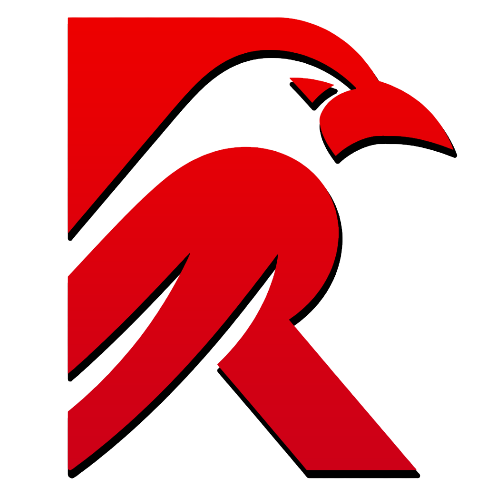

<span style="display: flex; justify-content: center;">
	
	
</span>
<span style="display: flex; justify-content: center;"><h1> Raven GUI - C3 Bindings </h1></span>


## Description
These are the C3 bindings for Raven GUI library [Raven Github](https://github.com/oscar-soirey/Raven). API generator is based off the C++ generator, but modified to C3. Current bindings are generated from latest source as of 11/6/2026

## Installing the library
Installing the library into a c3 binary project is straight forward. Copy the `raven.c3l` folder into your projects `lib` folder and add the following to your projects `project.json`

```json 
"dependencies": [ "raven" ]
```

you do need the shared libs for your platform to be included into `linked-libs\platform` folder

## Generating the bindings (if they're outdated)
The bindings are written by `tools/bindgen/gen_c3.py`, one of the generators of Raven's `tools/bindgen`, and are regenerated with the others (`python tools/bindgen/bindgen.py`). It only needs Python 3: it uses the header reader of the other generators (`tools/bindgen/cparse.py`), so no libclang is required. From a checkout of Raven:

```bash
python tools/bindgen/bindgen.py c3              # writes bindings/c3/raven.c3l/src
python tools/bindgen/bindgen.py --check         # fails when any binding is out of date
```

It can also run on its own:

```bash
python tools/bindgen/gen_c3.py .                # uses this checkout
python tools/bindgen/gen_c3.py                  # clones Raven (latest)
python tools/bindgen/gen_c3.py --ref v0.2.2     # clones a tag or branch
python tools/bindgen/gen_c3.py -o some/dir      # writes somewhere else
```

It writes two files into `src/`:

- `raven_c.c3` (`raven::c`) - the C API as `extern fn`, snake_case without the `R` (`Rbutton_set_text` is `raven::c::button_set_text`).
- `raven.c3` (`raven`) - the C3 API described below.

The only additional thing you need to do is update the dynamic libraries for linking under the `linked-libs/platform` folders.

## The C3 API
- **Naming:** types and constsets are PascalCase without the `R` (`RWidgetType` is `WidgetType`). Their values drop the common prefix (`R_WIDGET_BUTTON` is `WidgetType.BUTTON`). Constants are MACRO_CASE (`R_INVALID_ID` is `INVALID_ID`), and everything else is snake_case.
- **Handles are typed:** `Window`, `Widget`, `Button`, `TextEditor`, `XmlNode`... are `typedef`s of `Id`, chained with `inline` (a `Button` is a `Widget`, which is an `Id`). The C functions of an object are its methods: `Rbutton_set_text(button, "OK")` is `button.set_text("OK")`. Going the other way takes a cast: `(Button)widget`.
- **Constructors are functions:** `raven::button_create("OK")` returns a `Button`, and `raven::vbox_create()` returns a `Panel`.
- **Errors are faults:** `RError` maps to `ERROR_INVALID_ID`, `ERROR_XML`, ... What can fail returns an Optional carrying the fault from `Rerror_get_last` (`ERROR_FAILED` when nothing was recorded): `raven::init(...)`, `window.set_theme(...)`, `raven::font_create_from_file(...)`, `raven::window_create_from_xml(...)`, and others. `raven::check()!;` raises any pending error.
- **Yes/no values are `bool`:** functions that answer yes or no return `bool`, and parameters like `enabled` or `visible` take one.
- **Enums are `constset`s** with the C values. Flag sets combine with `|` and have `.has(flag)`.
- **Strings:** every `char*` / `const char*` is a `ZString`. A string literal passes as it is; a `String` goes through `.zstr_tcopy()`.
- **Callbacks:** C3 lambdas don't capture, so callbacks keep their `void* user_data`.
- **Painter:** paint callbacks receive a `Painter*`; draw with `painter.rect(...)`.

## Hello Window example in C3
```c3
module hello_window;
import std::io;
import raven;

fn int main(String[] args)
{
	if (catch err = raven::init(Backend.VULKAN))
	{
		io::printfn("Failed to initialize raven: %s", err);
		return 1;
	}
	defer raven::shutdown();

	Window window = raven::window_create("Hello world", 800, 600, WindowFlags.DEFAULT);
	Panel box = raven::vbox_create();
	box.set_spacing(12);
	box.slot_set_halign(HAlign.CENTER);
	box.slot_set_valign(VAlign.CENTER);
	window.set_content(box);

	box.add_child(raven::label_create("Hello from Raven"));
	Button quit_button = raven::button_create("Quit");
	box.add_child(quit_button);
	quit_button.set_clicked_callback(fn (Id button, void* user_data) { raven::quit(0); }, null);

	while (raven::wait_frame(-1.0)) {}
	return raven::get_exit_code();
}
```
