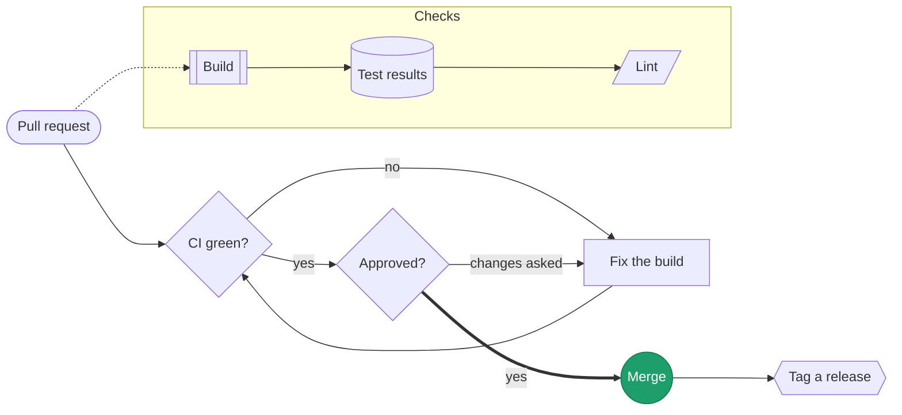
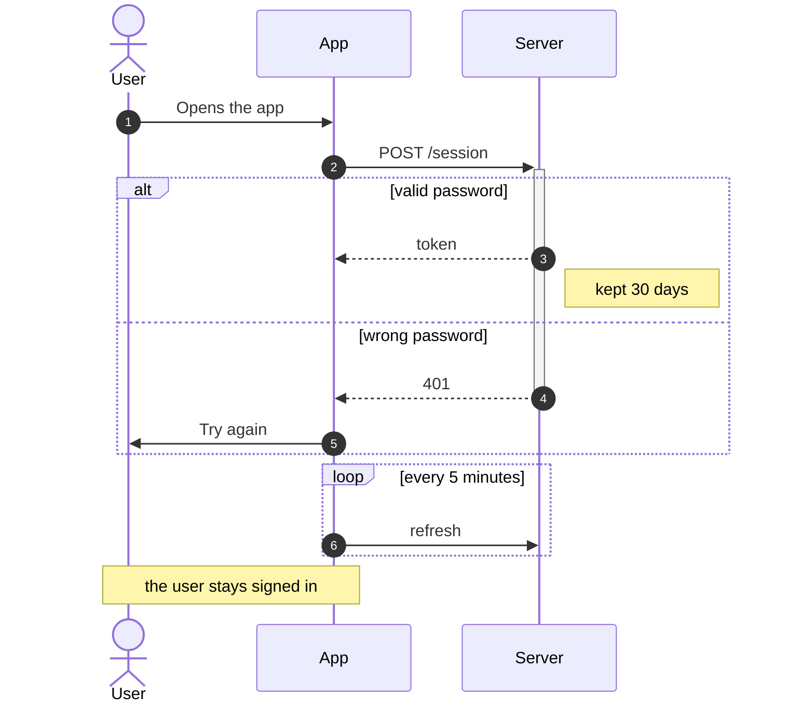
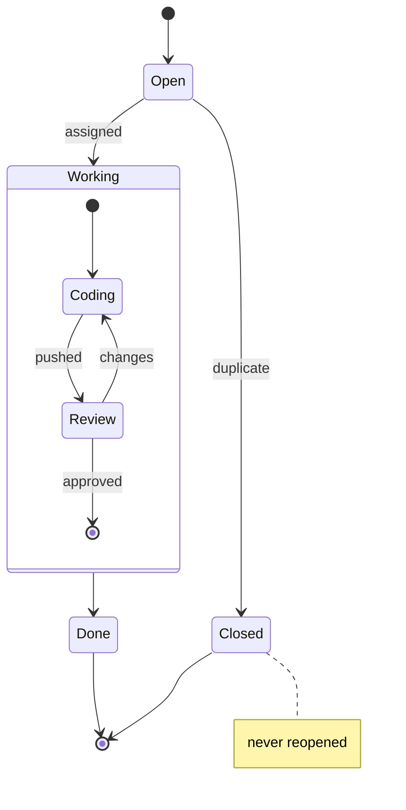
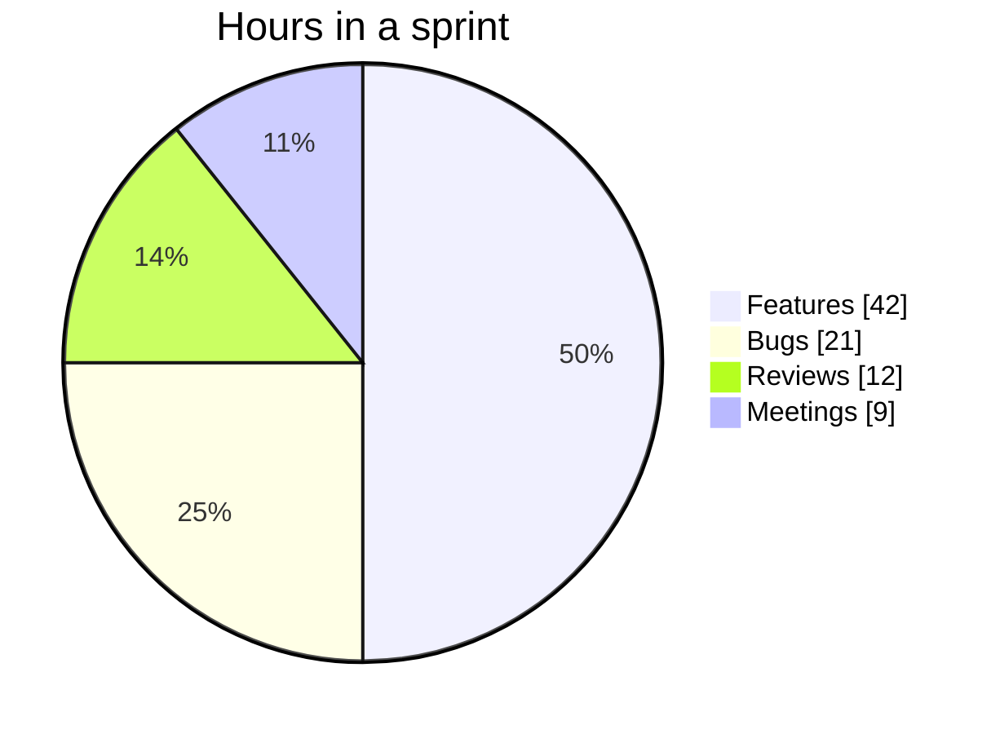

# Release process

Every change goes through the same steps. The diagrams below are written in
Mermaid inside this Markdown text, and drawn by Raven itself.

## Signing in

## The life of a ticket

## Where the time goes

