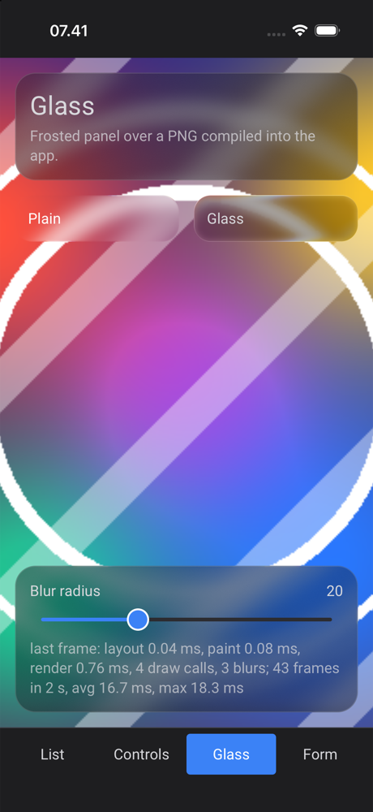
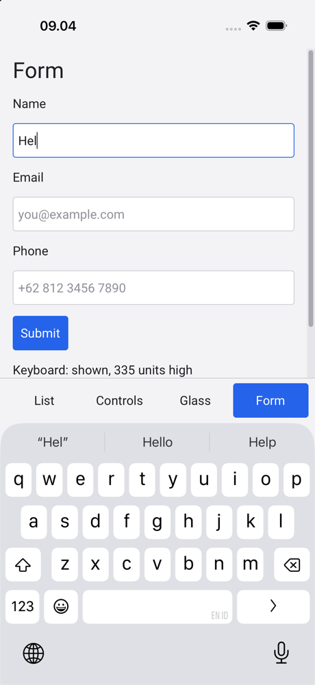
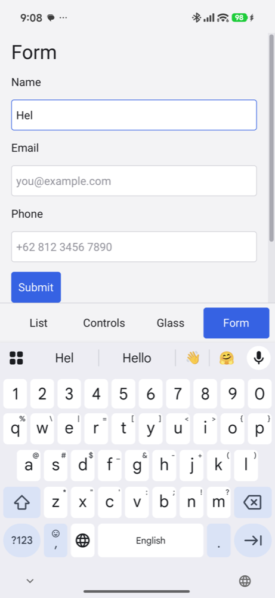
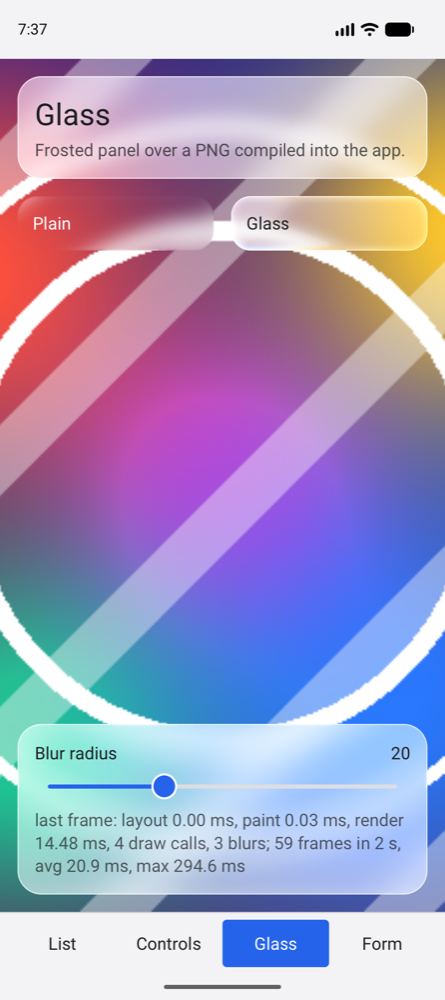

# Raven on iOS and Android (experimental)

One UI written in C, `shared/showcase.c` with its layout in
`shared/showcase.xml`, run by two small apps:

| Folder | What it is |
|---|---|
| `shared/` | The showcase: a bottom tab bar with List (1,000 rows and a detail page), Controls (counter, switch, slider, progress, dialog, toast), Glass (blur over a picture) and Form (text fields with keyboard types) |
| `ios/` | The iOS app: `src/main.m` (UIKit scene, `CADisplayLink` that drives `Rdraw_frame`), `Info.plist`, `build.sh` |
| `android/` | The Android app: `main.c` (`android_main`, NativeActivity), `AndroidManifest.xml`, `build.sh` |

Both build scripts compile Raven itself with CMake, then the app by hand, so no
Xcode project and no Gradle are needed. `shared/gen.sh` turns the XML and the
picture into C arrays (`shared/gen/`, not committed).

| iOS Simulator | | Android (Xiaomi 15T) | Android emulator |
|---|---|---|---|
|  |  |  |  |

This is an early stage port: see the platform sources
(`src/platform/uikit/uikit_platform.m`, `src/platform/android/`) and grep for
`SHORTCUT` for the places that are known to be simplified.

## iOS (Simulator)

Needs Xcode with an iOS Simulator runtime, CMake and Ninja.

1. MoltenVK for the simulator. Homebrew's `molten-vk` is for macOS only.
   Download `MoltenVK-all.tar` from the
   [MoltenVK releases](https://github.com/KhronosGroup/MoltenVK/releases)
   (tested with 1.4.2) and extract it here:
   `cd ios && tar xf ~/Downloads/MoltenVK-all.tar` (gives `ios/MoltenVK/`).
2. Boot a simulator, then `cd ios && ./build.sh run`. `UDID=<id>` picks
   another one than the booted simulator.

The simulator treats the Mac's keyboard as a hardware keyboard by default and
then shows no on-screen keyboard: turn "Connect Hardware Keyboard" off in the
Simulator to see it.

Testing hooks in `src/main.m`, set at launch with `SIMCTL_CHILD_` in front:
`RAVEN_ROTATE=landscape,portrait` (with `RAVEN_ROTATE_EVERY=<seconds>`)
rotates the scene, `RAVEN_DISMISS=<seconds>` closes the keyboard from outside
Raven.

A real device needs a signing identity and the `ios-arm64` slice of MoltenVK;
it has not been tried yet.

## Android

Needs the Android SDK with an NDK, build tools and a platform (API 29 or
later), a JDK (for `javac` and `d8`), CMake and Ninja. The script takes the
newest NDK, build tools and platform it finds in `$ANDROID_HOME` (default
`~/Library/Android/sdk`); `ANDROID_NDK`, `ANDROID_BUILD_TOOLS` and
`ANDROID_JAR` override them.

`cd android && ./build.sh install` builds `raven-hello.apk` (arm64-v8a,
signed with a debug key made on the first build) and starts it on the device
`adb` sees (`ANDROID_SERIAL` picks one).

Raven's Java part, the `InputConnection` of the on-screen keyboard
(`src/platform/android/java`), is compiled into the APK's `classes.dex`.
Without it Raven falls back to key events: no suggestions, ASCII only.

An emulator whose device has a hardware keyboard (`hw.keyboard=yes`) only
shows Gboard's small toolbar, not the full keyboard.
