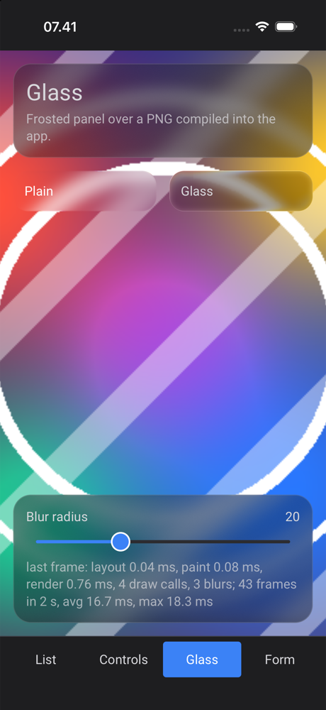

# Raven on iOS and Android (experimental)

One UI written in C, `shared/showcase.c` with its layout in
`shared/assets/showcase.xml`, run by two small apps:

| Folder | What it is |
|---|---|
| `shared/` | The showcase: a bottom tab bar with List (1,000 rows and a detail page), Controls (counter, switch, slider, progress, dialog, toast), Glass (blur over a picture) and Form (text fields with keyboard types) |
| `shared/assets/` | The files the app reads at run time: the layout and the picture |
| `ios/` | The iOS app: `src/main.m` (UIKit scene, `CADisplayLink` that drives `Rdraw_frame`), `Info.plist`, `build.sh` |
| `android/` | The Android app: `main.c` (`android_main`, NativeActivity), `AndroidManifest.xml`, `build.sh` |

Both build scripts compile Raven itself with CMake, then the app by hand, so no
Xcode project and no Gradle are needed.

## Files of the app

On Android and iOS a relative path that names no file held in memory
(`Rfile_register_memory`) and no file on disk is read from the app's package:
the APK's `assets/` folder (through the `AAssetManager`) or the resources of
the iOS bundle (`[NSBundle mainBundle].resourcePath`). It works for every file
Raven reads: `Rwidget_create_from_xml_file("showcase.xml")`, `Source="photo.png"`,
`Font="fonts/..."`, `Rtexture_create_from_file`, `Rfont_create_from_file`,
`Rfile_read`, themes and translation tables. Paths inside a document are relative
to its folder, as on a desktop. The package is read-only, is not watched for live
reload, and its folders are not listed, so the automatic loading of widget
declarations and translation tables found beside a document does not look into it
(register them by name instead).

Both build scripts put `shared/assets/` into the package (`aapt2 link -A` on
Android, a copy into `Hello.app` on iOS), with the font of the titles copied from
`tools/designer/fonts` into `fonts/`.

| iOS Simulator | | | Android (Xiaomi 15T) | Android emulator |
|---|---|---|---|---|
|  |  |  |  |  |

This is an early stage port: see the platform sources
(`src/platform/uikit/uikit_platform.m`, `src/platform/android/`) and grep for
`SHORTCUT` for the places that are known to be simplified.

## iOS (Simulator)

Needs Xcode with an iOS Simulator runtime, CMake and Ninja. Raven draws with
Metal (`-DRAVEN_BACKEND_VULKAN=OFF`): MoltenVK is not needed.

Boot a simulator, then `cd ios && ./build.sh run`. `UDID=<id>` picks another
one than the booted simulator.

The simulator treats the Mac's keyboard as a hardware keyboard by default and
then shows no on-screen keyboard: turn "Connect Hardware Keyboard" off in the
Simulator to see it.

Testing hooks in `src/main.m`, set at launch with `SIMCTL_CHILD_` in front:
`RAVEN_ROTATE=landscape,portrait` (with `RAVEN_ROTATE_EVERY=<seconds>`)
rotates the scene, `RAVEN_DISMISS=<seconds>` closes the keyboard from outside
Raven, `RAVEN_MEMORY_WARNING=<seconds>` posts UIKit's memory warning.

A real device needs a signing identity; it has not been tried yet.

## Android

Needs the Android SDK with an NDK, build tools and a platform (API 29 or
later), a JDK (for `javac` and `d8`), CMake and Ninja. The script takes the
newest NDK, build tools and platform it finds in `$ANDROID_HOME` (default
`~/Library/Android/sdk`); `ANDROID_NDK`, `ANDROID_BUILD_TOOLS` and
`ANDROID_JAR` override them.

`cd android && ./build.sh install` builds `raven-hello.apk` (arm64-v8a,
signed with a debug key made on the first build) and starts it on the device
`adb` sees (`ANDROID_SERIAL` picks one).

Raven's Java part, the `InputConnection` of the on-screen keyboard
(`src/platform/android/java`), is compiled into the APK's `classes.dex`.
Without it Raven falls back to key events: no suggestions, ASCII only.

An emulator whose device has a hardware keyboard (`hw.keyboard=yes`) only
shows Gboard's small toolbar, not the full keyboard.
